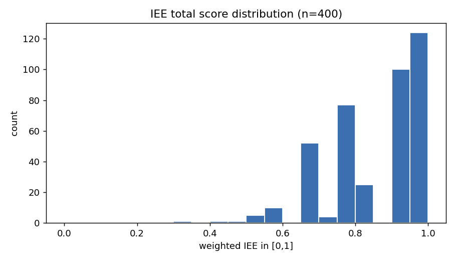
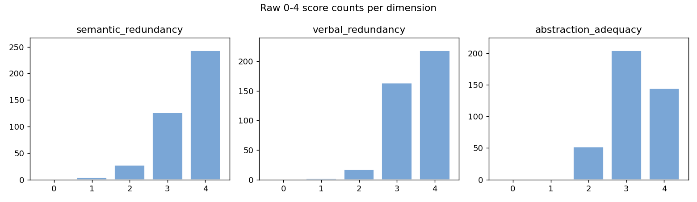
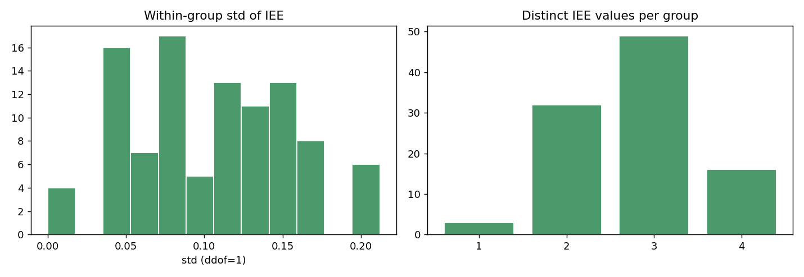
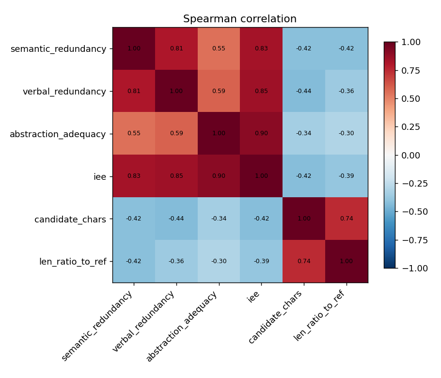
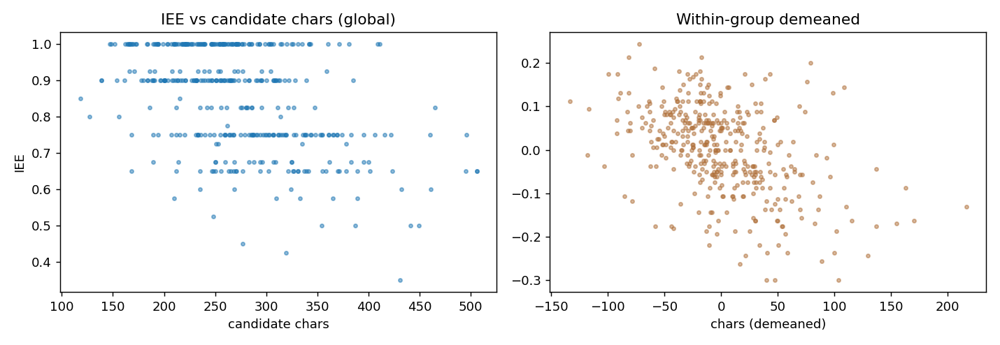

# IEE（信息表达效率）Reward 区分度验证报告

- 生成时间：2026-10-09T16:30:58
- 输入：`/home/yukino/projects/sfzy/data/triples/sft_val_100_n4.jsonl`
- 配置：`/home/yukino/projects/sfzy/configs/grpo_fact_coverage_inp_t4.yaml`
- 裁判：`deepseek-chat` @ `https://api.deepseek.com/v1`
- 数据规模：100 组 × [4] 候选 = 400 条候选
- EE 三维权重（**来自配置** `terms.expression_efficiency.dimension_weights`）：语义冗余=0.3000、表达冗余=0.3000、抽象适当性=0.4000

## 0. 结论速览（三个概念必须分开看）

1. **有区分度**（同组候选拿到不同分）：IEE 总分有 97.0% 的组组内方差非零；三维分项的非零方差组占比为 语义冗余=76.0%、表达冗余=80.0%、抽象适当性=83.0%。
2. **区分稳定**（重复评分一致）：重复评分完全一致率 IEE=76.2%，三维分项一致率 语义冗余=87.5%、表达冗余=91.2%、抽象适当性=86.2%。
3. **区分正确**（分数差异对应真实表达效率差异）：**本实验无法证实** —— 缺人工标注的表达效率真值。报告给出长度偏差、维度相关性、典型样本等间接证据，最终正确性需要人工复核。

## 1. 全局评分分布与天花板效应

| 维度 | 均值 | 标准差 | 中位数 | 最小 | 最大 | P10 | P25 | P75 | P90 | 满分率 | 低分率 |
| --- | --- | --- | --- | --- | --- | --- | --- | --- | --- | --- | --- |
| 语义冗余 | 3.520 | 0.668 | 4.0 | 1 | 4 | 3.0 | 3.0 | 4.0 | 4.0 | 60.8% | 7.8% |
| 表达冗余 | 3.493 | 0.605 | 4.0 | 1 | 4 | 3.0 | 3.0 | 4.0 | 4.0 | 54.5% | 4.8% |
| 抽象适当性 | 3.230 | 0.662 | 3.0 | 2 | 4 | 2.0 | 3.0 | 4.0 | 4.0 | 36.0% | 13.0% |
| **IEE 总分** | 0.849 | 0.139 | 0.900 | 0.350 | 1.000 | 0.650 | 0.750 | 1.000 | 1.000 | 31.0% | 1.8%(≤0.5) |

各维度 0~4 原始分数量（占比）：

| 维度 | 0 | 1 | 2 | 3 | 4 |
| --- | --- | --- | --- | --- | --- |
| 语义冗余 | 0 (0.0%) | 4 (1.0%) | 27 (6.8%) | 126 (31.5%) | 243 (60.8%) |
| 表达冗余 | 0 (0.0%) | 2 (0.5%) | 17 (4.2%) | 163 (40.8%) | 218 (54.5%) |
| 抽象适当性 | 0 (0.0%) | 0 (0.0%) | 52 (13.0%) | 204 (51.0%) | 144 (36.0%) |

- **分项天花板**：语义冗余 满分率 60.8%（均值 3.52/4）、表达冗余 满分率 54.5%（均值 3.49/4）、抽象适当性 满分率 36.0%（均值 3.23/4）。没有维度达到 >90% 的极端天花板（那样才算该维几乎失效），但 语义冗余 的满分率 60.8% 已偏高。
- **IEE 总分压缩（重点）**：81.5% 的候选 IEE ≥ 0.75，31.0% 恰好 = 1.0，中位数 0.900。总分高度堆在上端，会把组内本来就不大的差异进一步压缩（IEE 组内 σ 均值仅 0.105、极差均值 0.219）。
- **近乎恒定的维度**：三个维度的全局标准差都在 语义冗余=0.67、表达冗余=0.60、抽象适当性=0.66；组内零方差占比 语义冗余=24.0%、表达冗余=20.0%、抽象适当性=17.0%。**没有任何一个维度接近恒定**（未出现某维 100% 组内零方差）。

## 2. GRPO 组内区分度（核心）

| 指标 | 组内σ均值 | σ中位数 | σ P25 | σ P75 | 零方差组 | 非零方差占比 | 极差均值 | 极差中位数 | 成对可区分率 |
| --- | --- | --- | --- | --- | --- | --- | --- | --- | --- |
| 语义冗余 | 0.487 | 0.500 | 0.500 | 0.577 | 24 (24.0%) | 76.0% | 0.960 | 1.000 | 44.5% |
| 表达冗余 | 0.468 | 0.500 | 0.500 | 0.577 | 20 (20.0%) | 80.0% | 0.930 | 1.000 | 45.8% |
| 抽象适当性 | 0.488 | 0.500 | 0.500 | 0.577 | 17 (17.0%) | 83.0% | 0.950 | 1.000 | 50.2% |
| **IEE 总分** | 0.105 | 0.107 | 0.058 | 0.145 | 3 (3.0%) | 97.0% | 0.219 | 0.250 | 74.2% |

每组不同评分数量分布（1/2/3/4 种）：

| 指标 | 1 种 | 2 种 | 3 种 | 4 种 |
| --- | --- | --- | --- | --- |
| 语义冗余 | 24 | 66 | 9 | 1 |
| 表达冗余 | 20 | 71 | 9 | 0 |
| 抽象适当性 | 17 | 73 | 10 | 0 |
| **IEE** | 3 | 32 | 49 | 16 |

最高分并列候选数量分布（1/2/3/4）：

| 指标 | 1 个 | 2 个 | 3 个 | 4 个 |
| --- | --- | --- | --- | --- |
| 语义冗余 | 14 | 23 | 39 | 24 |
| 表达冗余 | 18 | 22 | 40 | 20 |
| 抽象适当性 | 23 | 36 | 24 | 17 |
| **IEE** | 43 | 37 | 17 | 3 |

- **各维度能区分的组数**：语义冗余=76/100、表达冗余=80/100、抽象适当性=83/100
- **三个维度全部无法区分的组**：3 组
- 各维度组合（能区分的维度集合 → 组数）：
  - 语义冗余+表达冗余+抽象适当性：58 组
  - 语义冗余+表达冗余：10 组
  - 抽象适当性：9 组
  - 语义冗余+抽象适当性：8 组
  - 表达冗余+抽象适当性：8 组
  - 表达冗余：4 组
  - (none)：3 组

## 3. 分项相关性、贡献与权重影响

维度间相关性（Pearson / Spearman）：

| 维度对 | Pearson r | Spearman ρ |
| --- | --- | --- |
| 语义冗余 ~ 表达冗余 | 0.798 | 0.807 |
| 语义冗余 ~ 抽象适当性 | 0.506 | 0.553 |
| 表达冗余 ~ 抽象适当性 | 0.574 | 0.590 |

各维度与 IEE 总分、与候选长度的相关性：

| 维度 | Pearson(dim,IEE) | Spearman(dim,IEE) | Pearson(dim,字数) | Spearman(dim,字数) |
| --- | --- | --- | --- | --- |
| 语义冗余 | 0.860 | 0.830 | -0.408 | -0.416 |
| 表达冗余 | 0.886 | 0.848 | -0.440 | -0.437 |
| 抽象适当性 | 0.845 | 0.899 | -0.360 | -0.341 |

各分项对 IEE 的贡献与组内波动来源（方差分解）：

| 分项 | 归一权重 | 平均贡献 | 占 IEE 均值 | 占组内 IEE 方差 |
| --- | --- | --- | --- | --- |
| 语义冗余 | 0.3000 | 0.2640 | 31.1% | 14.7% |
| 表达冗余 | 0.3000 | 0.2619 | 30.9% | 12.4% |
| 抽象适当性 | 0.4000 | 0.3230 | 38.0% | 22.5% |
| 语义冗余×表达冗余（协方差项） | — | — | — | 20.8% |
| 语义冗余×抽象适当性（协方差项） | — | — | — | 13.8% |
| 表达冗余×抽象适当性（协方差项） | — | — | — | 15.8% |

权重敏感性（**离线附加分析，不改配置、不改正式评分**）——各方案与正式方案的组内排序一致性：

| 权重方案 | 全局 Spearman(vs 正式) | 组内平均 Spearman | 组内 top1 一致率 |
| --- | --- | --- | --- |
| equal | 0.995 | 0.945 | 97.0% |
| only:semantic_redundancy | 0.830 | 0.582 | 64.0% |
| only:verbal_redundancy | 0.848 | 0.679 | 69.0% |
| only:abstraction_adequacy | 0.899 | 0.737 | 87.0% |

## 4. 长度偏差检查

| 指标 | Pearson(字数) | Spearman(字数) | Spearman(字数比) | Spearman(字数差) |
| --- | --- | --- | --- | --- |
| **IEE 总分** | -0.461 | -0.425 | -0.388 | -0.392 |
| 语义冗余 | -0.408 | -0.416 | -0.418 | -0.425 |
| 表达冗余 | -0.440 | -0.437 | -0.362 | -0.365 |
| 抽象适当性 | -0.360 | -0.341 | -0.298 | -0.301 |

- **组内去均值后**：IEE 与候选字数的 Spearman ρ = -0.456，与字数比 ρ = -0.465。
- 组内“最短候选拿最高 IEE”：64/100 组 (64.0%)；“最长候选拿最高分”：28 组 (28.0%)。
- 结论口径：负相关只能说明“长度与得分有关系”，**不能直接判定 Judge 错误**——更短可能确实更凝练。是否正确要看典型样本的人工复核。

## 5. 排序稳定性与典型样本

- IEE 最高分并列数量分布（每组）：1 个:43 组、2 个:37 组、3 个:17 组、4 个:3 组
- IEE 与三个维度在组内的平均 Spearman ρ：语义冗余=0.765、表达冗余=0.849、抽象适当性=0.888
- 重复评分：覆盖 80 条、80 个候选；组内排序 top1 一致率 75.0%，平均 Kendall τ = 0.839。

### 典型样本 · 组内完全同分（3 例）

**组 `7e72fb7227100d794e31616e871ee2b0`** — 4 个候选 IEE 完全相同，组内无梯度

- 人工参考摘要（266 字）：原被告系劳动合同纠纷。原告提出诉求：被告给付原告违法解除劳动合同1个月代通知金，1个月的经济补偿金。被告未答辩。经查明尧舜村委会是基层群众性自治组织，并非法律规定的用人单位，原被告之间并不存在劳动合同关系，故原告要求被告支付违法解除劳动合同的代通知金、经济补偿金的诉讼请求本于法无据。依照《中华人民共和国劳动合同法》第二条，《中华人民共和国村民委员会组织法》第二条，《中华人民共和国民事诉讼法》第一百四十四条之规定，判决如下：驳回原告全部诉讼请求。如果当事人未按本判决指定的期间履行给付金钱义务，应当加倍支付迟延履行期间的债务利息。
- 原文（1094 字，此处显示 1094 字，完整见 `samples.jsonl`）：
```
齐振杰与天津市静海区大邱庄镇尧舜街村民委员会劳动合同纠纷一审民事判决书天津市静海区人民法院民 事 判 决 书（2017）津0118民初2814号原告：齐振杰，男，1962年6月23日出生，汉族，住黑龙江省富裕县。被告：天津市静海区大邱庄镇尧舜街村民委员会，住所地天津市静海区。法定代表人：王福才。原告齐振杰与被告天津市静海区大邱庄镇尧舜街村民委员会（以下简称尧舜村委会）劳动合同纠纷一案，本院于2017年4月13日立案后，依法适用简易程序，公开开庭进行了审理。原告齐振杰到庭参加诉讼，被告尧舜村委会经传票传唤，无正当理由拒不到庭。本案现已审理终结。齐振杰向本院提出诉讼请求：1.请求法院依法判令被告给付原告违法解除劳动合同1个月代通知金2200元，1个月的经济补偿金2200元；2.诉讼费由被告承担。事实和理由：原告系被告处职工，被告指派原告在尧舜度假村从事保安工作，月平均工资2200元，原告自2016年7月15日至2017年3月31日在上述小区工作。2017年3月31日被告突然将原告无故辞退且不予支付违法解除劳动合同的各项经济补偿金、代通知金等。2017年4月11日原告曾诉至静海区劳动人事争议仲裁委员会仲裁，该委以此案不属于本委受案范围为由决定不予受理，原告不服故而成诉。尧舜村委会未出庭参加诉讼，亦未提交书面答辩意见。本院认为，《中华人民共和国劳动合同法》第二条第一款对劳动合同的适用范围有明确规定：“中华人民共和国境内的企业、个体经济组织、民办非企业单位等组织（以下称用人单位）与劳动者建立劳动关系，订立、履行、变更、解除或者终止劳动合同，适用本法。”而本案被告尧舜村委会按照《中华人民共和国村民委员会组织法》第二条第一款的规定属于村民自我管理、自我教育、自我服务的基层群众性自治组织，尧舜村委会并非法律规定的用人单位，原被告之间并不存在劳动合同关系，故原告要求被告支付违法解除劳动合同的代通知金、经济补偿金的诉讼请求本院不予支持。综上，依照《中华人民共和国劳动合同法》第二条第一款，《中华人民共和国村民委员会组织法》第二条第一款，《中华人民共和国民事诉讼法》第一百四十四条之规定，判决如下：驳回原告齐振杰的全部诉讼请求。如果当事人未按本判决指定的期间履行给付金钱义务，应当依照《中华人民共和国民事诉讼法》第二百五十三条之规定，加倍支付迟延履行期间的债务利息。案件受理费5元，由原告齐振杰负担。如不服本判决，可在判决书送达之日起十五日内，向本院递交上诉状，并按对方当事人或代表人的人数提出副本，上诉于天津市第一中级人民法院。审判员　　李德刚二〇一七年五月十七日书记员　　王亚琼
```
| 候选# | IEE | 组内最高 | 字数 | 语义冗余 | 表达冗余 | 抽象适当性 |
| --- | --- | --- | --- | --- | --- | --- |
| 0 | 1.000 | ✓ | 170 | 4 | 4 | 4 |
| 1 | 1.000 | ✓ | 192 | 4 | 4 | 4 |
| 2 | 1.000 | ✓ | 172 | 4 | 4 | 4 |
| 3 | 1.000 | ✓ | 165 | 4 | 4 | 4 |
  - 候选#0：原被告系劳动合同纠纷。原告提出诉求：被告给付原告违法解除劳动合同1个月代通知金，1个月的经济补偿金。经审查，被告并非法律规定的用人单位，原被告之间并不存在劳动合同关系。因此，依照《中华人民共和国劳动合同法》第二条第一款，《中华人民共和国村民委员会组织法》第二条第一款，《中华人民共和国民事诉讼法》第一百四十四条之规定，判决驳回原告诉讼请求。
  - 候选#1：原被告系劳动合同纠纷。原告提出诉求：被告给付原告违法解除劳动合同1个月代通知金及相应经济补偿金。经审查，原被告双方不存在劳动合同关系，被告并非法律规定的用人单位，因此不需支付违法解除劳动合同的代通知金及相应经济补偿金。依照《中华人民共和国劳动合同法》第二条第一款，《中华人民共和国村民委员会组织法》第二条第一款，《中华人民共和国民事诉讼法》第一百四十四条之规定，判决驳回原告诉讼请求。
  - 候选#2：原被告系劳动合同纠纷。原告提出诉求：被告给付原告违法解除劳动合同1个月代通知金和1个月的经济补偿金。经审查，被告并非法律规定的用人单位，原被告之间并不存在劳动合同关系。因此，依据《中华人民共和国劳动合同法》第二条第一款，《中华人民共和国村民委员会组织法》第二条第一款，《中华人民共和国民事诉讼法》第一百四十四条之规定，判决驳回原告全部诉讼请求。
  - 候选#3：原被告系劳动合同纠纷。原告提出诉求：被告给付原告违法解除劳动合同的代通知金。被告未答辩。经审查，被告并非法律规定的用人单位，原被告之间不存在劳动合同关系。因此，依照《中华人民共和国劳动合同法》第二条第一款，《中华人民共和国村民委员会组织法》第二条第一款，《中华人民共和国民事诉讼法》第一百四十四条之规定，判决驳回原告全部诉讼请求。

**组 `b58a7164b7bb2060ed7109a1c6ba5d23`** — 4 个候选 IEE 完全相同，组内无梯度

- 人工参考摘要（258 字）：原被告系租赁合同关系。原告诉求：依法判令被告支付所欠租金，并且将原告房屋交还给原告，经查明，原、被告租赁合同已经履行完毕，双方未继续签订书面租赁合同，被告给付原告租金，应视为不定期租赁，原告随时可以解除合同，原告要求被告支付房屋租金诉请，双方虽未约定，该诉请并未超过上一年度双方约定的三个月的租金数额，本院予以支持。被告支付租金的实际金额因数额不确定，本院不予支持。依《中华人民共和国民事诉讼法》、《中华人民共和国合同法》判决，一、被告将租赁原告位于商铺交付给原告。二、被告给付原告租金。三、驳回原告的其他诉讼请求。
- 原文（1858 字，此处显示 1858 字，完整见 `samples.jsonl`）：
```
崔艳竹与余莉莉租赁合同纠纷一审民事判决书河南省兰考县人民法院民 事 判 决 书（2017）豫0225民初2494号原告崔艳竹，女，汉族,1968年4月2日出生。委托代理人彭文洁，北京市瑞（深圳）律师事务所律师，代理权限为特别授权。被告余莉莉，女，汉族，1987年7月28日出生。原告崔艳竹诉被告余莉莉租赁合同纠纷一案，本院受理后，依法由审判员周进良适用简易程序公开开庭进行了审理。原告崔艳竹委托代理人到庭参加了诉讼，被告余莉莉经本院传唤未到庭参加诉讼。本案现已审理终结。原告诉称，被告承租原告位于中山××Ａ204的商铺，原被告双方于2016年2月14日签订了《商铺租赁合同》，约定租期为：2016年1月9日至2017年1月9日止，年租金为48000元。原被告签订的租赁合同到期后，被告请求原告先不要收房，因为她想把房子托出去收取托房费，2017年1月14日，被告向原告支付了6700元的房租，该房租付至2017年2月28日，原被告双方未另行签订租赁合同，但被告一直没有找到托房的人，经原告多次催促，被告一直未将房屋及钥匙交还给原告，为维护原告的合法权益，诉至法院请求法院依法判令被告支付所欠租金12000元（从2017年3月1日暂计至2017年5月31日，实际金额计算至被告将房屋交还给原告为止），并且将原告房屋交还给原告以及承担本案的诉讼费用。被告余莉莉经本院传唤未到庭参加诉讼，亦未提交书面答辩意见。经审理查明，2016年2月14日，原、被告签订了一份商铺租赁合同，甲方为原告崔艳竹，乙方为被告余莉莉。合同约定：一、甲方自愿将中山××Ａ204的商铺租赁给乙方作为服装经营使用，该商铺上下两层，面积92.47平方米。除双方另有约定外，乙方不得任意改变商铺经营用途及原有结构。二、租赁期限：租期一年，自2016年1月9日至2017年1月9日止。三、租金：年租金为肆万捌千元整，付款方式为一次性付清，装修期，甲方不再收取乙方租金。六、租赁期间，乙方不得私自转租、转借、转让他人或与他人承租的门面交换使用，如有以上行为，甲方有权终止合同，收回该店铺，并且剩余租金不再退回。如欲转租第三方，必须征得甲方同意，付清所有费用。并办理有关手续后，取得使用权的第三方可成为本合同的当然乙方。八、租赁期满后，如乙方要求续租，同等条件下，甲方优先同意乙方继续租赁，如乙方明确表示不租，应提前一个月告诉甲方。九、在合同终止，解除租赁关系时，乙方应结清所有费用，如期交还该店铺，逾期一日应向甲方支付原月租金（）倍的滞纳金。乙方装修的与房屋有关的设施、设备全部归甲方所有(可移动的设施、设备除外)。合同签订后，双方履行了2016年2月14日至2017年1月9日止的租赁合同。合同到期后，2017年1月14日，被告向原告又支付了6700元的房租，按第一次合同约定的租金计算，租金支付至2017年2月28日。此后，经原告多次催促，被告未将房屋及玥匙交换给原告,也未再付给原告租金。上述事实有当事人陈述、原被告签订的商铺租赁合同书一份、庭审笔录等证据在卷佐证，足以认定。本院认为，原、被告在2016年2月14日签订的租赁合同已经履行完毕，2017年1月10日开始，双方未继续签订书面租赁合同，被告给付原告租金6700元，应视为不定期租赁，原告随时可以解除合同，故对原告要求与被告解除房屋租赁的诉请，本院予以支持。原告要求被告支付2017年3月1日至2017年5月31日的房屋租金12000元的诉请，双方虽未约定，该诉请并未超过上一年度双方约定的三个月的租金数额，本院予以支持。原告要求被告支付租金的实际金额应计算至被告将房屋交给原告为止的诉请，因数额不确定，本院不予支持，可另诉。依照《中华人民共和国民事诉讼法》第一百四十四条、《中华人民共和国合同法》第二百二十六条、第二百二十七条、第二百三十二条之规定，判决如下：一、被告余莉莉于判决生效后十日内将租赁原告位于兰考县中山南街A204的商铺交付给原告崔艳竹。二、被告余莉莉于判决书生效后十日内给付原告崔艳竹租金12000元。三、驳回原告崔艳竹的其他诉讼请求。如未按本判决指定的期间履行给付金钱义务，应依照《中华人民共和国民事诉讼法》第二百五十三条之规定加倍支付迟延履行期间的债务利息。案件受理费50元，由被告崔艳竹负担。如不服本判决，可在判决书送达之日起十五日内，向本院递交上诉状，并按对方当事人的人数提出副本，上诉于河南省开封市中级人民法院。审判员　　周进良二〇一七年七月二十日书记员　　程文霞
```
| 候选# | IEE | 组内最高 | 字数 | 语义冗余 | 表达冗余 | 抽象适当性 |
| --- | --- | --- | --- | --- | --- | --- |
| 0 | 1.000 | ✓ | 273 | 4 | 4 | 4 |
| 1 | 1.000 | ✓ | 239 | 4 | 4 | 4 |
| 2 | 1.000 | ✓ | 303 | 4 | 4 | 4 |
| 3 | 1.000 | ✓ | 246 | 4 | 4 | 4 |
  - 候选#0：原被告系租赁合同纠纷。原告请求法院依法判令被告支付所欠租金，并且将原告房屋交还给原告。被告未答辩。原、被告在签订的租赁合同已履行完毕，2017年1月10日开始，双方未继续签订书面租赁合同，被告给付原告租金6700元，应视为不定期租赁，原告可随时解除合同，对原告要求与被告解除房屋租赁的诉请，予以支持。原告要求被告支付租金的诉请并未超过上一年度双方约定的三个月的租金数额，予以支持。原告要求被告支付租金的实际金额并未确定，可另诉。依照《民事诉讼法》、《合同法》的规定，判决:一、被告将商铺交付给原告。二、被告给付原告租金。三、驳回原告其他诉讼请求。
  - 候选#1：原被告系租赁合同纠纷。原告诉求如下：判令被告支付所欠租金。被告未答辩。本院认为，双方未继续签订书面租赁合同，被告给付原告租金，应视为不定期租赁，原告随时可以解除合同，原告要求被告支付租金的诉请并未超过上一年度双方约定的三个月的租金数额，因数额不确定，本院不予支持，可另诉。依照《中华人民共和国民事诉讼法》第一百四十四条、《中华人民共和国合同法》第二百二十六条、第二百二十七条、第二百三十二条的规定，判决:一、被告将商铺交付给原告。二、被告给付原告租金。三、驳回原告其他诉讼请求。
  - 候选#2：原告与被告租赁合同纠纷一案。原告提出诉求：依法判令被告支付所欠租金，并将原告房屋交还给原告。被告未作答辩。经查明原被告签订的租赁合同已履行完毕，双方未继续签订书面租赁合同，被告给付原告租金应视为不定期租赁；双方虽未约定，该诉请并未超过上一年度双方约定的三个月的租金数额；原告要求被告支付租金的数额应计算至被告将房屋交给原告为止的诉请，因数额不确定，可另诉。根据《中华人民共和国民事诉讼法》第一百四十四条、《中华人民共和国合同法》第二百二十六条、第二百二十七条、第二百三十二条的规定，判决:一、被告于判决生效后十日内将租赁原告的商铺交付给原告二、被告于判决书生效后十日内给付原告租金三、驳回原告其他诉讼请求。
  - 候选#3：原被告系租赁合同纠纷。原告提出诉求：判令被告支付所欠租金12000元，并将原告房屋交还给原告。被告未答辩。原、被告签订的租赁合同已经履行完毕，被告给付原告租金6700元，应视为不定期租赁，原告随时可以解除合同，故对原告要求与被告解除房屋租赁的诉请，本院予以支持。原告要求被告支付租金的具体数额应计算至被告将房屋交给原告为止，因数额不确定，本院不予支持。依照《民事诉讼法》、《合同法》的规定，判决:一、被告将租赁原告的商铺交付给原告；二、被告给付原告租金12000元；三、驳回原告其他诉讼请求。

**组 `2ccc7fd4d8a6b852d2c4d018750bb0f0`** — 4 个候选 IEE 完全相同，组内无梯度

- 人工参考摘要（288 字）：原被告系借款合同纠纷。原告诉请：被告归还借款本息。四被告未答辩。经审理：1、原告与被告赵立开签订借款合同合法有效；2、原告向被告履行了发放贷款义务，被告未按合同约定完全履行还款义务；3、剩余被告作为借款合同的连带责任保证人，对被告赵的借款应当承担连带清偿责任，在其承担连带清偿责任后，有权向被告赵立开追偿。依照《合同法》第一百九十六条、第二百零五条、第二百零六条、第二百零七条，《担保法》第十八条、第二十一条、第二十七条、第三十一条和《民事诉讼法》第一百四十四条判决:被告赵立开偿还借款本息；剩余被告对上述借款本息负连带清偿责任，在其承担连带清偿责任后，有权向被告赵立开追偿。
- 原文（1937 字，此处显示 1937 字，完整见 `samples.jsonl`）：
```
山东莒县农村商业银行股份有限公司与赵立开、赵立军等借款合同纠纷一审民事判决书山东省莒县人民法院民 事 判 决 书(2017)鲁1122民初5630号原告：山东莒县农村商业银行股份有限公司，地址：山东省日照市莒县，组织机构代码：66932229-8。法定代表人：牛学强，该公司董事长。委托讼诉代理人：丁元福，该公司工作人员。被告：赵立开，男。被告：赵立军，男。被告：李希永，男。被告：纪丙玉，女。原告山东莒县农村商业银行股份有限公司与被告赵立开、赵立军、李希永、纪丙玉借款合同纠纷一案，本院于2017年10月11日立案后，依法适用简易程序，公开开庭进行了审理。原告山东莒县农村商业银行股份有限公司的委托诉讼代理人丁元福到庭参加诉讼，被告赵立开、赵立军、李希永、纪丙玉经本院传票传唤无正当理由拒不到庭应诉。本案现已审理终结。原告山东莒县农村商业银行股份有限公司向本院提出诉讼请求：1、依法判令被告归还借款96000元及利息；2、诉讼费等费用由被告承担。事实和理由：被告赵立开于2016年4月28日从原告处借款96000元，借款时，被告赵立开与原告签订借款合同。被告赵立军、李希永、纪丙玉与原告签订保证合同，为赵立开提供连带责任担保。2017年4月9日到期后，经原告催收，借款人未付款，担保人也未履行担保责任。被告赵立开、赵立军、李希永、纪丙玉未答辩。本院经审理认定事实如下：2016年4月28日，山东莒县农村商业银行股份有限公司安庄支行与赵立开签订个人借款合同，合同约定：赵立国向该社借款96000元，借款用途为借新还旧，借款合同期限为2016年4月28至2017年4月9日，借款利率在借款发放日所对应的中国人民银行同期同档次人民币借款基准利率基础上上浮140%确定，借款人应按时付还借款本息，借款人违反合同约定的义务，贷款人有权要求其限期纠正违约行为、停止发放借款、提前收回已发放借款。合同第八条第2项约定：借款人未按合同约定期限归还借款本金的，贷款人有权对逾期借款从逾期之日起在借款执行利率基础上上浮50%计收罚息，直至本息清偿为止；本条第四项约定：对应付未付利息贷款人依据中国人民银行有关规定计收复利。同日山东莒县农村商业银行股份有限公司安庄支行与被告赵立军、李希永、纪丙玉以及赵立国签订保证合同，合同约定由赵立军、李希永、纪丙玉、赵立国对赵立开的上述借款提供担保；保证方式为连带责任保证；保证期间为决算期届至之日起二年；保证范围包括主债权本金、利息、罚息、复利、违约金、损害赔偿金及实现债权的费用。2016年4月29日，赵立开签订了贷转存凭证，向安庄支行借款96000元，月利率为8.70000‰，约定到期日为2017年4月9日。到期后，借款人未付款，担保人也未履行义务。另查明，借款借出后担保人赵立国因故死亡。本院认为，原告山东莒县农村商业银行股份有限公司与被告赵立开签订借款合同，并由被告赵立军、李希永、纪丙玉承担连带责任保证，系各方真实意思表示，且不违反法律规定，本院予以认定。原、被告双方均应按合同的约定全面履行义务。原告向被告履行了发放贷款义务，被告未按合同约定完全履行还款义务。原告请求被告赵立开付还借款本金96000元及利息有事实和法律依据，应予以支持。被告赵立军、李希永、纪丙玉作为借款合同的连带责任保证人，对被告赵立开的借款应当承担连带清偿责任，在其承担连带清偿责任后，有权向被告赵立开追偿。被告赵立开、赵立军、李希永、纪丙玉经本院合法传唤拒不到庭参加诉讼，也未提供答辩状对原告的主张进行抗辩，对原告提供的证据亦未到庭质证，放弃了应享有的诉讼权利。综上，原告诉讼请求符合法律规定，本院予以支持。依照《中华人民共和国合同法》第一百九十六条、第二百零五条、第二百零六条、第二百零七条，《中华人民共和国担保法》第十八条、第二十一条、第二十七条、第三十一条和《中华人民共和国民事诉讼法》第一百四十四条的规定，判决如下：一、被告赵立开于判决生效后十日内偿还原告山东莒县农村商业银行股份有限公司借款本金96000元及利息（利息按双方借款合同约定利率计算至借款履行完毕之日止）；二、被告赵立军、李希永、纪丙玉对上述借款本息负连带清偿责任，在其承担连带清偿责任后，有权向被告赵立开追偿。如果未按本判决指定的期间履行给付义务，应当依照《中华人民共和国民事诉讼法》第二百五十三条的规定，加倍支付迟延履行期间的债务利息。案件受理费1100元，由被告赵立开、赵立军、李希永、纪丙玉负担。如不服本判决，可在判决书送达之日起十五日内，向本院递交上诉状，并按对方当事人的人数或代表人的人数提出副本，上诉于山东省日照市中级人民法院。审判员　　王艳民二〇一七年十一月七日书记员　　谢振涛
```
| 候选# | IEE | 组内最高 | 字数 | 语义冗余 | 表达冗余 | 抽象适当性 |
| --- | --- | --- | --- | --- | --- | --- |
| 0 | 1.000 | ✓ | 293 | 4 | 4 | 4 |
| 1 | 1.000 | ✓ | 227 | 4 | 4 | 4 |
| 2 | 1.000 | ✓ | 257 | 4 | 4 | 4 |
| 3 | 1.000 | ✓ | 270 | 4 | 4 | 4 |
  - 候选#0：原被告系借款合同关系。原告提出诉求：被告归还借款及利息。经审查，原告与被告签订的借款合同与保证合同均合法有效，被告未按合同约定全面履行还本付息义务，应当承担违约责任。同时保证人需承担连带清偿责任。因此，依照《中华人民共和国合同法》第一百九十六条、第二百零五条、第二百零六条、第二百零七条，《中华人民共和国担保法》第十八条、第二十一条、第二十七条、第三十一条和《中华人民共和国民事诉讼法》第一百四十四条的规定，判决被告偿还原告借款本金及利息；保证人对上述借款本息负连带清偿责任，在其承担连带清偿责任后，有权向被告追偿；如未按本判决指定的期间履行金钱义务，则加倍支付迟延履行期间的债务利息。
  - 候选#1：原被告系借款合同关系。原告提出诉求：被告归还借款本息。经审理查明，原告与被告签订的借款合同合法有效，原告已经发放借款，而被告未按合同约定全面履行还款义务，构成违约，应承担违约责任。同时，保证人对被告的借款应当承担连带清偿责任。据此，根据《合同法》第一百九十六条、第二百零五条、第二百零六条、第二百零七条，《担保法》第十八条、第二十一条、第二十七条、第三十一条和《民事诉讼法》第一百四十四条规定，判决被告偿还原告借款本息；保证人承担连带清偿责任并有权追偿。
  - 候选#2：原被告系借款合同关系。原告提出诉求：被告归还借款本息。经审查，原被告间签订的个人借款合同真实有效，被告未按合同约定全面履行还本付息义务，应当承担违约责任。同时保证人对债务承担连带责任。因此，依照《中华人民共和国合同法》第一百九十六条、第二百零五条、第二百零六条、第二百零七条，《中华人民共和国担保法》第十八条、第二十一条、第二十七条、第三十一条和《中华人民共和国民事诉讼法》第一百四十四条之规定，判决被告偿还原告借款本息；保证人负连带清偿责任，若被告未在指定期间履行给付金钱义务，应加倍支付迟延履行期间的债务利息。
  - 候选#3：原被告系借款合同关系。原告提出诉求：被告归还借款本息。经审查，原告与被告签订的借款合同真实有效，被告未按合同约定完全履行还款义务，应当承担违约责任，同时保证人应对被告的借款本息承担连带清偿责任。因此，依照《中华人民共和国合同法》第一百九十六条、第二百零五条、第二百零六条、第二百零七条，《中华人民共和国担保法》第十八条、第二十一条、第二十七条、第三十一条和《中华人民共和国民事诉讼法》第一百四十四条的规定，判决被告偿还原告借款本息；保证人对上述欠款承担连带清偿责任，若未按本判决指定的期间履行给付金钱义务，则加倍支付延迟履行期间的债务利息。

### 典型样本 · 组内分差最大（3 例）

**组 `8904826501f17556483bfe66a162ab58`** — IEE 组内极差 = 0.475

- 人工参考摘要（307 字）：原被告系侵权责任纠纷。原告诉请：被告停止侵权，交还非法占据的房屋并赔偿原告经济损失30000元。被告辩称：该房产的原实际所有权人将房屋抵押给被告，原告房产证不合法。经查明，经过房管部门的审核登记，原告取得了该房屋的所有权，被告明知原告为房屋的所有权人，仍非法占据该房屋，侵犯了原告房屋的所有权；原告要求被告赔偿经济损失30000元没有证据证明；原房屋实际所有权人虽承诺以涉案房屋抵押给被告，但双方并未办理抵押登记。依照《民法通则》第七十一条、第一百一十七条的规定，判决:一、被告于本判决书生效后十五日内将位于三门峡市陕州区陕州路东段南侧建业绿色家园7号楼1单元3、4层西户房屋交还原告；二、驳回原告的其他诉讼请求。
- 原文（2363 字，此处显示 2363 字，完整见 `samples.jsonl`）：
```
河南卢氏农村商业银行股份有限公司与兀占军侵权责任纠纷一审民事判决书河南省三门峡市陕州区人民法院民 事 判 决 书（2017）豫1203民初782号原告河南卢氏农村商业银行股份有限公司。住所地：河南省三门峡市卢氏县新建路与伏牛路交叉口。法定代表人王裕粟，董事长。委托诉讼代理人郭龙仁，男，汉族，生于1969年3月2日，住河南省卢氏县。系该公司员工。委托诉讼代理人李晶，河南洛韵律师事务所律师。被告兀占军，男，汉族，生于1955年3月27日，住河南省三门峡市陕州区。委托诉讼代理人周鹏举，河南康研律师事务所律师。原告河南卢氏农村商业银行股份有限公司（以下简称卢氏农商行）与被告兀占军侵权责任纠纷一案，本院受理后，依法组成合议庭，公开开庭审理了本案。原告的委托诉讼代理人、被告及其委托诉讼代理人到庭参加诉讼。本案现已审理终结。原告卢氏农商行诉称：原告在收取借款人的借款时与借款人充分协商将借款人所有的位于三××市××州区××州××段南侧建业绿色家园7号楼1单元3、4层西户经评估作价后抵顶给原告用以偿还借款人的借款，原告于2015年10月15日办理了该房屋的产权登记手续，取得了上述房产的所有权。正当原告要使用上述房产并要取得收益权的时候，被告却以和借款人之父有纠纷为由强行阻止原告行使合法权利并将原告房门钥匙予以更换。原告多次要进入自己的房屋均被被告强行阻拦而未果。请求：依法判令被告停止侵权并交还非法占据的房屋；被告赔偿原告经济损失30000元；承担本案的诉讼费用。被告兀占军辩称：该房产的原实际所有权人席江斌在2015年7月已将房屋抵押给被告，被告从2015年5月在该房居住至今，原告的房产证不合法。2016年5月30日，公安机关在调查房屋原房主聂卫东时，聂卫东还明确说明当时该房产登记在其名下，现原告称自己取得的房产证时间为2015年10月15日，属于诈骗案件，请求驳回原告的诉讼请求。经审理查明：2007年左右，席江斌出资、以其妻姨聂卫东的名义购买了三××市××州区××州××段南侧建业绿色家园7号楼1单元3、4层西户房屋一套。2010年6月，席江斌在原告卢氏农商行贷款3000000元，期限6个月。贷款到期后，席江斌不能及时清偿贷款，原告以贷款诈骗罪向卢氏县公安局报案。卢氏县公安局立案后，席江斌陆续偿还部分贷款，在席江斌履行债务期间，同意以其购买的上述房屋抵顶债务。2015年9月20日，原告与席江斌、聂卫东签订了《以物抵债协议书》和《售房协议》，席江斌、聂卫东将上述房屋出售给原告。2015年10月15日，双方在陕县房管局办理了产权转移手续，原告取得房屋所有权。2014年11月24日，席江斌之父席来定借被告兀占军500000元不能归还。2015年7月28日，席来定、席江斌向被告出具还款协议保证书一份，承诺在2015年8月25日前还清该欠款，如还不了，愿意以三××市××州区××州××段南侧建业绿色家园7号楼1单元3、4层西户房屋一套做抵押。该保证逾期后，席江斌、席来定没有归还欠款。2017年2月，原告持房产证到三××市××州区××州××段南侧建业绿色家园收房，被告兀占军阻止，双方发生冲突。原告于2017年3月28日向本院提起诉讼，请求依法判令被告停止侵权，交还非法占据的房屋并赔偿原告经济损失30000元。本案另查明，2017年5月2日，被告兀占军到三门峡市陕州区公安局刑警队报案称被诈骗。报案简要案情：席来定2014年11月24日借被告50万元不还，2015年7月28日自愿将位于三××市××州区××州××段南侧建业绿色家园7号楼1单元3、4层西户房屋一套抵押给被告，之后私下又将该房过户给卢氏县农商行。陕州区公安局接报后，立案受理了该案。经调查，陕州区公安局认为本案证据不足，撤销了案件。本院认为，《中华人民共和国物权法》第九条规定：不动产物权的设立、变更、转让和消灭，经依法登记，发生效力，未经登记，不发生效力。本案争议的房产属不动产，2015年10月15日，经过房管部门的审核登记，原告取得了该房屋的所有权。原告是争议房产的所有权人，事实清楚，证据确实，应予认定。2017年2月，被告明确得知原告为房屋的所有权人，仍然非法占据该房屋，阻挠原告行使合法权利，被告的行为侵犯了原告的房屋的所有权，因此，原告要求被告停止侵权并交还非法占据的房屋的诉讼请求，符合法律规定，依法应予支持。但原告要求被告赔偿经济损失30000元没有证据证明，依法不予支持。被告辩称在原告取得房屋所有权之前，原所有权人席江斌已将该房屋抵押给被告。根据《中华人民共和国担保法》第四十一条规定，以城市房地产抵押的，应当办理抵押物登记，抵押合同自登记之日起生效。本案中，原房屋实际所有权人席江斌虽然在与被告的还款协议保证书中承诺愿意以涉案房屋抵押给被告，但双方并未到房管部门办理抵押登记，因此，双方的抵押合同没有生效。故被告以席江斌私下将已抵押给自己的房屋卖给原告不合法为由认为其不构成侵权的理由不能成立。根据《中华人民共和国民法通则》第七十一条、第一百一十七条第一款之规定，判决如下一、被告兀占军于本判决书生效后十五日内将位于三门峡市陕州区陕州路东段南侧建业绿色家园7号楼1单元3、4层西户房屋交还原告河南卢氏农村商业银行股份有限公司。二、驳回原告河南卢氏农村商业银行股份有限公司的其他诉讼请求。案件受理费550元，原告河南卢氏农村商业银行股份有限公司承担150元，被告兀占军承担400元。如不服本判决，可在判决书送达之日起十五日内，向本院提交上诉状，并按对方当事人的人数提出副本，上诉于三门峡市中级人民法院，并预交上诉案件受理费。审　判　长　　宋亚红审　判　员　　孙国丽人民陪审员　　吉洪云二〇一七年八月二十一日书　记　员　　郑琳娅
```
| 候选# | IEE | 组内最高 | 字数 | 语义冗余 | 表达冗余 | 抽象适当性 |
| --- | --- | --- | --- | --- | --- | --- |
| 3 | 0.900 | ✓ | 221 | 4 | 4 | 3 |
| 0 | 0.750 |  | 307 | 3 | 3 | 3 |
| 1 | 0.675 |  | 362 | 2 | 3 | 3 |
| 2 | 0.425 |  | 319 | 1 | 2 | 2 |
  - 候选#0：原被告系侵权责任纠纷。原告提出诉求：依法判令被告停止侵权并交还非法占据的房屋；被告赔偿原告经济损失。被告辩称该房产原实际所有权人席江斌已将房屋抵押给被告，且原告称自己取得的房产证但其并不是真实有效。争议的房产属不动产，原告取得该房屋的所有权。原告是争议房产的所有权人，被告非法占据该房屋，阻挠原告行使合法权利，被告的行为侵犯了原告的房屋的所有权。但原告要求被告赔偿经济损失30000元没有证据证明。原房屋实际所有权人席江斌虽然在与被告的还款协议保证书中承诺愿意以涉案房屋抵押给被告，但双方并未到房管部门办理抵押登记，因此，双方的抵押合同没有生效。据此，依据相关法律规定判决被告将房屋交还原告，驳回原告其他诉讼请求。
  - 候选#1：原被告系侵权责任纠纷。原告提出诉求：依法判令被告停止侵权并交还非法占据的房屋；被告赔偿原告经济损失。被告辩称该房产的原实际所有权人席江斌已将房屋抵押给被告。争议的房产属不动产，原告取得了该房屋的所有权；被告非法占据该房屋，阻挠原告行使合法权利，被告的行为侵犯了原告的房屋的所有权；但原告要求被告赔偿经济损失没有证据证明。本案中，原房屋实际所有权人席江斌虽然在与被告的还款协议保证书中承诺愿意以涉案房屋抵押给被告，但双方并未到房管部门办理抵押登记，因此，双方的抵押合同没有生效；被告以席江斌私下将已抵押给自己的房屋卖给原告不合法。故被告以席江斌私下将已抵押给自己的房屋卖给原告不合法为由认为其不构成侵权的理由不能成立。据此，依照《民法通则》第七十一条、第一百一十七条第一款之规定，判决被告将房屋交还原告；驳回原告其他诉讼请求。
  - 候选#2：原被告系侵权责任纠纷。原告提出诉求：1、被告停止侵权并交还非法占据的房屋 2、被告赔偿原告经济损失。被告辩称：该房产的原实际所有权人已将该房产抵押给被告；原告的房产证不合法；原告称自己取得的房产证时间属诈骗。经查原告取得了该房屋的所有权，且原所有权人席江斌虽然在与被告的还款协议保证书中承诺愿意以涉案房屋抵押给被告，但双方并未到房管部门办理抵押登记，因此，双方的抵押合同没有生效。原房屋实际所有权人席江斌虽然在与被告的还款协议保证书中承诺愿意以涉案房屋抵押给被告，但双方并未到房管部门办理抵押登记，因此，双方的抵押合同没有生效。据此依照《民法通则》第七十一条、第一百一十七条的规定，判决:一、被告将房屋交还原告二、驳回原告的其他诉讼请求。
  - 候选#3：原被告系侵权责任纠纷。原告提出诉求：依法判令被告停止侵权并交还非法占据的房屋、被告赔偿原告经济损失。被告辩称：原告的房产证不合法。经审理查明，被告非法占据原告的房屋，阻挠原告行使合法权利。但原告要求被告赔偿经济损失没有证据证明。被告以席江斌私下将已抵押给自己的房屋卖给原告不合法为由认为其不构成侵权的理由不能成立。根据《中华人民共和国民法通则》第七十一条、第一百一十七条第一款之规定，判决如下一、被告将房屋交还原告；二、驳回原告其他诉讼请求。

**组 `1c8ffc1bb3bff496f3323a28d7f2d7c6`** — IEE 组内极差 = 0.450

- 人工参考摘要（172 字）：原被告系劳动合同纠纷。原告提出诉求：与被告解除劳动关系并支付经济补偿金。被告辩称，原被告没有劳动关系，且其诉讼请求超过法定时效。经审查，原告的申请已经超过仲裁时效期间。因此，依照《中华人民共和国劳动争议调解仲裁法》第二十七条、《中华人民共和国民事诉讼法》第六十四条、《最高人民法院关于民事诉讼证据的若干规定》第二条的规定，判决驳回原告诉讼请求。
- 原文（1472 字，此处显示 1472 字，完整见 `samples.jsonl`）：
```
李娟新与靖宇鼎元煤业有限公司劳动合同纠纷一审民事判决书吉林省靖宇县人民法院民 事 判 决 书（2017）吉0622民初409号原告：李娟新，女，汉族，无职业，住吉林省江源县。委托代理人：王广亮，靖宇县法律援助中心律师。被告：靖宇鼎元煤业有限公司。住所：吉林省靖宇县。法定代表人：卢兴赞，系经理。委托代理人：郑宏，女，汉族，职员，住吉林省通化市。原告李娟新与被告靖宇鼎元煤业有限公司劳动合同纠纷一案，本院于2017年4月18日受理后，依法适用简易程序于2017年5月24日、6月6日公开开庭进行了审理。原告李娟新的委托代理人王广亮、被告靖宇鼎元煤业有限公司的委托代理人郑宏到庭参加了诉讼。本案现已审理终结。李娟新向本院提出诉讼请求：要求与靖宇鼎元煤业有限公司解除劳动关系并支付经济补偿金25440元（3180元×8个月）。事实与理由：2007年12月，李娟新通过招聘方式到靖宇鼎元煤业有限公司从事采煤工作，双方约定工资后没有签订劳动合同。李娟新工作到2015年12月，期间多次要求与鼎元煤业有限公司签订劳动合同，且多次要求为李娟新缴纳社会基本养老保险金，均遭拒绝。2017年2月27日，李娟新申请至靖宇县劳动人事争议仲裁委员会，该委不予受理。靖宇鼎元煤业有限公司辩称：李娟新请求解除劳动关系并要求给付经济补偿金无事实依据及法律依据。李娟新称2007年开始工作，而靖宇鼎元煤业有限公司于2008年9月11日成立，李娟新所述不属实。李娟新与靖宇鼎元煤业有限公司没有劳动关系，靖宇鼎元煤业有限公司从没给李娟新发过工资，李娟新主张月工资标准3180元没有依据，也没有通过诉讼程序给李娟新补发过工资。李娟新自称工作至2015年12月，到申请仲裁时按劳动仲裁法第27条规定超过一年的法定诉讼时效，超过诉讼时效的请求不应保护。并且李娟新超过劳动法规定的法定劳动年龄，李娟新与靖宇鼎元煤业有限公司之间不可能存在劳动合同关系，更不能要求支付解除劳动合同补偿金。经审理查明：靖宇鼎元煤业有限公司于2008年9月11日成立。2013年5月至2014年6月，靖宇鼎元煤业有限公司通过建设银行和其他方式给李娟新支付过工资。李娟新在靖宇鼎元煤业有限公司工作，但未签订过劳动合同，至今未解除劳动关系。2017年2月27日，靖宇县劳动人事争议仲裁委员会作出靖劳人仲不字（2017）47号不予受理案件通知书。李娟新今年53周岁。本院认为，本案属劳动争议纠纷。《中华人民共和国劳动争议调解仲裁法》第二十七条“劳动争议申请仲裁的时效期间为一年。仲裁时效期间从当事人知道或者应当知道其权利被侵害之日起计算。”原告李娟新2013年7月21日达到法定退休年龄，其应当在2014年7月21日之前申请仲裁，现在已经超过仲裁时效期间。故对原告的诉讼请求，本院不予支持。《中华人民共和国民事诉讼法》第六十四条“当事人对自己提出的主张，有责任提供证据。”《最高人民法院关于民事诉讼证据的若干规定》第二条“当事人对自己提出的诉讼请求所依据的事实或反驳对方的诉讼请求所依据的事实有责任提供证据加以证明。没有证据或证据不足以证明当事人的事实主张的，由负有举证责任的一方当事人承担不利后果。”判决如下：驳回原告李娟新的诉讼请求。案件受理费5元，由原告负担。如不服本判决，可在判决书送达之日起十五日内，向本院递交上诉状，并按对方当事人的人数提出副本，上诉于吉林省白山市中级人民法院。本判决发生效力后，权利人可在判决书确定的履行期限界满后二年内向本院申请执行。审判员　　陈志颖二〇一七年六月二十日书记员　　薛煜薪
```
| 候选# | IEE | 组内最高 | 字数 | 语义冗余 | 表达冗余 | 抽象适当性 |
| --- | --- | --- | --- | --- | --- | --- |
| 0 | 0.900 | ✓ | 196 | 4 | 4 | 3 |
| 2 | 0.900 | ✓ | 211 | 4 | 4 | 3 |
| 1 | 0.750 |  | 233 | 3 | 3 | 3 |
| 3 | 0.450 |  | 277 | 1 | 1 | 3 |
  - 候选#0：原被告系劳动合同纠纷。原告诉请：要求与被告解除劳动关系并支付经济补偿金。被告辩称：原告请求解除劳动关系并要求给付经济补偿金无事实依据及法律依据。经审理：原告李娟新达到法定退休年龄，其应当在2014年7月21日之前申请仲裁，现在已经超过仲裁时效期间。依照《中华人民共和国劳动争议调解仲裁法》《中华人民共和国民事诉讼法》《最高人民法院关于民事诉讼证据的若干规定》的规定，判决:驳回原告的诉讼请求。
  - 候选#1：原被告系劳动合同纠纷。原告提出诉求：要求与被告解除劳动关系并支付经济补偿金。被告辩称：原告称原告所述不属实。原告与被告没有劳动关系，被告从没给原告发过工资，原告主张月工资标准没有依据，也没有通过诉讼程序给原告补发过工资。原告诉求已经超过仲裁时效期间。综上，依照《中华人民共和国劳动争议调解仲裁法》《中华人民共和国民事诉讼法》《最高人民法院关于民事诉讼证据的若干规定》之规定，判决：驳回原告诉讼请求；若被告未在指定期间履行给付金钱义务，加倍支付迟延履行期间的债务利息。
  - 候选#2：原被告系劳动合同关系。原告诉求：要求与被告解除劳动关系并支付经济补偿金。被告辩称：李娟新请求解除劳动关系并要求给付经济补偿金无事实依据及法律依据。经法院审理认为：原告李娟新达到法定退休年龄，其应当在2014年7月21日之前申请仲裁，现在已经超过仲裁时效期间。故对原告的诉讼请求，依照《中华人民共和国劳动争议调解仲裁法》《中华人民共和国民事诉讼法》《最高人民法院关于民事诉讼证据的若干规定》之规定，判决：驳回原告的诉讼请求。
  - 候选#3：原被告系劳动合同纠纷。原告诉求：与被告解除劳动关系并支付经济补偿金。被告辩称：原告与被告没有劳动关系，被告从未给原告发过工资，原告主张月工资标准也不符。经查明原告达到法定退休年龄，已经超过仲裁时效期间；原告应当于2014年7月21日之前申请仲裁， already over the time limit of arbitration;被告从没给原告发过工资，原告也未通过诉讼程序给原告补发过工资；被告从没给原告发过工资，原告也未通过诉讼程序给原告补发过工资。依照《民事诉讼法》、《最高人民法院关于民事诉讼证据的若干规定》的规定，判决:驳回原告的诉讼请求。

**组 `d621a8e4e0d8389fd78f254bd06d8176`** — IEE 组内极差 = 0.400

- 人工参考摘要（253 字）：本案系租赁合同纠纷。原告提出诉讼，请求确认原告与被告签订的租赁合同合法有效并判令被告向原告支付拖欠的租金，并按合同约定支付违约金。被告未答辩。原告与世奥国贸公司之间已形成了租赁合同关系，世奥国贸公司未能及时向原告支付第四年的租金的行为显属不当；根据租赁合同约定，世奥国贸公司应向原告支付租金及违约金；根据原告与世奥国贸达成的租赁合同约定，被告应当对世奥国贸公司向原告支付租金及违约金承担连带清偿责任。依照《合同法》、《民事诉讼法》之规定，判决原告与被告签订的租赁合同成立并有效；被告向原告支付租金及违约金。
- 原文（2239 字，此处显示 2239 字，完整见 `samples.jsonl`）：
```
赵海东与河南省惠裕房地产开发有限责任公司租赁合同纠纷一审民事判决书河南省南阳市卧龙区人民法院民 事 判 决 书（2017）豫1303民初2101号原告赵海东，男，回族，1974年8月10日出生，住河南省社旗县。被告河南省惠裕房地产开发有限责任公司。法定代表人白松杨。住所地南阳市新华西路106号（原新西电影院）格林酒店二十四楼。原告赵海东与被告河南省惠裕房地产开发有限责任公司租赁合同纠纷一案，本院立案受理后，依法组成合议庭，公开开庭进行了审理。原告赵海东到庭参加了诉讼。被告河南省惠裕房地产开发有限责任公司经本院开庭传票依法传唤，无正当理由拒不到庭，本院依法进行缺席审理。本案现已审理终结。原告诉称，2011年12月24日原告赵海东与被告签订了（商业租赁合同）合同规定：原告赵海东将位于世奥财富广场三层48号南商铺出租给被告。租期2012年6月1日至2021年5月31日。约定：租赁期间不管经营状况如何。均按原告购置该房屋产权合同总价，壹拾伍万肆仟伍佰捌拾捌元。小写154588元。向原告每年按约定的年回报率支付租金。第一至第三年年回报率为百分之十。第四年后依次为百分之十二，十四，十六，十七，十八，十九按年支付。每逾期一日，按月租金千分之一支付违约金。此后，原告曾多次要求被告支付租金，但被告均以种种理由推诿，未按约定支付租金。故原告诉至本院，请求法院依法确认原告与被告签订的商业产权租赁合同合法有效并判令被告向原告支付拖欠的租金34568.45元（2015年至2017年应付40192.88元减去已还的5624.43元下欠34568.45元租金），并按合同约定支付违约金。被告经本院传票依法传唤，无正当理由未到庭应诉，未举证也未答辩。经审理查明，2011年12月24日，原告赵海东与河南省世奥国贸商业管理有限责任公司、被告河南省惠裕房地产开发有限责任公司签订了商业产权租赁合同，甲方（租赁方）赵海东，乙方（承租方）河南省世奥国贸商业管理有限责任公司、丙方（担保方）河南省惠裕房地产开发有限责任公司。该合同第二条约定甲方出租给乙方的房屋产权位于世奥财富广场商业第三层，铺号48号铺南产权面积为9.75平方米（以南阳市房管部门测定为准）；第五条约定不管乙方经营状况，乙方均须按甲方购置该房屋产权的合同总价，即壹拾伍万肆仟伍佰捌拾捌元整（￥154588元）向甲方每年按约定的年回率支付现金回报。第一至第三年年回报率为10%；第四年至第九年年回报率依次为12%、14%、16%、17%、18%、19%。甲方租金所得由甲方自行完税，与乙方无关。合同第九条约定乙方向甲方支付租金的时间自2012年6月1日起，按年支付。同时，被告河南省惠裕房地产开发有限责任公司对于河南省世奥国贸商业管理有限责任公司履约及向原告支付租金提供经济担保并承担连带责任保证。合同签订后，世奥国贸公司向原告支付了2012年度、2013年度、2014年度的租金,自2015年6月1日起的租金至今未付。此后，原告曾多次要求世奥国贸公司支付租金，但世奥国贸公司均以种种理由推诿，未按约定支付租金，故原告诉至本院。以上事实，有原告举证的商业产权租赁合同、收款收据以及当事人的陈述予以认定。并记录在卷。本院认为，原、被告达成合意并签订合同后，应当按照合同约定与法律规定履行合同义务。本案中，原告赵海东将其购买的房屋出租给世奥国贸公司，双方签订了书面合同，原告与世奥国贸公司之间已形成了租赁合同关系。原告作为出租人应当及时将出租物交付给世奥国贸公司使用，世奥国贸公司作为承租人应当按照合同约定及时足额向出租人支付租金。依照所签订的合同第九条的约定，世奥国贸公司应当在每年6月1日向原告支付租金，现世奥国贸公司在已支付三年租金的情况下，未能及时向原告支付第四年的租金的行为显属不当。关于租金金额问题，依照所签订的租赁合同第五条之约定，世奥国贸公司应向原告支付34568.45元租金。关于原告诉请的违约金问题，在租赁合同第十条对违约金进行了约定，故现原告主张按照合同约定支付违约金的诉讼请求，本院依法予以支持。关于被告惠裕公司的责任问题，在原告与世奥国贸达成的租赁合同中，被告明确表示其愿意对世奥国贸公司履约及向原告支付租金提供经济担保并承担连带责任保证，故被告应当对世奥国贸公司向原告支付租金及违约金承担连带清偿责任。被告经本院开庭传票依法传唤，无正当理由未到庭，是对其诉讼权利的自主处分，不影响本院在查明事实的基础上缺席判决。综上，原、被告基于意思自治达成合意，并签订了书面合同，合同当事人均应按照合同约定履行义务、承担责任，故现依照《中华人民共和国合同法》第八条、第一百零七条、第一百一十四条、第二百一十二条、第二百二十六条、《中华人民共和国民事诉讼法》第一百四十四条之规定，判决如下：一、2011年12月24日原告赵海东与被告河南省惠裕房地产开发有限责任公司签订的商业产权租赁合同成立并有效。二、本判决生效后十日内，被告河南省惠裕房地产开发有限责任公司向原告赵海东支付租金34568.45元，并自2015年6月1日起按照月租金的1‰按日向原告支付违约金至款还清之日止。诉讼费684元，由被告负担。如不服本判决，可在判决书送达之日起十五日内向本院递交上诉状，并按对方当事人的人数提出副本，上诉于河南省南阳市中级人民法院。审　判　长　　刘雅丽审　判　员　　相庆磊人民陪审员　　李　楠二〇一七年五月十七日书　记　员　　韩　冬
```
| 候选# | IEE | 组内最高 | 字数 | 语义冗余 | 表达冗余 | 抽象适当性 |
| --- | --- | --- | --- | --- | --- | --- |
| 2 | 1.000 | ✓ | 223 | 4 | 4 | 4 |
| 3 | 0.750 |  | 339 | 3 | 3 | 3 |
| 1 | 0.675 |  | 296 | 2 | 3 | 3 |
| 0 | 0.600 |  | 324 | 2 | 2 | 3 |
  - 候选#0：原被告系租赁合同纠纷。原告诉请，请求法院依法确认原告与被告签订的商业产权租赁合同合法有效并判令被告向原告支付拖欠的租金及违约金。经查明，原告将房屋出租给世奥国贸公司，双方签订了书面合同，原告与世奥国贸公司之间已形成租赁合同关系。原告作为出租人，应及时将出租物交付给世奥国贸公司使用，世奥国贸公司作为承租人应当按照合同约定及时足额向出租人支付租金。依照所签订的合同约定，原告主张 wonderful company向原告支付34568.45元租金。依照所签订的租赁合同约定，现原告主张支付违约金的诉讼请求，予以支持。依照《合同法》、《民事诉讼法》一、原告与被告签订的商业产权租赁合同成立并有效。二、被告向原告支付租金34568.45元，并支付违约金。
  - 候选#1：原被告系租赁合同纠纷。原告诉请，确认原告与被告签订的商业产权租赁合同合法有效并判令被告向原告支付拖欠的租金，并支付违约金。经查明，原告与世奥国贸公司，双方签订了书面合同，原告与世奥国贸公司之间已形成了租赁合同关系；原告作为出租人应当及时将出租物交付给世奥国贸公司使用，世奥国贸公司作为承租人应当按照合同约定及时足额向出租人支付租金；世奥国贸公司未及时向原告支付第四年的租金的行为显属不当；被告应支付34568.45元租金，被告对世奥国贸公司向原告支付租金及违约金承担连带清偿责任。依《合同法》《民事诉讼法》判决一、原被告签订的商业产权租赁合同成立并有效。二、被告向原告支付租金，并支付违约金。
  - 候选#2：原被告系租赁合同关系。原告诉求：确认原告与被告签订的商业产权租赁合同合法有效并判令被告向原告支付拖欠的租金及违约金。经查明，原、被告基于意思自治达成合意，并签订了书面合同，合同当事人均应按照合同约定履行义务、承担责任。被告应当对世奥公司向原告支付租金及违约金承担连带清偿责任。依照《中华人民共和国合同法》《中华人民共和国民事诉讼法》的规定，判决:一、原告与被告签订的商业产权租赁合同成立并有效。二、本判决生效后十日内，被告向原告支付租金及违约金。
  - 候选#3：原告与被告租赁合同纠纷一案。原告请求确认原被告签订的商业产权租赁合同合法有效并判令被告向原告支付拖欠的租金及违约金。被告未出庭应诉，也未答辩。经查明，原被告签订的租赁合同真实有效；原告与世奥国贸公司之间已形成了租赁合同关系；原告作为出租人应及时将出租物交付给世奥国贸公司使用，被告作为承租人应足额支付租金；被告对原告租金的行为显属不当；租金金额；违约金合法有效；被告愿意对世奥国贸公司履约及向原告支付租金提供经济担保并承担连带责任保证，故被告应对世奥国贸公司向原告支付租金及违约金承担连带清偿责任。根据《中华人民共和国合同法》、《中华人民共和国民事诉讼法》规定，判决：一、原告与被告 commercial property租赁合同成立并有效。二、被告向原告支付租金，并支付违约金

### 典型样本 · 维度冲突明显（1 例）

**组 `a09edccc72dfbf32ddd632031fab11d9`** — 2 个维度的组内最高分不是 IEE 最高分

- 人工参考摘要（187 字）：原被告系租赁合同纠纷。原告提出诉讼请求：请求人民法院依法判决由被告给付原告租赁勾机费38000元。被告未答辩。法院认为，被告欠原告勾机租赁费，应当予以给付。依照《中华人民共和国合同法》第二百二十六条的规定，判决:被告给付原告租赁费38000元。如未在本判决指定的期间履行金钱给付义务，应当依照《中华人民共和国民事诉讼法》第二百五十三条的规定，加倍支付迟延履行期间的债务利息。
- 原文（1139 字，此处显示 1139 字，完整见 `samples.jsonl`）：
```
高福永与崇礼县三道营小南沟矿业有限公司租赁合同纠纷一审民事判决书张家口市崇礼区人民法院民 事 判 决 书（2018）冀0709民初168号原告：高福永，男，1969年5月15日出生，汉族，农民，住张家口市崇礼区。被告：崇礼县三道营小南沟矿业有限公司，住所地张家口市崇礼区。法定代表人：郝亮。原告高福永与被告崇礼县三道营小南沟矿业有限公司租赁合同纠纷一案，本院2018年2月24日立案受理。依法适用简易程序公开开庭进行了审理。原告高福永到庭参加诉讼，被告崇礼县三道营小南沟矿业有限公司经依法传唤未到庭参加诉讼。本案现已审理终结。原告高福永向本院提出诉讼请求：一、请求人民法院依法判决由被告给付原告租赁勾机费38000元；二、诉讼费由被告承担。事实与理由：2013年原告与被告口头约定由被告租赁原告勾机，同年10月9日被告指派李昆平给原告打下来欠条，在欠条上写明了被告欠原告租赁勾机费38000元。原告经再三催偿，被告一直未予给付。原告无奈，向人民法院提起诉讼，请求人民法院依法判决。被告崇礼县三道营小南沟矿业有限公司未答辩。经审理查明，2013年10月29日，被告崇礼县三道营小南沟矿业有限公司欠原告高福永租赁勾机费38000元，并由被告向原告出具欠条。以上事实有原告举证、本庭认证的欠条一份，及庭审笔录在卷予以证明。本院认为，被告欠原告勾机租赁费，应当予以给付。故被告崇礼县三道营小南沟矿业有限公司给付原告高福永勾机租赁费38000元。依照《中华人民共和国合同法》第二百二十六条之规定判决如下：被告崇礼县三道营小南沟矿业有限公司于本判决生效后十日内给付原告高福永勾机租赁费38000元。如未在本判决指定的期间履行金钱给付义务，应当依照《中华人民共和国民事诉讼法》第二百五十三条的规定，加倍支付迟延履行期间的债务利息。案件受理费减半收取计375元，由被告崇礼县三道营小南沟矿业有限公司承担。如不服本判决，可在判决书送达之日起十五日内，向本院递交上诉状并按对方当事人人数提出副本，上诉于河北省张家口市中级人民法院。审判员　　闫洁茹二〇一八年四月十六日书记员　　郭满东附法律条文：《中华人民共和国合同法》第二百二十六条承租人应该按照约定的期限支付租金。对支付期限没有约定或者约定不明确，依照本法第六十一条的规定仍不能确定，租赁期间不满一年的，应当在租赁期间届满时支付；租赁期间一年以上的，应当在每届满一年时支付，剩余期间不满一年的，应当在租赁期间届满时支付。《中华人民共和国民事诉讼法》第二百五十三条被执行人未按判决、裁定和其他法律文书指定的期间履行给付金钱义务的，应当加倍支付迟延履行期间的债务利息。被执行人未按判决、裁定和其他法律文书指定的期间履行其他义务的，应当支付迟延履行金。
```
| 候选# | IEE | 组内最高 | 字数 | 语义冗余 | 表达冗余 | 抽象适当性 |
| --- | --- | --- | --- | --- | --- | --- |
| 1 | 0.850 | ✓ | 118 | 3 | 3 | 4 |
| 0 | 0.800 |  | 127 | 4 | 4 | 2 |
| 2 | 0.650 |  | 212 | 3 | 3 | 2 |
| 3 | 0.650 |  | 168 | 3 | 3 | 2 |
  - 候选#0：原被告系租赁合同关系。原告诉称：请求人民法院依法判决由被告给付原告租赁勾机费。经查明，被告欠原告租赁费，应当予以给付。依照《中华人民共和国合同法》第二百二十六条的规定，判决:被告崇礼县三道营小南沟矿业有限公司于本判决生效后十日内给付原告高福永勾机租赁费。
  - 候选#1：原被告系租赁合同纠纷。原告诉求：请求人民法院依法判决由被告给付原告租赁勾机费；被告未答辩。本院认为，被告欠原告勾机租赁费，应当予以给付。故被告给付原告租赁费。依照《中华人民共和国合同法》第二百二十六条之规定判决如下：被告给付原告租赁费。
  - 候选#2：原被告系租赁合同关系。原告诉求：请求人民法院依法判决由被告给付原告租赁勾机费38000元，被告未答辩。法院查明，被告欠原告租赁费，应当予以给付。依照《中华人民共和国合同法》第二百二十六条之规定判决如下：被告崇礼县三道营小南沟矿业有限公司于本判决生效后十日内给付原告高福永勾机租赁费38000元。如未在本判决指定的期间履行金钱给付义务，应当依照《中华人民共和国民事诉讼法》第二百五十三条的规定，加倍支付迟延履行期间的债务利息。
  - 候选#3：原告诉被告租赁合同纠纷一案。原告请求人民法院依法判决由被告给付原告租赁勾机费38000元。被告未答辩。经审理查明，被告崇礼县三道营小南沟矿业有限公司欠原告高福永租赁勾机费38000元，并由被告向原告出具欠条。依照《中华人民共和国合同法》第二百二十六条的规定，判决:被告崇礼县三道营小南沟矿业有限公司给付原告高福永勾机租赁费38000元。

### 典型样本 · 最长候选反而最高（3 例）

**组 `bb3ed8cdfc28d3bc1a3e60c88b04b446`** — 最长候选拿到组内最高 IEE

- 人工参考摘要（285 字）：原被告系侵权责任纠纷。原告诉请，要求被告归还强占土地；要求被告依法赔偿损失。被告辩称，我不同意赔偿，因为我对原告没有造成侵权。我耕种的不属于原告的土地。经查明，原告与和平社区村民委员会签订了土地承包合同，合法有效，原告依法享有诉争土地承包经营权。被告没有合法依据强行耕种原告承包的土地，侵害了原告的土地经营权，应当承担侵权责任。故对原告请求被告返还土地及赔偿损失的诉讼请求应予支持。依《侵权责任法》《农村土地承包法》《民事诉讼法》判决一、被告返还原告承包的土地；二、被告赔偿原告土地的经济损失；三、驳回原告的其他诉讼请求。如果未按期履行，加倍支付迟延履行期间的债务利息。
- 原文（1850 字，此处显示 1850 字，完整见 `samples.jsonl`）：
```
赵德海与彭铁侵权责任纠纷一审民事判决书吉林省农安县人民法院民 事 判 决 书（2017）吉0122民初3927号原告：赵德海，男，1964年2月3日出生，汉族，现住吉林省长春市宽城区。委托诉讼代理人：刘维超，男，汉族，1958年4月30日出生，现住吉林省宽城区，系赵德海表哥。被告：彭铁，男，1974年10月29日出生，汉族，农民，现住吉林省农安县。委托诉讼代理人：彭连文，男，汉族，1955年6月3日出生，现住吉林省农安县，系彭铁叔父。原告赵德海与被告彭铁侵权责任纠纷一案，本院于2017年8月3日立案后，依法适用普通程序公开开庭进行了审理。原告赵德海及其委托诉讼代理人刘维超、被告彭铁及其委托诉讼代理人彭连文均到庭参加诉讼。本案现已审理终结。赵德海向本院提出诉讼请求：1.要求被告归还强占土地0.5公顷；2.要求被告依法赔偿损失7000元。事实和理由：2014年原告与和平村委会签订了和平社区修水泥路和山皮石路用荒地抵顶修路款合同书，约定将和平社区2社村西部2.8公顷四荒地归原告承包，由原告承包经营、耕种。2015年——2017年被告强行抢种，为此原告请求判令被告立即停止侵害，排除妨害；返还土地，赔偿损失。彭铁辩称，我不同意赔偿，因为我对原告没有造成侵权。我是先与村里签订的合同，我是在2011年买的土地，原告是在我之后签订的合同，我耕种的不属于原告的土地，所以我不同意赔偿。当事人围绕诉讼请求依法提交了证据，本院组织当事人进行了证据质证。赵德海提供的农仲裁字【2013】第43号仲裁裁决书双方均没有异议，故本院予以确认并采信。赵德海提供了农安县巴吉垒镇和平村社区村民委员会的证明一份及争议地块的边界四至图一份，彭铁均有异议，认为不属实是假的；彭铁提供了废弃土地承包合同一份及2017年10月13日王峰的书面证明一份，用以证明自己对争议的土地有经营权及村委会证明与王峰无关的事实，赵德海有异议，认为被告的合同已经终止履行，且和平社区村民村委会的证明是该村委会出具的，是真实有效的证据。本院对争议的证据认证如下：赵德海证据之间相互印证吻合，彭铁虽有异议，但其无有效证据予以反驳，故对赵德海提供的证据予以确认；彭铁提供的证据不足以反驳赵德海的请求，故不予确认。根据当事人陈述和经庭审确认的证据，本院认定事实如下：2014年农安县巴吉垒镇和平社区村民委员会与赵德海签订了和平社区修水泥路和山皮石路用四荒地抵顶修路款合同书，其中包括和平社区2社村西部2.8公顷的四荒地抵顶修路款。2017年9月27日经原被告双方的共同委托，由农安县巴吉垒镇和平社区村民委员会及农安县巴吉垒农村承包合同管理站共同测量，彭铁侵占赵德海0.45公顷土地。2015年——2017年该争议土地被彭铁耕种至今。另查明2015年、2016年和平村每公顷土地出租价格6000元，2017年每公顷土地出租价格2000元。本院认为，赵德海与和平社区村民委员会签订了土地承包合同，不违反法律法规强制性规定，合法有效，赵德海依法享有诉争土地承包经营权。彭铁没有合法依据强行耕种赵德海承包的土地，侵害了赵德海的土地经营权，应当承担侵权责任。故对赵德海请求彭铁返还土地及赔偿损失的诉讼请求应予支持。赵德海土地损失应以本院查明的年度承包价格为标准计算，即：2015年为2700元（0.45公顷*6000元=2700元）、2016年为2700元（0.45公顷*6000元=2700元）、2017年为900元（0.45公顷*2000元=900元），共计6300元。综上所述，依照《中华人民共和国侵权责任法》第六条、第十五条第一款第（四）、（六）项、《中华人民共和国农村土地承包法》第九条、第五十三条、《中华人民共和国民事诉讼法》第六十四条之规定，判决如下：一、被告彭铁于2017年12月30日前返还原告赵德海承包的土地0.45公顷；二、被告彭铁于本判决生效后五日内赔偿原告赵德海2015年——2017年的土地的经济损失6300元；三、驳回原告赵德海的其他诉讼请求。案件受理费100元由彭铁负担。如果未按判决指定的期间履行给付金钱义务，应当依照《中华人民共和国民事诉讼法》第二百五十三条之规定，加倍支付迟延履行期间的债务利息。如不服本判决，可在判决书送达之日起十五日内向本院递交上诉状，并按对方当事人的人数提出副本，上诉于吉林省长春市中级人民法院。审　判　长　　孙茂春审　判　员　　史柏川人民陪审员　　张百军二〇一七年十一月二十六日书　记　员　　韩　超
```
| 候选# | IEE | 组内最高 | 字数 | 语义冗余 | 表达冗余 | 抽象适当性 |
| --- | --- | --- | --- | --- | --- | --- |
| 2 | 0.900 | ✓ | 300 | 4 | 4 | 3 |
| 3 | 0.900 | ✓ | 328 | 4 | 4 | 3 |
| 1 | 0.800 |  | 314 | 4 | 4 | 2 |
| 0 | 0.750 |  | 312 | 3 | 3 | 3 |
  - 候选#0：原被告系侵权责任纠纷。原告提出诉求：1.要求被告归还强占土地；2.要求被告依法赔偿损失。被告辩称我不同意赔偿，因为我对原告没有造成侵权。我是先与村里签订的合同，我是在2011年买的土地，原告是在我之后签订的合同，我耕种的不属于原告的土地，说我不同意赔偿。经查明赵德海与和平社区村民委员会签订了土地承包合同，合法有效。彭铁没有合法依据强行耕种赵德海承包的土地，侵害了赵德海的土地经营权，应当承担侵权责任。根据《中华人民共和国侵权责任法》、《中华人民共和国农村土地承包法》、《中华人民共和国民事诉讼法》的规定，判决:一、被告返还原告承包的土地，二、被告赔偿原告2015年——2017年的土地的经济损失，三、驳回原告其他诉讼请求。
  - 候选#1：原被告系侵权责任纠纷。原告提出诉求：要求被告归还强占土地0.5公顷；要求被告依法赔偿损失。被告彭铁辩称，我不同意赔偿，因为我对原告没有造成侵权。由于赵德海与和平社区村民委员会签订了土地承包合同，合法有效，赵德海依法享有诉争土地承包经营权。彭铁没有合法依据强行耕种赵德海承包的土地，侵害了赵德海的土地经营权。根据《中华人民共和国侵权责任法》、《中华人民共和国农村土地承包法》、《中华人民共和国民事诉讼法》的规定，判决如下：一、被告彭铁于2017年12月30日前返还原告赵德海承包的土地0.45公顷；二、被告彭铁于本判决生效后五日内赔偿原告赵德海2015年——2017年的土地的经济损失6300元；三、驳回原告赵德海的其他诉讼请求。
  - 候选#2：原被告系侵权责任纠纷。原告提出诉求：要求被告归还强占土地0.5公顷；要求被告依法赔偿损失7000元。被告辩称其主张不属原告的地块，所以不同意赔偿。经审理查明，原告与和平社区村民委员会签订了土地承包合同，合法有效，原告依法享有诉争土地承包经营权。被告没有合法依据强行耕种原告承包的土地，侵害了原告的土地经营权，应当承担侵权责任。故对原告请求被告返还土地及赔偿损失的诉讼请求应予支持。故依照《中华人民共和国侵权责任法》《中华人民共和国农村土地承包法》、《中华人民共和国民事诉讼法》第六十四条的规定，判决:一、被告于2017年12月30日前返还原告承包的土地；二、被告于本判决生效后五日内赔偿原告经济损失。
  - 候选#3：原被告系侵权责任纠纷。原告提出诉求：1、要求被告归还强占土地0.5公顷；2、要求被告依法赔偿损失7000元。被告彭铁辩称其与原告签订的合同已终止履行；耕种的不属于原告的土地，不同意赔偿。由于原告与和平社区村民委员会签订了土地承包合同，合法有效，原告依法享有诉争土地承包经营权。被告彭铁没有合法依据强行耕种原告承包的土地，侵害了原告的土地经营权，应当承担侵权责任。故依照《侵权责任法》第六条、第十五条第一款第（四）、（六）项、《农村土地承包法》第九条、第五十三条、《民事诉讼法》第六十四条的规定，判决:一、被告彭铁于2017年12月30日前返还原告承包的土地0.45公顷；二、被告彭铁于本判决生效后五日内赔偿原告经济损失6300元；三、驳回原告其他诉讼请求。

**组 `a740553d457e35b6b8527960b92afbbb`** — 最长候选拿到组内最高 IEE

- 人工参考摘要（296 字）：原告与被告之间存在劳动纠纷一案。原告提出诉讼请求：1、判令解除原告与被告所签订的劳动合同；2、判令原告无需向被告支付解除劳动关系经济补偿金。被告辩称：一、本案实际上是原告单方违法解除劳动关系。二、原告也没有证据证明是本人自行离职。经查原、被告双方的劳动关系自2017年1月20日解除。被告声称是因原告在2017年1月20日会议上宣布因单位经营困难对其予以裁减所致，原告主张是被告自动离职行为，双方对所提出主张均无法证实。原告诉求无需向被告支付解除劳动关系经济补偿金，没有事实和法律依据。依照《劳动合同法》第三十六条、第四十六条第（二）项、第四十七条第一款、第三款的规定，判决驳回原告诉讼请求。
- 原文（3630 字，此处显示 3014 字，完整见 `samples.jsonl`）：
```
广东尚智建筑工程有限公司与向桂东劳动合同纠纷一审民事判决书广东省清远市清城区人民法院民 事 判 决 书（2017）粤1802民初3435号原告：广东尚智建筑工程有限公司，住所：清远市清城区北江一路星洲苑一号楼C梯二层01号。法定代表人：梁国荣，经理。委托代理人：王成汉、邵其威，广东盈辉律师事务所律师。被告：向桂东，男，1970年8月4日出生，汉族，住清远市清城区，委托诉讼代理人：刘少斌、黄少国，广东定海针（佛山）律师事务所律师。原告广东尚智建筑工程有限公司与被告向桂东劳动合同纠纷一案，本院于2017年6月27日立案后，依法适用简易程序，公开开庭进行了审理。原告广东尚智建筑工程有限公司的委托代理人王成汉、邵其威、被告向桂东的委托代理人黄少国到庭参加诉讼。本案现已审理终结。原告广东尚智建筑工程有限公司向本院提出诉讼请求：1、判令解除原告与被告所签订的劳动合同；2、判令原告无需向被告支付解除劳动关系经济补偿金；3、本案诉讼费由被告承担。事实和理由：2016年7月，被告与原告签订《劳动合同》一份，约定的劳动合同期限为固定期限，从2016年7月1日起至2017年6月30日。2017年1月19日，原告将当月整月的工资2554元发放被告的账户。2017年1月20日，原告负责人召集公司全部员工召开全员会议，会议上，原告负责人就公司的经营情况进行了通报,公司负责人说到了公司经营困难，存在经营不下去的情形，就连年底的员工工资也是借钱才得以发放。会后，被告在得知公司困难后，再没有回到原告处上班，经原告多次通知，被告仍未到原告处履行劳动合同义务。原告认为，被告在《劳动合同》约定的劳动期限内长期脱离工作岗位，已经严重违反了原告的规章制度，依照《中华人民共和国劳动合同法》第三十九之规定以及《劳动合同》的约定，原告有权解除劳动合同并依照《中华人民共和国劳动合同法》第四十六条，无需向被告支付经济补偿。清远市清城区劳动人事争议仲裁委员会无视原告在仲裁期间提出的被告属于自离的意见，并裁决原告向被告支付解除劳动关系经济补偿金，缺乏事实和法律依据，实属不当。此外，按照被告向仲裁委员会提交的《劳动仲裁申请书》记载，被告申请的解除劳动关系经济补偿金的数额为30920元，仲裁委员会径直裁决原告向被告支付34796.25元亦属不当。劳动争议申请人的仲裁请求是劳动争议仲裁委员会行使仲裁司法权的根据和前提。仲裁与民事诉讼一样应受不告不理原则的约束，仲裁庭的审查范围应受当事人仲裁请求的限制，不能超出当事人的请求作出裁决。综上所述，原仲裁裁决是错误的，缺乏事实和法律依据。为维护原告的合法权益，特提起诉讼。被告向桂东辩称：一、本案实际上是原告单方违法解除劳动关系。原告在2017年1月20日办公室二楼会议室开会时，明确告知本人因其经营困难，本人以后不用回来上班。也就是说原告以开会口头通知的形式事实上违法解除了双方的劳动关系，本来应该按照经济补偿标准的二倍向劳动者支付赔偿金的，但是本人也考虑到原告确实存在困难，所以只是本分地要求原告支付其应该向本人支付的经济补偿金，完全是属于最基本的要求。二、即使本人没有证据证明原告于2017年1月20日违法解除了双方的劳动关系，原告也没有证据证明是本人自行离职。根据《广东省高级人民法院广东省劳动人事争议仲裁委员会关于审理劳动人事争议案件若干问题的座谈会纪要》第29条规定：劳动者与用人单位均无法证明劳动者的离职原因，可视为用人单位提出且经双方协商一致解除劳动合同，用人单位应向劳动者支付经济补偿。综上所述，请求判决驳回原告的诉讼请求。当事人围绕诉讼请求依法提交了证据，本院组织
……（原文中间省略）……
由原告自裁决生效之日起五日内支付被告解除劳动关系经济补偿金34796.25元，驳回被告的其他仲裁请求。原告不服裁决，遂向本院提起诉讼。被告自2017年1月20日离开原告单位，一直至今，且原告没有在被告离开单位后有向被告支付工资或作出经济补偿的事实依据。本院认为，被告自2017年1月20日离开原告单位后，双方均没有履行劳动合同的事实，据此，原、被告双方的劳动关系自2017年1月20日解除。对于被告自2017年1月20日后没有回单位上班的事实，被告声称是因原告在2017年1月20日会议上宣布因单位经营困难对其予以裁减所致，原告主张是被告自动离职行为，双方对所提出主张均无法证实。对此，参照广东省高级人民法院粤高法[2012]284号《广东省高级人民法院、广东省劳动人事争议仲裁委员会关于审理劳动人事争议案件若干问题的座谈会纪要》第29点“劳动者与用人单位均无法证明劳动者的离职原因，可视为用人单位提出且经双方协商一致解除劳动合同，用人单位应向劳动者支付经济补偿”的意见，应视原告提出且经双方协商一致解除劳动合同的事实。根据《中华人民共和国劳动合同法》第三十六条“用人单位与劳动者协商一致，可以解除劳动合同”和第四十六条“用人单位依照本法第三十六条规定向劳动者提出解除劳动合同并与劳动者协商一致解除劳动合同的”，“用人单位应当向劳动者支付经济补偿”的规定，原告应当依法向被告支付解除劳动合同的经济补偿金。原告诉求无需向被告支付解除劳动关系经济补偿金，没有事实和法律依据，本院不予支持。清远市清城区劳动人事争议仲裁委员作出的城劳人仲案字［2017］107号裁决书，裁决由原告支付被告解除劳动关系经济补偿金34796.25元（月平均工资为2577.50元×工龄为13.5个月），事实清楚，证据确实，程序合法，处理恰当，本院应予支持。综上所述，依照《中华人民共和国劳动合同法》第三十六条、第四十六条第（二）项、第四十七条第一款、第三款的规定，判决如下：驳回原告广东尚智建筑工程有限公司的诉讼请求。案件受理费5元，由原告广东尚智建筑工程有限公司负担。如不服本判决，可以在判决书送达之日起十五日内，向本院递交上诉状，并按照对方当事人或者代表人的人数提出副本，上诉于广东省清远市中级人民法院。审判员　　曾韶清二〇一七年九月十九日书记员　　唐伟生附：有关法律条文《中华人民共和国劳动合同法》第三十六条用人单位与劳动者协商一致，可以解除劳动合同。第四十六条有下列情形之一的，用人单位应当向劳动者支付经济补偿：(一)劳动者依照本法第三十八条规定解除劳动合同的;(二)用人单位依照本法第三十六条规定向劳动者提出解除劳动合同并与劳动者协商一致解除劳动合同的;(三)用人单位依照本法第四十条规定解除劳动合同的;(四)用人单位依照本法第四十一条第一款规定解除劳动合同的;(五)除用人单位维持或者提高劳动合同约定条件续订劳动合同，劳动者不同意续订的情形外，依照本法第四十四条第一项规定终止固定期限劳动合同的;(六)依照本法第四十四条第四项、第五项规定终止劳动合同的;(七)法律、行政法规规定的其他情形。第四十七条经济补偿按劳动者在本单位工作的年限，每满一年支付一个月工资的标准向劳动者支付。六个月以上不满一年的，按一年计算;不满六个月的，向劳动者支付半个月工资的经济补偿。劳动者月工资高于用人单位所在直辖市、设区的市级人民政府公布的本地区上年度职工月平均工资三倍的，向其支付经济补偿的标准按职工月平均工资三倍的数额支付，向其支付经济补偿的年限最高不超过十二年。本条所称月工资是指劳动者在劳动合同解除或者终止前十二个月的平均工资。
```
| 候选# | IEE | 组内最高 | 字数 | 语义冗余 | 表达冗余 | 抽象适当性 |
| --- | --- | --- | --- | --- | --- | --- |
| 0 | 1.000 | ✓ | 254 | 4 | 4 | 4 |
| 1 | 1.000 | ✓ | 193 | 4 | 4 | 4 |
| 2 | 1.000 | ✓ | 210 | 4 | 4 | 4 |
| 3 | 0.925 |  | 233 | 4 | 3 | 4 |
  - 候选#0：原被告系劳动合同纠纷。原告提出诉求：解除原被告之间的劳动合同；不向被告支付解除劳动关系经济补偿金。被告辩称：原告以开会口头形式违法解除了双方劳动关系，本人也考虑到原告确实存在困难，要求支付其应向本人支付的经济补偿金。经查明双方对所提出主张均无法证实，根据《劳动合同法》原被告之间的劳动关系已解除，原告应依法向被告支付解除劳动合同的经济补偿金。依照《劳动合同法》第三十六条、第四十六条第（二）项、第四十七条第一款、第三款，《关于审理劳动人事争议案件若干问题的座谈会纪要》第29点的规定，判决:驳回原告诉讼请求。
  - 候选#1：原被告系劳动合同关系。原告提出诉求：1、解除原告与被告所签订的劳动合同；2、原告无需向被告支付解除劳动关系经济补偿金。被告辩称：原告单方违法解除劳动关系；原告没有证据证明违法解除劳动关系，原告没有证据证明是本人自行离职。经查明原告未举证证明被告解除劳动关系的事实。依照《中华人民共和国劳动合同法》第三十六条、第四十六条第（二）项、第四十七条第一款、第三款的规定，判决：驳回原告诉讼请求。
  - 候选#2：原被告系劳动合同纠纷。原告提出诉求：1、解除原告与被告的劳动合同；2、原告无需支付解除劳动关系经济补偿金。被告辩称：原告单方违法解除劳动关系，原告不符合解除劳动关系条件，原告没有证据证明是本人自行离职。经查原被告均无法证明被告离职原因，且双方均不履行劳动合同，因此原、被告双方的劳动关系已解除。依照《中华人民共和国劳动合同法》第三十六条、第四十六条第（二）项、第四十七条第一款、第三款的规定，判决如下：驳回原告诉讼请求。
  - 候选#3：原被告系劳动合同纠纷。原告提出诉求：1、解除劳动合同；2、无需支付解除劳动关系经济补偿金。被告辩称：原告单方违法解除劳动关系；被告没有证明违法解除双方劳动关系，亦无证据证明自行离职；原告 Strategies与被告协商一致解除劳动合同。经查明原被告的劳动关系已解除，原告提出双方协商一致解除劳动合同的事实，故应依法向被告支付解除劳动合同的经济补偿金。依照《中华人民共和国劳动合同法》第三十六条、第四十六条、第四十七条、第三十五条的规定，判决如下：驳回原告的诉讼请求。

**组 `6b6a5d64320e162171135f997498ccf7`** — 最长候选拿到组内最高 IEE

- 人工参考摘要（314 字）：两原告与被告之间存在劳动纠纷一案。原告提出诉讼请求被告赔偿因违法解除劳动合同给公司造成的损失。被告未答辩。经查被告在行睿上海分公司拖欠其2015年7月1日至同年10月19日工资的情况下以公司拖欠工资为由提出辞职，符合法律的规定，行睿上海分公司于2015年10月19日即向何涛出具了双方劳动合同于2015年10月20日解除的离职证明，故不存在行睿公司及其上海分公司所称的何涛违法解除劳动合同突然离职的事实，故何涛对于其在行睿上海分公司工作期间所从事的项目开发工作无法继续进行而产生的损失，无需承担责任。综上所述，依照《中华人民共和国劳动法》第七十八条、《中华人民共和国民事诉讼法》第一百四十四条规定，判决如下：驳回两原告诉讼请求。
- 原文（5102 字，此处显示 3014 字，完整见 `samples.jsonl`）：
```
行睿网络电视技术有限公司、行睿网络电视技术有限公司上海分公司与何涛劳动合同纠纷一审民事判决书上海市徐汇区人民法院民 事 判 决 书（2017）沪0104民初3823号原告：行睿网络电视技术有限公司，住所地北京市。法定代表人：杨蓓，总经理。原告：行睿网络电视技术有限公司上海分公司，营业场所上海市徐汇区。主要负责人：杨蓓，总经理。两原告共同委托诉讼代理人：田燕刚，北京市律理律师事务所律师。两原告共同委托诉讼代理人：杨平娟，北京市律理律师事务所律师。被告：何涛，男，1985年9月8日出生，汉族，住北京市。原告行睿网络电视技术有限公司(以下简称行睿公司)、原告行睿网络电视技术有限公司上海分公司(以下简称行睿上海分公司)与被告何涛劳动合同纠纷一案，本院立案后，依法适用简易程序，于2017年5月5日公开开庭进行了审理。两原告的委托诉讼代理人田燕刚到庭参加诉讼。被告何涛经本院依法传唤，未到庭参加诉讼，本院依法缺席审理。本案现已审理终结。行睿公司及其上海分公司向本院提出诉讼请求：何涛赔偿因违法解除劳动合同给公司造成的损失507,171.03元(何涛所得工资总额/公司已支付的开发成本15,343,331.65元*公司另行开发所需支出的费用3,000万元)。事实和理由：行睿公司系2014年10月注册成立的港资法人独资企业，属于从事“移动互联网技术+视频内容”的高新技术企业，经营基于移动互联网技术的网络电视台。何涛曾为行睿上海分公司技术部员工，负责互联网平台系统的设计和开发。根据《劳动合同法》的规定，劳动者提前30日以书面形式通知用人单位，可以解除劳动合同。劳动者应当按照双方的约定，办理工作交接，用人单位依据劳动合同法的有关规定向劳动者支付经济补偿的，在办结工作交接时支付。2015年10月，何涛未提前30日以书面形式通知公司即突然离职，并且在离职时未办理工作交接，未将技术成果(包括软件源程序等)交接给公司，并且经多次催促，仍拒绝交接。2015年12月，在公司两次安排好接受技术成果的团队，并提前通知何涛办理交接的情况下，何涛仍拒绝交接。行睿公司及其上海分公司作为高科技企业，技术对公司而言至关重要，公司成立后的主要精力和财力支出均在网络电视台的系统开发上，最重要的经营成果就是网络电视台互联网平台系统，该系统包括多层技术架构、多个功能模块、APP应用系统等多个方面，该技术成果的各部分均由员工分别掌握，何涛离职时应将其掌握的技术成果交还给公司并办理交接手续，何涛违法解除劳动合同突然离职，并且未将技术成果交给公司，导致公司之前付出的开发成本全部付之东流，给公司造成了巨大的损失，其应当承担赔偿责任。何涛未答辩。本院认定事实如下：2015年1月26日，何涛至行睿上海分公司工作，在技术部担任高级软件工程师。双方于同日签订的劳动合同约定：合同期限为2015年1月26日至2018年1月25日，前6个月为试用期；何涛月基本工资25,000元，每年按13个月发放；公司将不晚于每月最后一个工作日向何涛发放当月工资；该合同还约定了其他事项。行睿上海分公司支付何涛工资至2015年6月30日，何涛在行睿上海分公司最后出勤至2015年10月8日，2015年10月9日起行睿上海分公司安排何涛经营性放假。2015年10月19日，何涛以行睿上海分公司拖欠工资为由解除双方劳动合同，同日行睿上海分公司向何涛出具了《离职证明》，确认自2015年10月20日起双方正式解除劳动合同。2015年12月9日，行睿上海分公司给何涛发邮件要求何涛进行工作交接，何涛于次日回复周六可以进行系统交接。行睿上海分公司表示何涛所从事工
……（原文中间省略）……
个工作日内，甲方向乙方支付合同总额的30%；在乙方提交《系统验收报告》，并通过双方书面签字封印确认后的10个工作日内，甲方向乙方支付合同总额的35%；合同签订时间为2016年1月20日；代表乙方签字人为李宗霖；该合同还约定了其他事项。再查明，2016年9月13日，行睿公司及其上海分公司向北京市朝阳区劳动人事争议仲裁委员会申请仲裁，提出与本案诉讼请求相同的申诉请求，该仲裁委员会于同日作出京朝劳人仲不字(2016)第01439号《不予受理通知书》，对行睿公司及其上海分公司的申诉请求决定不予受理。行睿公司及其上海分公司对此不服，起诉至北京市朝阳区人民法院，北京市朝阳区人民法院依职权将案件移送至本院。上述事实，除当事人陈述外，另有劳动合同、电子邮件、技术开发(委托)合同、企业信用信息公示报告、民事判决书、移送函、民事裁定书、仲裁申请书、不予受理通知书等证据证明，本院予以确认。行睿公司及其上海分公司当庭提交了以下三份补充证据：1、公司负责人杨蓓2015年12月3日11时45分向技术负责人佘某某发送的电子邮件及其附件。邮件内容是行睿公司暂定该周末在北京交接，细节问题由姚某跟进，附件是交接清单。证明公司要求进行技术交接及交接的内容；2、技术负责人佘某某2015年12月3日22时17分回复给丁某的电子邮件，证明佘某某确认的交接内容、交接方式和各子系统的负责人；3、微信群聊天记录截屏两页，发言人为丁某、姚某、俞某某，证明该群中除公司管理层外，还包括主要技术负责人俞某某、佘某某、游某、王某、赵某等，公司提出过技术交接要求，交接内容包括源代码移交等，公司主要负责人俞某某拒绝配合交接。本院认为，按时足额向劳动者支付工资是用人单位的法定义务，何涛在行睿上海分公司拖欠其2015年7月1日至同年10月19日工资的情况下以公司拖欠工资为由提出辞职，符合法律的规定，行睿上海分公司于2015年10月19日即向何涛出具了双方劳动合同于2015年10月20日解除的离职证明，故不存在行睿公司及其上海分公司所称的何涛违法解除劳动合同突然离职的事实，故何涛对于其在行睿上海分公司工作期间所从事的项目开发工作无法继续进行而产生的损失，无需承担责任。另，因行睿公司及其上海分公司表示要求何涛赔偿的损失为其委托新华视讯天下通公司另行开发香港网络电视台互联网平台系统项目所需支出的费用，但行睿公司及其上海分公司仅提供了其与新华视讯天下通公司签订的《技术开发(委托)合同》，未提供付款凭证、开发成果等证据证明该合同的实际履行情况，仅凭《技术开发(委托)合同》不足以证明行睿公司及其上海分公司主张的损失已实际发生，故行睿公司及其上海分公司要求何涛赔偿因违法解除劳动合同给其造成的损失的诉讼请求，本院不予支持。何涛经本院依法传唤，未到庭参加诉讼，视为放弃相应诉讼权利。综上所述，依照《中华人民共和国劳动法》第七十八条、《中华人民共和国民事诉讼法》第一百四十四条规定，判决如下：驳回行睿网络电视技术有限公司和行睿网络电视技术有限公司上海分公司的诉讼请求。案件受理费10元，减半计5元，免予收取。如不服本判决，可以在判决书送达之日起十五日内，向本院递交上诉状，并按对方当事人的人数提出副本，上诉于上海市第一中级人民法院。审判员　　赵永桥二〇一七年六月五日书记员　　陈　琪附：相关法律条文一、《中华人民共和国劳动法》第七十八条解决劳动争议，应当根据合法、公正、及时处理的原则，依法维护劳动争议当事人的合法权益。二、《中华人民共和国民事诉讼法》第一百四十四条被告经传票传唤，无正当理由拒不到庭的，或者未经法庭许可中途退庭的，可以缺席判决。
```
| 候选# | IEE | 组内最高 | 字数 | 语义冗余 | 表达冗余 | 抽象适当性 |
| --- | --- | --- | --- | --- | --- | --- |
| 1 | 1.000 | ✓ | 210 | 4 | 4 | 4 |
| 3 | 1.000 | ✓ | 291 | 4 | 4 | 4 |
| 2 | 0.900 |  | 229 | 4 | 4 | 3 |
| 0 | 0.825 |  | 246 | 4 | 3 | 3 |
  - 候选#0：原被告系劳动合同纠纷。原告提出诉求：被告何涛赔偿因违法解除劳动合同给公司造成的损失。由于何涛在原告拖欠其工资的情况下以公司拖欠工资为由提出辞职，符合法律的规定，原告解除的离职证明，不存在何涛违法解除劳动合同突然离职的事实；原告仅凭《技术开发(委托)合同》不足以证明行睿公司及其上海分公司主张的损失已实际发生，故原告要求何涛赔偿因违法解除劳动合同给其造成的损失的诉讼请求不予支持。依照《中华人民共和国劳动法》第七十八条、《中华人民共和国民事诉讼法》第一百四十四条的规定，判决：驳回原告诉讼请求。
  - 候选#1：原被告系劳动合同关系。原告提出诉求，请求被告赔偿公司造成的损失。被告辩称不同意诉争焦点。经审查，由于被告拖欠原告工资并以公司拖欠工资为由提出辞职，符合法律规定，故不存在原告所称的被告违法解除劳动合同突然离职的事实，原告要求被告赔偿损失的诉请，不予支持。另外，原告未能提供证据证明其主张的损失已实际发生。因此，依照《中华人民共和国劳动法》第七十八条、《中华人民共和国民事诉讼法》第一百四十四条之规定，判决驳回原告诉讼请求。
  - 候选#2：原被告系劳动合同纠纷。原告提出诉求：被告赔偿因违法解除劳动合同给公司造成的损失。被告辩称：原告未按照合同约定向被告支付工资，被告有权解除劳动合同。经审查，原被告之间存在劳动关系，被告在拖欠工资的情况下以公司拖欠工资为由提出辞职，符合法律规定，原告仅凭《技术开发(委托)合同》不足以证明行睿公司及其上海分公司主张的损失已实际发生，故本院不予支持。故依照《中华人民共和国劳动法》第七十八条、《中华人民共和国民事诉讼法》第一百四十四条之规定，判决驳回原告诉讼请求。
  - 候选#3：原被告系劳动合同纠纷。原告诉求：被告赔偿因违法解除劳动合同给公司造成的损失。被告辩称：原告未按正常程序和员工手册规定给其一个月的时间进行交接。经审理：被告在原告拖欠其工资的情况下以公司拖欠工资为由提出辞职，符合法律规定，不存在原告所称的被告违法解除劳动合同突然离职的事实，故原告对被告所产生的损失无需承担责任。因原告仅证明其与第三方签订的合同，未提供付款凭证、开发成果等证明该合同的实际履行情况，且原告对原告主张的损失计算错误，故原告要求被告赔偿的诉讼请求，本院不予支持。依照《中华人民共和国劳动法》第七十八条、《中华人民共和国民事诉讼法》第一百四十四条，判决驳回两原告的诉讼请求。

### 典型样本 · 最短候选得分最低（3 例）

**组 `7d68dce3ff106acea0ad27cd514da0ce`** — 最短候选拿到组内最低 IEE

- 人工参考摘要（231 字）：原被告系租赁合同纠纷。原告提出诉讼请求：要求被告归还所欠租赁费及租赁物。二被告未作答辩。本案的争议焦点为：1、被告所欠租费及租赁物资是否明确；2、郑某某应否承担保证责任。席某某从原告处租赁建房材料，其出具结算单且有双方签名确认，原告要求席某某据此支付租期内租费及归还租赁材料，符合法律规定。郑某某虽为保证人，但原告未在保证期间内向其主张权利，故郑某某不再承担保证责任。依照《合同法》的规定，判决:一、被告席某某给付租费并归还租赁物。二、被告郑某某不承担保证责任。
- 原文（1639 字，此处显示 1639 字，完整见 `samples.jsonl`）：
```
某某钢模板租赁站与席某某、郑某某租赁合同纠纷一审民事判决书西安市临潼区人民法院民 事 判 决 书（2017）陕0115民初915号原告：某某钢模板租赁站。经营者：张某某，男，1944年5月21日出生，汉族。被告：席某某，男，1974年8月19日出生，汉族。被告：郑某某，男，1987年12月12日出生，汉族。原告某某钢模板租赁站（下称某某租赁站）与被告席某某、郑某某租赁合同纠纷一案，本院于2017年2月17日立案后，依法适用普通程序，公开开庭进行了审理。原告某某租赁站到庭参加诉讼，被告席某某、郑某某经本院传票传唤无正当理由拒不到庭参加诉讼。本案现已审理终结。某某租赁站向本院提出诉讼请求：1、要求被告归还所欠租赁费19225.4元及钢管523米、丝杠105套、扣件285套；2、诉讼费由被告承担。事实和理由：席某某2012年至2013年在临潼给郑某某盖房时租用我站钢管、扣件等物，工程早已结束，所欠我站租费及材料催要多次无果，故诉至法院。某某租赁站向本院提交的证据有：1、物资租赁合同，证明租赁事实及郑某某系保证人；2、结算单6张，证明经结算被告下欠租赁费及材料的事实。席某某未作答辩。郑某某未作答辩。当事人围绕诉讼请求依法提交了证据，本院组织当事人进行了证据交换和质证。对当事人无异议的证据，本院予以确认并在卷佐证。对有争议的证据和事实，本院认定如下：1、物资租赁合同，有原、被告签名确认，本院依法予以采信；2、结算单6张，与租赁合同相互佐证，本院依法予以采信。根据当事人陈述和经审查确认的证据，本院认定事实如下：席某某曾在某某租赁站租赁材料，2012年12月31日经结算，席某某欠某某租赁站租费1516.1元，席某某在结算单上签名确认。2013年9月席某某为给郑某某盖房再次向某某租赁站租用钢管、扣件、丝杠等材料，同年9月6日席某某与某某租赁站签订物资租赁合同，郑某某作为保证方签字。合同约定租金钢管按0.014元/日、米，扣件按0.008元/日、套，丝杠按0.04元/日、套；工程结束，租费付清；超期不还租赁物资而又不延续合同，除补交租金外，应承担违约责任，违约金按逾期之日起的租金总额的30%收取。郑某某家盖房工程完工后，席某某与原告于2013年11月30日结算租费为7937.93元，下欠材料钢管523.2米、丝杠105套、扣件285套、铜管5套，双方在结算单签名确认。因席某某未归还所欠租费及材料，原告曾于2015年向郑某某索要租费未果。本院认为，本案的争议焦点为：1、被告所欠租费及租赁物资是否明确；2、郑某某应否承担保证责任。席某某从原告处租赁建房材料，于2012年12月31日和2013年11月30日分别出具结算单且有双方签名确认，原告要求席某某据此支付租期内租费及归还租赁材料，符合法律规定。原告主张因席某某违约未归还租赁材料导致的损失，一方面物资租赁合同中有明确约定，违约方应补交租金，另一方面双方结算单中对下欠材料结算清楚，席某某应据此赔偿原告损失。原告仅主张2014年1月1日至2016年5月31日的租费损失，系对自身权利的处分。郑某某虽为保证人，但原告未在保证期间内向其主张权利，故郑某某不再承担保证责任。综上所述，依照《中华人民共和国合同法》第一百一十二条、第二百二十六条、第二百三十五条规定，判决如下：一、席某某于本判决生效之日起十五日内给付某某钢模板租赁站租费19225.4元并归还钢管523米、丝杠105套、扣件285套。二、郑某某不承担保证责任。如果未按本判决指定的期间履行金钱给付义务，应当依照《中华人民共和国民事诉讼法》第二百五十三条之规定，加倍支付迟延履行期间的债务利息。案件受理费281元，由席某某负担。如不服本判决，可在判决书送达之日起十五日内，向本院递交上诉状，并按对方当事人的人数提出副本，上诉于陕西省西安市中级人民法院。审　判　长　　王于凯人民陪审员　　姚随昌人民陪审员　　房　涛二〇一七年四月十九日书　记　员　　田莎莉
```
| 候选# | IEE | 组内最高 | 字数 | 语义冗余 | 表达冗余 | 抽象适当性 |
| --- | --- | --- | --- | --- | --- | --- |
| 1 | 1.000 | ✓ | 265 | 4 | 4 | 4 |
| 0 | 0.900 |  | 189 | 4 | 4 | 3 |
| 2 | 0.900 |  | 200 | 4 | 4 | 3 |
| 3 | 0.900 |  | 209 | 4 | 4 | 3 |
  - 候选#0：原被告系租赁合同关系。原告提出诉求：要求被告归还所欠租赁费及钢管、丝杠、扣件等。两被告均未答辩。争议焦点为：1、被告所欠租费及租赁物资是否明确；2、原告是否可以要求保证人承担保证责任。根据《中华人民共和国合同法》第一百一十二条、第二百二十六条、第二百三十五条规定，判决：一、席某某于本判决生效之日起十五日内给付某钢模板租赁站租费并归还钢管、丝杠、扣件。二、郑某某不承担保证责任。
  - 候选#1：原被告系租赁合同关系。原告提出诉求：要求被告归还所欠租赁费及钢管、丝杠、扣件。本案的争议焦点为：1、被告所欠租费及租赁物资是否明确；2、郑某某应否承担保证责任。经审理查明，席某某从原告处租赁建房材料，出具结算单并由双方签名确认。原告仅主张2014年1月至2016年5月31日的租费损失，系对自身权利的处分。郑某某虽为保证人，但原告未在保证期间内向其主张权利，故郑某某不再承担保证责任。依照《合同法》第一百一十二条、第二百二十六条、第二百三十五条的规定，判决：一、席某某给付原告租费并归还钢管、丝杠、扣件；二、郑某某不承担保证责任。
  - 候选#2：原被告系租赁合同关系。原告诉求：1、要求被告归还所欠租赁费及钢管、丝杠、扣件；2、诉讼费由被告承担。争议焦点：1、被告所欠租费及租赁物资是否明确；2、郑某某应否承担保证责任。经查明，原告要求被告支付租期内租费及归还租赁材料，符合法律规定。原告未在保证期间内向保证人主张权利，即郑某某不再承担保证责任。依照《合同法》的规定，判决:一、席某某给付原告租费并归还钢管、丝杠、扣件。二、郑某某不承担保证责任。
  - 候选#3：原被告系租赁合同关系。原告提出诉求，请求被告归还所欠租赁费及钢管、丝杠、扣件等。经审理本案的争议焦点为：1、被告所欠租费及租赁物资是否明确；2、郑某某应否承担保证责任。由于被告从原告处租赁建房材料，出具结算单且有双方签名确认，原告要求被告支付租期内租费及归还租赁材料，符合法律规定。原告仅主张租费损失，系对自身权利的处分。依照《合同法》的规定，判决：一、席某某给付租费并归还钢管、丝杠、扣件。二、郑某某不承担保证责任。

**组 `0b096350f9543180f91db90e5e4e610a`** — 最短候选拿到组内最低 IEE

- 人工参考摘要（240 字）：原被告系借款合同纠纷。原告提出诉请，1、要求被告偿还借款本金277789.54元及相应利息；2、诉讼费由被告承担。被告冯勋松、王爱粉、冯勋堂、冯勋阁、冯勋轻未作答辩。经查明，原告与被告签订的借款合同及保证合同为有效合同。借款人未按约定归还借款，构成违约，应按约定承担违约责任。依照《合同法》《担保法》《民事诉讼法》判决:被告冯勋松、王爱粉共同偿还原告借款本金277789.54元及相应利息；被告冯勋堂、冯勋阁、冯勋轻对上述给付款项承担连带清偿责任。加倍支付迟延履行期间的债务利息。
- 原文（1368 字，此处显示 1368 字，完整见 `samples.jsonl`）：
```
山东郓城农村商业银行股份有限公司与冯勋松、王爱粉等借款合同纠纷一审民事判决书山东省郓城县人民法院民 事 判 决 书（2017）鲁1725民初710号原告：山东郓城农村商业银行股份有限公司，统一社会信用代码91370000169196125Y，住所地郓城县东门街中段。法定代表人：尹利广，董事长。委托代理人：王敬珍，该公司员工。被告:冯勋松，男，1960年11月13日出生，汉族，居民，住郓城县。被告:王爱粉，女，1962年3月3日出生，汉族，居民，住郓城县。被告:冯勋堂，男，1961年4月12日出生，汉族，居民，住郓城县。被告:冯勋阁，男，1972年1月10日出生，汉族，居民，住郓城县。被告:冯勋轻，男，1957年2月21日出生，汉族，居民，住郓城县。原告山东郓城农村商业银行股份有限公司（以下简称郓农商行）与被告冯勋松、王爱粉、冯勋堂、冯勋阁、冯勋轻借款合同纠纷一案，本院受理后，依法组成合议庭，公开开庭进行了审理。原告委托代理人王敬珍到庭参加了诉讼。被告冯勋松、王爱粉、冯勋堂、冯勋阁、冯勋轻经本院合法传唤无正当理由拒不到庭参加诉讼。本案现已审理终结。原告郓农商行向本院提出诉讼请求，1、要求被告偿还借款本金277789.54元及相应利息；2、诉讼费由被告承担。被告冯勋松、王爱粉、冯勋堂、冯勋阁、冯勋轻未作答辩。根据当事人的陈述和经审查确认的证据，本院认定事实如下：2013年9月30日借款人第一被告向原告借款280000元，并签订了借款合同，合同约定，借款期限到2015年9月25日，其他被告为该笔借款（包括利息含复利和罚息、违约金、赔偿金、为实现债权而发生的费用等）承担连带保证责任，保证期间为二年，贷款月利率为11.7875‰，逾期罚息按中国人民银行最新颁布逾期相应罚息利率计收。被告冯勋松、王爱粉是夫妻关系，并签订了夫妻共同还款责任承诺书。上述事实由当事人陈述、借款合同、保证合同、借款凭证、贷转存凭证及夫妻共同还款责任承诺书记录在卷，足以认定。本院认为，原告与被告签订的借款合同及保证合同，是其真实意思表示，且不违反法律法规的强制性规定，依法认定为有效合同。当事人应按照合同约定全面履行义务。借款人未按约定归还借款，构成违约，应按约定承担违约责任。依照《中华人民共和国合同法》第二百零六条、第二百零七条，《中华人民共和国担保法》第十八条、第二十一条，《中华人民共和国民事诉讼法》第一百四十四条之规定，判决如下：一、被告冯勋松、王爱粉于本判决生效后十日内共同偿还原告山东郓城农村商业银行股份有限公司借款本金277789.54元及相应利息（利息按约定从欠息之日起计算到清偿之日）。二、被告冯勋堂、冯勋阁、冯勋轻对上述给付款项承担连带清偿责任。如义务人未按本判决指定的期间履行给付金钱义务，应当依照《中华人民共和国民事诉讼法》第二百五十三条之规定，加倍支付迟延履行期间的债务利息。案件受理费5467元，由被告负担。如不服本判决，可在判决书送达之日起十五日内，向本院递交上诉状，并按对方当事人的人数提出副本，上诉于山东省菏泽市中级人民法院。审　判　长　　许学同审　判　员　　夏广太人民陪审员　　吴福生二〇一七年十二月二十日书　记　员　　李　聘注：本判决生效后，义务人逾期不履行判决书所确定的义务，权利人申请执行的期限为二年。
```
| 候选# | IEE | 组内最高 | 字数 | 语义冗余 | 表达冗余 | 抽象适当性 |
| --- | --- | --- | --- | --- | --- | --- |
| 1 | 1.000 | ✓ | 257 | 4 | 4 | 4 |
| 3 | 1.000 | ✓ | 252 | 4 | 4 | 4 |
| 0 | 0.900 |  | 251 | 4 | 4 | 3 |
| 2 | 0.900 |  | 245 | 4 | 4 | 3 |
  - 候选#0：原被告系借款合同纠纷。原告提出诉讼请求：要求被告偿还借款本金及相应利息。被告未答辩。本院认为，原告与被告签订的借款合同及保证合同，是其真实意思表示，且不违反法律法规的强制性规定，依法认定为有效合同。当事人应按照合同约定全面履行义务。借款人未按约定归还借款，构成违约，应按约定承担违约责任。依照《中华人民共和国合同法》，《中华人民共和国担保法》，《中华人民共和国民事诉讼法》的规定，判决：1、被告冯勋松、王爱粉共同偿还原告借款本金及相应利息。2、被告冯勋堂、冯勋阁、冯勋轻对上述给付款项承担连带清偿责任。
  - 候选#1：原被告系借款合同纠纷。原告提出诉请：要求被告偿还借款本金277789.54元及相应利息；被告未作答辩。经审理查明，被告冯勋松、王爱粉是夫妻关系，并签订了夫妻共同还款责任承诺书。原被告签订的借款合同及保证合同，是其真实意思表示，且不违反法律法规的强制性规定，依法认定为有效合同。借款人未按约定归还借款，构成违约，应按约定承担违约责任。依照《合同法》《担保法》《民事诉讼法》的规定，判决：一、被告冯勋松、王爱粉偿还原告借款本金277789.54元及相应利息二、被告冯勋堂、冯勋阁、冯勋轻对上述给付款项承担连带清偿责任。
  - 候选#2：原被告系借款合同纠纷。原告提出诉请：要求被告偿还借款本金277789.54元及相应利息。被告未答辩。法院查明：1、原被告签订的借款合同及保证合同，系有效合同；2、借款人未按约定归还借款，构成违约；3、保证人则签订了夫妻共同还款责任承诺书。依照《合同法》第二百零六条、第二百零七条，《担保法》十八条、第二十一条，《民事诉讼法》第一百四十四条的规定，判决:一、被告冯勋松、王爱粉于本判决生效后十日内共同偿还原告借款本金277789.54元及相应利息；二、其他被告对上述给付款项承担连带清偿责任。
  - 候选#3：本案系借款合同纠纷。原告提出诉请，要求被告偿还借款本金及利息。经法院查明：1、原被告签订的借款合同与保证合同均系双方真实意思表示，系合法有效合同；2、原告已发放借款，被告未依约归还借款，属于违约行为，应承担违约责任；3、保证人对原告的借款属于连带清偿责任。综上，依照《中华人民共和国合同法》、《中华人民共和国担保法》、《中华人民共和国民事诉讼法》第规定，判决：被告偿还原告借款本金及利息；保证人对上述给付款项承担连带清偿责任；如义务人未按本判决指定的期间履行给付金钱义务，加倍支付迟延履行期间的债务利息。

**组 `66becf3cc1a6e2aa31e7d32770c7f522`** — 最短候选拿到组内最低 IEE

- 人工参考摘要（197 字）：原被告系侵权责任纠纷。原告提出诉求：要求被告给付高铁占地补偿款。被告辩称该荒地由其丈夫李志荣开垦，此开荒地与被告无关。审理查明原告系李志荣的遗孀，李志荣开垦的荒地被高铁征占，经镇、村干部调解，其补偿款由被告所有；且被告与原告系祖孙关系，被告年事已高，上述补偿款归被告亦在情理之中。据此，依据《民法通则》第七条，《最高人民法院关于适用〈民事诉讼法〉的解释》第九十条的规定，判决驳回原告的诉讼请求。
- 原文（1001 字，此处显示 1001 字，完整见 `samples.jsonl`）：
```
李丽娟与齐秀莲侵权责任纠纷一审民事判决书内蒙古自治区宁城县人民法院民 事 判 决 书（2017）内0429民初323号原告：李丽娟，女，1980年12月6日出生，蒙古族，农民，住宁城县。委托诉讼代理人：王枝梅，女，1982年1月1日出生，蒙古族，农民，住宁城县。被告：齐秀莲，女，1934年7月18日出生，蒙古族，农民，住宁城县。委托诉讼代理人：李桂范，男，1954年5月3日，蒙古族，农民，住宁城县。委托诉讼代理人：李桂清,男，1952年9月6日，蒙古族，农民，住宁城县。原告诉被告侵权责任纠纷一案，本院于2017年1月11日立案受理，依法由审判员张七品适用简易程序于2017年2月16日公开开庭进行了审理。原、被告均到庭参加诉讼。本案现已审理终结。原告向本院提出诉讼请求：要求被告给付高铁占地补偿款5053.94元。事实和理由：原告系被告的孙女。1990年左右，被告之夫李志荣在本组开垦荒地约1.3亩。2016年，上述部分耕地被高铁征占，补偿款25269.70元打入被告的银行卡中。原告要求分得1/5即5053.94元。被告辩称，1992年，我丈夫李志荣开垦荒地约0.3亩，因无收益，有的年份辍耕。后经开垦，面积增加。2016年高铁征占前由我的儿子李桂清耕种。此开荒地与被告无关。本院经审理认定事实如下：被告夫妇与李桂忠（已故）一家人共同生活。1992年，被告之夫李志荣（已故）在本组开垦荒地一块。2016年，上述部分耕地被高铁征占，补偿款打入被告的银行卡中。原告系李桂忠之女，要求分割未果。本院认为，本案的涉案耕地系开荒地，所有权属于集体，对于高铁占地补偿款补偿给被告，集体组织并未提出异议。被告系李志荣的遗孀，李志荣开垦的荒地被高铁征占，经镇、村干部调解，其补偿款由被告所有，并无不妥。被告与原告系祖孙关系，被告年事已高，上述补偿款归被告亦在情理之中，被告之外的人主张分割，不符合公序良俗。综上，对原告的诉讼请求，本院不予支持。依据《中华人民共和国民法通则》第七条，《最高人民法院关于适用〈中华人民共和国民事诉讼法〉的解释》第九十条的规定，判决如下：驳回原告李丽娟的诉讼请求。案件受理费25元，邮寄费22元，由原告负担。如不服本判决，可在判决书送达之日起十五日内，向本院递交上诉状，并按对方当事人的人数提出副本，上诉于赤峰市中级人民法院。审?判?员?张七品二〇一七年二月十六日书?记?员?宋炎冬
```
| 候选# | IEE | 组内最高 | 字数 | 语义冗余 | 表达冗余 | 抽象适当性 |
| --- | --- | --- | --- | --- | --- | --- |
| 0 | 1.000 | ✓ | 238 | 4 | 4 | 4 |
| 2 | 1.000 | ✓ | 266 | 4 | 4 | 4 |
| 3 | 1.000 | ✓ | 246 | 4 | 4 | 4 |
| 1 | 0.750 |  | 233 | 3 | 3 | 3 |
  - 候选#0：原被告系侵权责任纠纷。原告提出诉求：要求被告给付高铁占地补偿款。被告辩称，此开荒地与被告无关。经审理查明，涉案耕地系开荒地，所有权属于集体。被告系李志荣的遗孀，李志荣开垦的荒地被高铁征占，经镇、村干部调解，其补偿款由被告所有，并无不妥。被告与原告系祖孙关系，被告年事已高，上述补偿款归被告亦在情理之中，被告之外的人主张分割，不符合公序良俗。依据《中华人民共和国民法通则》第七条，《最高人民法院关于适用〈中华人民共和国民事诉讼法〉的解释》第九十条的规定，判决驳回原告的诉讼请求。
  - 候选#1：原被告系侵权责任纠纷。原告提出诉求要求被告给付高铁占地补偿款5053.94元。被告辩称；高铁征占前由我的儿子李桂清耕种，此开荒地与被告无关。审理查明被告之夫李志荣在本组开垦荒地一块，2016年，上述部分耕地被高铁征占，补偿款打入被告的银行卡中。被告系李志荣的遗孀，李志荣开垦的荒地被高铁征占，经镇、村干部调解，其补偿款由被告所有，并无不妥。据此依照《民法通则》第七条、《最高人民法院关于适用〈中华人民共和国民事诉讼法〉的解释》第九十条规定，判决:驳回原告的诉讼请求。
  - 候选#2：原被告系侵权责任纠纷。原告提出诉求：要求被告给付高铁占地补偿款5053.94元。被告辩称，高铁征占前由我的儿子耕种，此开荒地与被告无关。经查涉案耕地系开荒地，所有权属于集体，对于高铁占地补偿款补偿给被告，集体组织并未提出异议。被告系李志荣的遗孀，李志荣开垦的荒地被高铁征占，经镇、村干部调解，其补偿款由被告所有，并无不妥。被告与原告系祖孙关系，被告年事已高，上述补偿款归被告亦在情理之中，被告之外的人主张分割，不符合公序良俗。故依照《民法通则》第七条，《最高院关于适用〈民事诉讼法〉的解释》第九十条的规定，判决:驳回原告的诉讼请求。
  - 候选#3：原被告系侵权责任纠纷。原告提出诉求：要求被告给付高铁占地补偿款。被告辩称，高铁征占前由我的儿子耕种。此开荒地与被告无关。由于本案的涉案耕地系开荒地，所有权属于集体，对于高铁占地补偿款补偿给被告，集体组织并未提出异议。被告系李志荣的遗孀，李志荣开垦的荒地被高铁征占，经镇、村干部调解，其补偿款由被告所有，并无不妥。且被告与原告系祖孙关系，被告年事已高，上述补偿款归被告亦在情理之中。故依照《民法通则》第七条、《最高人民法院关于适用〈民事诉讼法〉的解释》第九十条的规定，判决:驳回原告的诉讼请求。

## 6. 重复评分一致性（区分稳定）

| 重复轮次 | 样本数 | 语义冗余 | 表达冗余 | 抽象适当性 | IEE 完全一致率 | IEE 平均绝对差 |
| --- | --- | --- | --- | --- | --- | --- |
| 第 0 次 | 80 | 87.5% | 91.2% | 86.2% | 76.2% | 0.030 |

裁判 temperature=0（确定性贪心），重复调用的一致性反映的是服务端非确定性。组内排序 top1 一致率 75.0%，平均 Kendall τ = 0.839。

## 7. 对 GRPO 组内相对奖励的结论

**有区分度（组内不同分）**：IEE 总分零方差组占 3.0%（3/100 组 4 个候选完全同分），成对可区分率均值 74.2%。组内 σ 均值 0.105、极差均值 0.219；65 组有 3~4 个不同的 IEE 值。总分在多数组存在可用的组内差异。

**天花板 / 压缩**：81.5% 的候选 IEE ≥ 0.75、31.0% = 1.0；分项满分率 语义冗余=60.8%、表达冗余=54.5%、抽象适当性=36.0%。分数堆在上端，组内可分辨的绝对差距被压小。

**三个分项各自的区分度**：语义冗余 非零方差组占比 76.0%；表达冗余 非零方差组占比 80.0%；抽象适当性 非零方差组占比 83.0%。三个维度全部无法区分的组有 3 组。

**权重影响**：低权重维度即使本身有区分度，对 IEE 排序的贡献也会被压缩；具体看第 3 节的方差分解与权重敏感性表（例如某维度组内波动大但权重仅 0.3，其组内方差占比会明显偏低）。

**区分稳定**：重复评分 IEE 完全一致率 76.2%，组内排序 top1 一致率 75.0%，平均 Kendall τ = 0.839。完全一致率不高：即使 temperature=0，裁判在重复调用间也会给出不同分（服务端非确定性），组内奖励因此带有额外噪声。

**区分正确**：本实验只能提供间接证据（长度偏差、维度相关性、典型样本），不能证明“分差 = 真实表达效率差”。建议对第 5 节的典型样本做人工复核后再定论。

**结论**：IEE 总分在多数组有组内差异、重复评分 IEE 完全一致率 76.2%、组内排序 top1 一致率 75.0%，**可作为 GRPO 组内相对优势的候选信号**；但仍需人工复核确认区分正确性，并注意同分组比例带来的零梯度。

## 附录 A. 图表











## 附录 B. 限制与未完成项

- 判定由 LLM 裁判完成，非人工真值；“区分正确”无法由本实验证实。
- 缺失维度按既有逻辑填中性分 2（`judge_ee_batch` 的默认），低概率的解析失败会被这种默认掩盖，可能轻微影响分布。
- 重复评分仅抽样一部分组；temperature=0 下的一致性偏高属预期。
