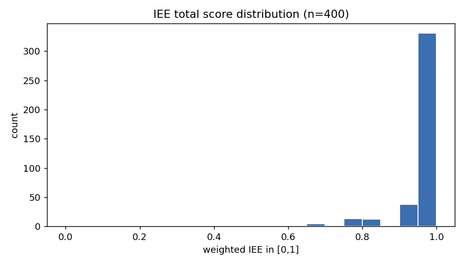
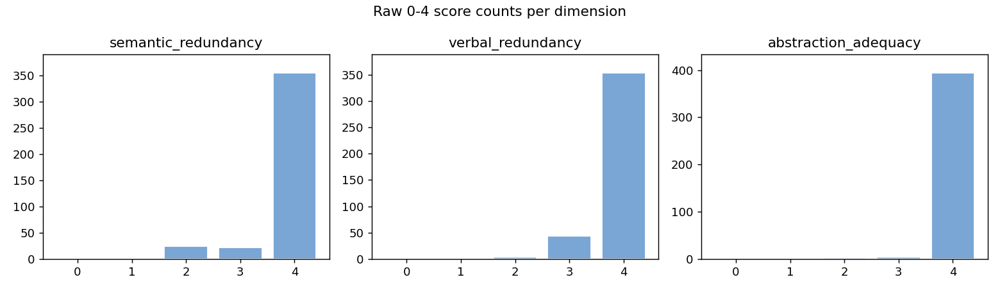
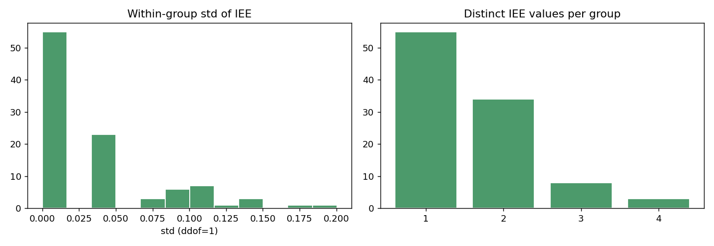
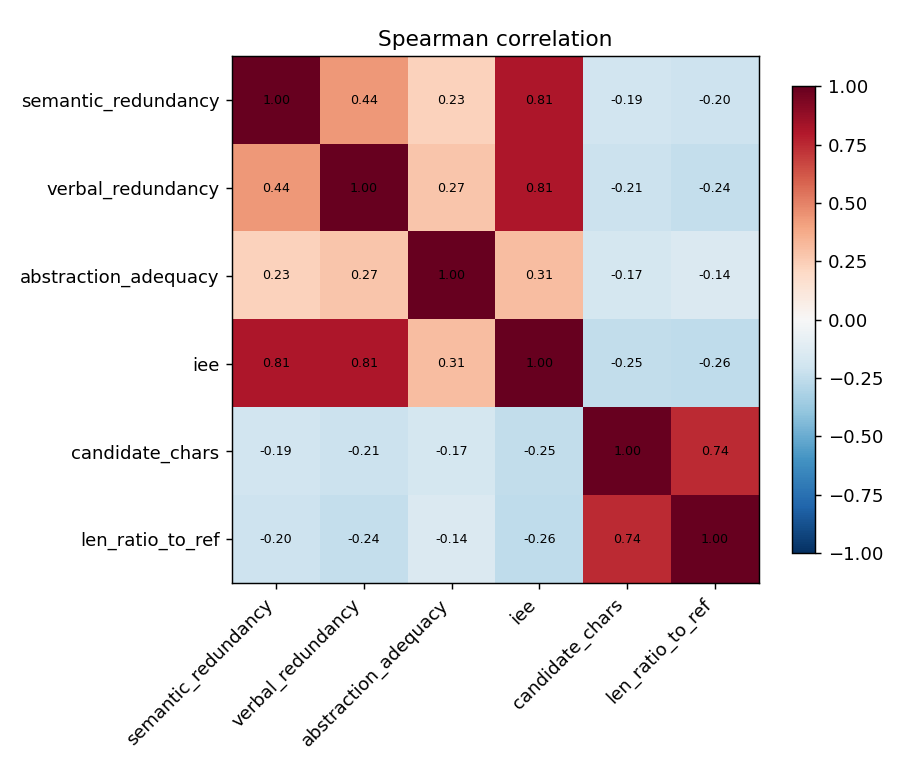
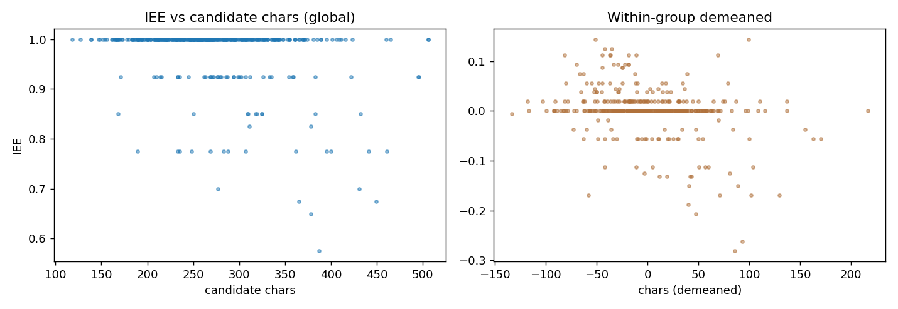

# IEE（信息表达效率）Reward 区分度验证报告

- 生成时间：2026-10-09T17:34:15
- 输入：`/home/yukino/projects/sfzy/data/triples/sft_val_100_n4.jsonl`
- 配置：`/home/yukino/projects/sfzy/configs/grpo_fact_coverage_inp_t4.yaml`
- 裁判：`deepseek-chat` @ `https://api.deepseek.com/v1`
- 数据规模：100 组 × [4] 候选 = 400 条候选
- EE 三维权重（**来自配置** `terms.expression_efficiency.dimension_weights`）：语义冗余=0.3000、表达冗余=0.3000、抽象适当性=0.4000

## 0. 结论速览（三个概念必须分开看）

1. **有区分度**（同组候选拿到不同分）：IEE 总分有 45.0% 的组组内方差非零；三维分项的非零方差组占比为 语义冗余=31.0%、表达冗余=31.0%、抽象适当性=5.0%。
2. **区分稳定**（重复评分一致）：重复评分完全一致率 IEE=87.5%，三维分项一致率 语义冗余=95.0%、表达冗余=92.5%、抽象适当性=97.5%。
3. **区分正确**（分数差异对应真实表达效率差异）：**本实验无法证实** —— 缺人工标注的表达效率真值。报告给出长度偏差、维度相关性、典型样本等间接证据，最终正确性需要人工复核。

## 1. 全局评分分布与天花板效应

| 维度 | 均值 | 标准差 | 中位数 | 最小 | 最大 | P10 | P25 | P75 | P90 | 满分率 | 低分率 |
| --- | --- | --- | --- | --- | --- | --- | --- | --- | --- | --- | --- |
| 语义冗余 | 3.828 | 0.513 | 4.0 | 2 | 4 | 3.0 | 4.0 | 4.0 | 4.0 | 88.8% | 6.0% |
| 表达冗余 | 3.877 | 0.350 | 4.0 | 2 | 4 | 3.0 | 4.0 | 4.0 | 4.0 | 88.5% | 0.8% |
| 抽象适当性 | 3.980 | 0.172 | 4.0 | 2 | 4 | 4.0 | 4.0 | 4.0 | 4.0 | 98.5% | 0.5% |
| **IEE 总分** | 0.976 | 0.064 | 1.000 | 0.575 | 1.000 | 0.925 | 1.000 | 1.000 | 1.000 | 82.8% | 0.0%(≤0.5) |

各维度 0~4 原始分数量（占比）：

| 维度 | 0 | 1 | 2 | 3 | 4 |
| --- | --- | --- | --- | --- | --- |
| 语义冗余 | 0 (0.0%) | 0 (0.0%) | 24 (6.0%) | 21 (5.2%) | 355 (88.8%) |
| 表达冗余 | 0 (0.0%) | 0 (0.0%) | 3 (0.8%) | 43 (10.8%) | 354 (88.5%) |
| 抽象适当性 | 0 (0.0%) | 0 (0.0%) | 2 (0.5%) | 4 (1.0%) | 394 (98.5%) |

- **分项天花板**：语义冗余 满分率 88.8%（均值 3.83/4）、表达冗余 满分率 88.5%（均值 3.88/4）、抽象适当性 满分率 98.5%（均值 3.98/4）。没有维度达到 >90% 的极端天花板（那样才算该维几乎失效），但 抽象适当性 的满分率 98.5% 已偏高。
- **IEE 总分压缩（重点）**：98.5% 的候选 IEE ≥ 0.75，82.8% 恰好 = 1.0，中位数 1.000。总分高度堆在上端，会把组内本来就不大的差异进一步压缩（IEE 组内 σ 均值仅 0.034、极差均值 0.068）。
- **近乎恒定的维度**：三个维度的全局标准差都在 语义冗余=0.51、表达冗余=0.35、抽象适当性=0.17；组内零方差占比 语义冗余=69.0%、表达冗余=69.0%、抽象适当性=95.0%。**没有任何一个维度接近恒定**（未出现某维 100% 组内零方差）。

## 2. GRPO 组内区分度（核心）

| 指标 | 组内σ均值 | σ中位数 | σ P25 | σ P75 | 零方差组 | 非零方差占比 | 极差均值 | 极差中位数 | 成对可区分率 |
| --- | --- | --- | --- | --- | --- | --- | --- | --- | --- |
| 语义冗余 | 0.247 | 0.000 | 0.000 | 0.500 | 69 (69.0%) | 31.0% | 0.490 | 0.000 | 18.0% |
| 表达冗余 | 0.171 | 0.000 | 0.000 | 0.500 | 69 (69.0%) | 31.0% | 0.340 | 0.000 | 17.3% |
| 抽象适当性 | 0.036 | 0.000 | 0.000 | 0.000 | 95 (95.0%) | 5.0% | 0.070 | 0.000 | 2.7% |
| **IEE 总分** | 0.034 | 0.000 | 0.000 | 0.037 | 55 (55.0%) | 45.0% | 0.068 | 0.000 | 27.3% |

每组不同评分数量分布（1/2/3/4 种）：

| 指标 | 1 种 | 2 种 | 3 种 | 4 种 |
| --- | --- | --- | --- | --- |
| 语义冗余 | 69 | 25 | 6 | 0 |
| 表达冗余 | 69 | 28 | 3 | 0 |
| 抽象适当性 | 95 | 5 | 0 | 0 |
| **IEE** | 55 | 34 | 8 | 3 |

最高分并列候选数量分布（1/2/3/4）：

| 指标 | 1 个 | 2 个 | 3 个 | 4 个 |
| --- | --- | --- | --- | --- |
| 语义冗余 | 4 | 6 | 21 | 69 |
| 表达冗余 | 2 | 7 | 22 | 69 |
| 抽象适当性 | 0 | 1 | 4 | 95 |
| **IEE** | 6 | 10 | 29 | 55 |

- **各维度能区分的组数**：语义冗余=31/100、表达冗余=31/100、抽象适当性=5/100
- **三个维度全部无法区分的组**：55 组
- 各维度组合（能区分的维度集合 → 组数）：
  - (none)：55 组
  - 语义冗余+表达冗余：16 组
  - 表达冗余：12 组
  - 语义冗余：12 组
  - 语义冗余+抽象适当性：2 组
  - 表达冗余+抽象适当性：2 组
  - 语义冗余+表达冗余+抽象适当性：1 组

## 3. 分项相关性、贡献与权重影响

维度间相关性（Pearson / Spearman）：

| 维度对 | Pearson r | Spearman ρ |
| --- | --- | --- |
| 语义冗余 ~ 表达冗余 | 0.495 | 0.436 |
| 语义冗余 ~ 抽象适当性 | 0.301 | 0.230 |
| 表达冗余 ~ 抽象适当性 | 0.208 | 0.275 |

各维度与 IEE 总分、与候选长度的相关性：

| 维度 | Pearson(dim,IEE) | Spearman(dim,IEE) | Pearson(dim,字数) | Spearman(dim,字数) |
| --- | --- | --- | --- | --- |
| 语义冗余 | 0.890 | 0.809 | -0.236 | -0.188 |
| 表达冗余 | 0.768 | 0.805 | -0.240 | -0.212 |
| 抽象适当性 | 0.538 | 0.312 | -0.183 | -0.173 |

各分项对 IEE 的贡献与组内波动来源（方差分解）：

| 分项 | 归一权重 | 平均贡献 | 占 IEE 均值 | 占组内 IEE 方差 |
| --- | --- | --- | --- | --- |
| 语义冗余 | 0.3000 | 0.2871 | 29.4% | 36.3% |
| 表达冗余 | 0.3000 | 0.2908 | 29.8% | 16.5% |
| 抽象适当性 | 0.4000 | 0.3980 | 40.8% | 8.4% |
| 语义冗余×表达冗余（协方差项） | — | — | — | 23.9% |
| 语义冗余×抽象适当性（协方差项） | — | — | — | 11.1% |
| 表达冗余×抽象适当性（协方差项） | — | — | — | 3.7% |

权重敏感性（**离线附加分析，不改配置、不改正式评分**）——各方案与正式方案的组内排序一致性：

| 权重方案 | 全局 Spearman(vs 正式) | 组内平均 Spearman | 组内 top1 一致率 |
| --- | --- | --- | --- |
| equal | 1.000 | 0.450 | 100.0% |
| only:semantic_redundancy | 0.809 | 0.298 | 96.0% |
| only:verbal_redundancy | 0.805 | 0.295 | 96.0% |
| only:abstraction_adequacy | 0.312 | 0.048 | 90.0% |

## 4. 长度偏差检查

| 指标 | Pearson(字数) | Spearman(字数) | Spearman(字数比) | Spearman(字数差) |
| --- | --- | --- | --- | --- |
| **IEE 总分** | -0.291 | -0.249 | -0.255 | -0.255 |
| 语义冗余 | -0.236 | -0.188 | -0.204 | -0.203 |
| 表达冗余 | -0.240 | -0.212 | -0.240 | -0.240 |
| 抽象适当性 | -0.183 | -0.173 | -0.143 | -0.152 |

- **组内去均值后**：IEE 与候选字数的 Spearman ρ = -0.268，与字数比 ρ = -0.270。
- 组内“最短候选拿最高 IEE”：89/100 组 (89.0%)；“最长候选拿最高分”：72 组 (72.0%)。
- 结论口径：负相关只能说明“长度与得分有关系”，**不能直接判定 Judge 错误**——更短可能确实更凝练。是否正确要看典型样本的人工复核。

## 5. 排序稳定性与典型样本

- IEE 最高分并列数量分布（每组）：1 个:6 组、2 个:10 组、3 个:29 组、4 个:55 组
- IEE 与三个维度在组内的平均 Spearman ρ：语义冗余=0.961、表达冗余=0.951、抽象适当性=0.963
- 重复评分：覆盖 80 条、80 个候选；组内排序 top1 一致率 85.0%，平均 Kendall τ = 0.930。

### 典型样本 · 组内完全同分（3 例）

**组 `d621a8e4e0d8389fd78f254bd06d8176`** — 4 个候选 IEE 完全相同，组内无梯度

- 人工参考摘要（253 字）：本案系租赁合同纠纷。原告提出诉讼，请求确认原告与被告签订的租赁合同合法有效并判令被告向原告支付拖欠的租金，并按合同约定支付违约金。被告未答辩。原告与世奥国贸公司之间已形成了租赁合同关系，世奥国贸公司未能及时向原告支付第四年的租金的行为显属不当；根据租赁合同约定，世奥国贸公司应向原告支付租金及违约金；根据原告与世奥国贸达成的租赁合同约定，被告应当对世奥国贸公司向原告支付租金及违约金承担连带清偿责任。依照《合同法》、《民事诉讼法》之规定，判决原告与被告签订的租赁合同成立并有效；被告向原告支付租金及违约金。
- 原文（2239 字，此处显示 2239 字，完整见 `samples.jsonl`）：
```
赵海东与河南省惠裕房地产开发有限责任公司租赁合同纠纷一审民事判决书河南省南阳市卧龙区人民法院民 事 判 决 书（2017）豫1303民初2101号原告赵海东，男，回族，1974年8月10日出生，住河南省社旗县。被告河南省惠裕房地产开发有限责任公司。法定代表人白松杨。住所地南阳市新华西路106号（原新西电影院）格林酒店二十四楼。原告赵海东与被告河南省惠裕房地产开发有限责任公司租赁合同纠纷一案，本院立案受理后，依法组成合议庭，公开开庭进行了审理。原告赵海东到庭参加了诉讼。被告河南省惠裕房地产开发有限责任公司经本院开庭传票依法传唤，无正当理由拒不到庭，本院依法进行缺席审理。本案现已审理终结。原告诉称，2011年12月24日原告赵海东与被告签订了（商业租赁合同）合同规定：原告赵海东将位于世奥财富广场三层48号南商铺出租给被告。租期2012年6月1日至2021年5月31日。约定：租赁期间不管经营状况如何。均按原告购置该房屋产权合同总价，壹拾伍万肆仟伍佰捌拾捌元。小写154588元。向原告每年按约定的年回报率支付租金。第一至第三年年回报率为百分之十。第四年后依次为百分之十二，十四，十六，十七，十八，十九按年支付。每逾期一日，按月租金千分之一支付违约金。此后，原告曾多次要求被告支付租金，但被告均以种种理由推诿，未按约定支付租金。故原告诉至本院，请求法院依法确认原告与被告签订的商业产权租赁合同合法有效并判令被告向原告支付拖欠的租金34568.45元（2015年至2017年应付40192.88元减去已还的5624.43元下欠34568.45元租金），并按合同约定支付违约金。被告经本院传票依法传唤，无正当理由未到庭应诉，未举证也未答辩。经审理查明，2011年12月24日，原告赵海东与河南省世奥国贸商业管理有限责任公司、被告河南省惠裕房地产开发有限责任公司签订了商业产权租赁合同，甲方（租赁方）赵海东，乙方（承租方）河南省世奥国贸商业管理有限责任公司、丙方（担保方）河南省惠裕房地产开发有限责任公司。该合同第二条约定甲方出租给乙方的房屋产权位于世奥财富广场商业第三层，铺号48号铺南产权面积为9.75平方米（以南阳市房管部门测定为准）；第五条约定不管乙方经营状况，乙方均须按甲方购置该房屋产权的合同总价，即壹拾伍万肆仟伍佰捌拾捌元整（￥154588元）向甲方每年按约定的年回率支付现金回报。第一至第三年年回报率为10%；第四年至第九年年回报率依次为12%、14%、16%、17%、18%、19%。甲方租金所得由甲方自行完税，与乙方无关。合同第九条约定乙方向甲方支付租金的时间自2012年6月1日起，按年支付。同时，被告河南省惠裕房地产开发有限责任公司对于河南省世奥国贸商业管理有限责任公司履约及向原告支付租金提供经济担保并承担连带责任保证。合同签订后，世奥国贸公司向原告支付了2012年度、2013年度、2014年度的租金,自2015年6月1日起的租金至今未付。此后，原告曾多次要求世奥国贸公司支付租金，但世奥国贸公司均以种种理由推诿，未按约定支付租金，故原告诉至本院。以上事实，有原告举证的商业产权租赁合同、收款收据以及当事人的陈述予以认定。并记录在卷。本院认为，原、被告达成合意并签订合同后，应当按照合同约定与法律规定履行合同义务。本案中，原告赵海东将其购买的房屋出租给世奥国贸公司，双方签订了书面合同，原告与世奥国贸公司之间已形成了租赁合同关系。原告作为出租人应当及时将出租物交付给世奥国贸公司使用，世奥国贸公司作为承租人应当按照合同约定及时足额向出租人支付租金。依照所签订的合同第九条的约定，世奥国贸公司应当在每年6月1日向原告支付租金，现世奥国贸公司在已支付三年租金的情况下，未能及时向原告支付第四年的租金的行为显属不当。关于租金金额问题，依照所签订的租赁合同第五条之约定，世奥国贸公司应向原告支付34568.45元租金。关于原告诉请的违约金问题，在租赁合同第十条对违约金进行了约定，故现原告主张按照合同约定支付违约金的诉讼请求，本院依法予以支持。关于被告惠裕公司的责任问题，在原告与世奥国贸达成的租赁合同中，被告明确表示其愿意对世奥国贸公司履约及向原告支付租金提供经济担保并承担连带责任保证，故被告应当对世奥国贸公司向原告支付租金及违约金承担连带清偿责任。被告经本院开庭传票依法传唤，无正当理由未到庭，是对其诉讼权利的自主处分，不影响本院在查明事实的基础上缺席判决。综上，原、被告基于意思自治达成合意，并签订了书面合同，合同当事人均应按照合同约定履行义务、承担责任，故现依照《中华人民共和国合同法》第八条、第一百零七条、第一百一十四条、第二百一十二条、第二百二十六条、《中华人民共和国民事诉讼法》第一百四十四条之规定，判决如下：一、2011年12月24日原告赵海东与被告河南省惠裕房地产开发有限责任公司签订的商业产权租赁合同成立并有效。二、本判决生效后十日内，被告河南省惠裕房地产开发有限责任公司向原告赵海东支付租金34568.45元，并自2015年6月1日起按照月租金的1‰按日向原告支付违约金至款还清之日止。诉讼费684元，由被告负担。如不服本判决，可在判决书送达之日起十五日内向本院递交上诉状，并按对方当事人的人数提出副本，上诉于河南省南阳市中级人民法院。审　判　长　　刘雅丽审　判　员　　相庆磊人民陪审员　　李　楠二〇一七年五月十七日书　记　员　　韩　冬
```
| 候选# | IEE | 组内最高 | 字数 | 语义冗余 | 表达冗余 | 抽象适当性 |
| --- | --- | --- | --- | --- | --- | --- |
| 0 | 1.000 | ✓ | 324 | 4 | 4 | 4 |
| 1 | 1.000 | ✓ | 296 | 4 | 4 | 4 |
| 2 | 1.000 | ✓ | 223 | 4 | 4 | 4 |
| 3 | 1.000 | ✓ | 339 | 4 | 4 | 4 |
  - 候选#0：原被告系租赁合同纠纷。原告诉请，请求法院依法确认原告与被告签订的商业产权租赁合同合法有效并判令被告向原告支付拖欠的租金及违约金。经查明，原告将房屋出租给世奥国贸公司，双方签订了书面合同，原告与世奥国贸公司之间已形成租赁合同关系。原告作为出租人，应及时将出租物交付给世奥国贸公司使用，世奥国贸公司作为承租人应当按照合同约定及时足额向出租人支付租金。依照所签订的合同约定，原告主张 wonderful company向原告支付34568.45元租金。依照所签订的租赁合同约定，现原告主张支付违约金的诉讼请求，予以支持。依照《合同法》、《民事诉讼法》一、原告与被告签订的商业产权租赁合同成立并有效。二、被告向原告支付租金34568.45元，并支付违约金。
  - 候选#1：原被告系租赁合同纠纷。原告诉请，确认原告与被告签订的商业产权租赁合同合法有效并判令被告向原告支付拖欠的租金，并支付违约金。经查明，原告与世奥国贸公司，双方签订了书面合同，原告与世奥国贸公司之间已形成了租赁合同关系；原告作为出租人应当及时将出租物交付给世奥国贸公司使用，世奥国贸公司作为承租人应当按照合同约定及时足额向出租人支付租金；世奥国贸公司未及时向原告支付第四年的租金的行为显属不当；被告应支付34568.45元租金，被告对世奥国贸公司向原告支付租金及违约金承担连带清偿责任。依《合同法》《民事诉讼法》判决一、原被告签订的商业产权租赁合同成立并有效。二、被告向原告支付租金，并支付违约金。
  - 候选#2：原被告系租赁合同关系。原告诉求：确认原告与被告签订的商业产权租赁合同合法有效并判令被告向原告支付拖欠的租金及违约金。经查明，原、被告基于意思自治达成合意，并签订了书面合同，合同当事人均应按照合同约定履行义务、承担责任。被告应当对世奥公司向原告支付租金及违约金承担连带清偿责任。依照《中华人民共和国合同法》《中华人民共和国民事诉讼法》的规定，判决:一、原告与被告签订的商业产权租赁合同成立并有效。二、本判决生效后十日内，被告向原告支付租金及违约金。
  - 候选#3：原告与被告租赁合同纠纷一案。原告请求确认原被告签订的商业产权租赁合同合法有效并判令被告向原告支付拖欠的租金及违约金。被告未出庭应诉，也未答辩。经查明，原被告签订的租赁合同真实有效；原告与世奥国贸公司之间已形成了租赁合同关系；原告作为出租人应及时将出租物交付给世奥国贸公司使用，被告作为承租人应足额支付租金；被告对原告租金的行为显属不当；租金金额；违约金合法有效；被告愿意对世奥国贸公司履约及向原告支付租金提供经济担保并承担连带责任保证，故被告应对世奥国贸公司向原告支付租金及违约金承担连带清偿责任。根据《中华人民共和国合同法》、《中华人民共和国民事诉讼法》规定，判决：一、原告与被告 commercial property租赁合同成立并有效。二、被告向原告支付租金，并支付违约金

**组 `ae770e09ba9f733320d186463e820ccd`** — 4 个候选 IEE 完全相同，组内无梯度

- 人工参考摘要（249 字）：本案为继承纠纷。原告诉请依法确认其对被继承人所遗留的房产享有继承权，并确认享有三分之一的继承份额。经查，院落一套为双方讼争的遗产。被继承人未留有遗嘱，应按法定继承处理。继承人范围是本案的原、被告。被告王寿禄所提供的过继的证明及分单协议不能客观真实的证明其所要证实的内容，故对此不予认定。因该讼争房产拆迁补偿未形成事实，故应按法定继承均等继承份额。根据《中华人民共和国继承法》第三条、第五条、第十条、第十一条、第十三条、第十五条的规定，判决院落一套由原告、被告王寿禄、被告王爱龙各继承三分之一的份额。
- 原文（2016 字，此处显示 2016 字，完整见 `samples.jsonl`）：
```
王广生与王寿禄、王爱龙继承纠纷一审民事判决书山西省阳泉市郊区人民法院民 事 判 决 书（2018）晋0311民初162号原告：王广生，男，1963年11月27日出生，汉族，现住阳泉市郊区。委托诉讼代理人：甄晋生，山西泽晋律师事务所律师被告：王寿禄，男，1946年10月25日出生，汉族，无业，现住阳泉市郊区。被告：王爱龙，男，1955年1月24日出生，汉族，退休教师，，现住阳泉市。第三人：阳泉市郊区平坦镇西上庄村村民委员会法定代表人：赵金生职务：该村委主任原告王广生与被告王寿禄、王爱龙、第三人阳泉市郊区平坦镇西上庄村村民委员会（以下简称西上庄村委）继承纠纷一案，本院于2018年1月26日立案后，依法适用简易程序，公开开庭进行了审理。原告王广生及委托诉讼代理人甄晋生、被告王寿禄、被告王爱龙和第三人西上庄村委法定代表人赵金生到庭参加诉讼。本案现已审理终结。原告王广生向本院提出诉讼请求：1、请求依法确认原告对王玉金和荆双林所遗留的房产享有继承权，并确认享有三分之一的继承份额。2、本案诉讼费用由被告承担。事实与理由：位于阳泉市郊区.48平方米的房产为王玉金和荆双林所有。二人生前共育有三个儿子，长子王寿福，二子王寿禄，三子王爱龙。王玉金和荆双林生前没有留下遗嘱，长子王寿福早年故去，其配偶王秀英也早已故去，也未留有遗嘱。长子王寿福共生有四个子女，长子王广生、二子王广军、女儿王巧生、女儿王巧莲，对于本案争议的房屋拆迁补偿款除王广生主张继承外，王寿福和王秀英的其他三个子女均表示放弃继承。因王玉金和荆双林所遗留的位于阳泉市郊区平坦镇西上庄村面积为249.48平方米的房产拆迁补偿款由第三人村委会保管，虽然经过原告多次与被告及第三人沟通，但始终未有结果，第三人截至目前拒绝支付拆迁补偿款，故请依法判如所求。被告王寿禄辩称，讼争的房产是祖遗产，虽然宅基地证登记在王玉金名下，但王玉金还有一个弟弟叫王玉吉，我从小过继给了王玉吉，且在一九七六年分割家庭财产时明确了由被告王寿禄继承王玉吉的财产。故讼争财产被告王寿禄应继承二分之一。被告王爱龙承认原告提出的全部诉讼请求。第三人西上庄村委述称，虽然和被告王爱龙签定了拆迁安置补偿协议，但该房屋并未拆迁，拆迁补偿款也未在村委会保管。本院经审理认定如下事实：位于阳泉市郊区.48平方米院落一套的宅基地证登记在王玉金名下，同时载明其家庭成员有王玉金之妻荆双林，持证人为被告王爱龙。王玉金和荆双林夫妻分别于1993年和2011年去世。王玉金有一弟弟王玉吉于1953年去世，无配偶子女。王玉金和荆双林生前共生有三个儿子，长子王寿福、次子被告王寿禄、三子被告王爱龙。长子王寿福及其妻分别于2004年和2006年去世，生前生有四个子女，长子为原告王广生，其他三个子女对诉争房产均表示放弃继承。2017年9月30日，西上庄村委与被告王爱龙对该诉争房产签定了一份《西上庄村整体搬迁货币补偿安置协议》，该协议中表明该争议房产拆迁所得利益有481820元。现该讼争的房产仍未拆迁，拆迁补偿款也不在第三人西上庄村委处保管。以上事实双方无异议，且有宅基地证、拆迁补偿协议及当事人陈述等在案佐证。本院对此依法予以确认。双方有争议的证据和事实有：一、被告王寿禄提供“1951年土地房产所有证”一份证明该讼争房产登记在王玉金之父王有发名下，是祖遗产。原告及被告王爱龙认可该房产为祖遗产，但认为应以宅基地证为准，被告该证据和本案无关。二、被告王寿禄提供1976年10月2日家庭财产分单协议和5个村民签字的证明各一份，证明被告王寿禄从小过继给其叔叔王玉吉，祖遗产中有王玉吉的份额，被告王寿禄继承王玉吉的财产。原告及被告王爱龙对此不予认可。认为没有过继的事实，证人证言不符合证据形式，证人也未出庭作证。分单与事实不符，其叔叔王玉吉于1953年去世，该证据反映的事实与常理不合。本院认为，本案249.48平方米院落一套为双方讼争的遗产。本案被继承人未留有遗嘱，应按法定继承处理。继承人范围是本案的原、被告。继承遗产的份额，一般应当均等。被告王寿禄所提供的过继的证明及分单协议不能客观真实的证明其所要证实的内容，故本院对此不予认定，其主张本院不予支持。因该讼争房产拆迁补偿未形成事实，故应按法定继承均等继承份额。根据《中华人民共和国继承法》第三条、第五条、第十条、第十一条、第十三条、第十五条的规定，判决如下：位于阳泉市郊区平坦镇西上庄村登记在王玉金名下的249.48平方米院落一套由原告王广生、被告王寿禄、被告王爱龙各继承三分之一的份额。案件受理费3500元减半收取1750元，由原告王广生、被告王寿禄、被告王爱龙各负担583元。如不服本判决，可在判决书送达之日起十五日内，向本院递交上诉状，并按对方当事人或代理人的人数提出副本，上诉于阳泉市中级人民法院。审 判 员　　杜　军二〇一八年四月九日法官助理　　蔺志慧书 记 员　　杨艳丽
```
| 候选# | IEE | 组内最高 | 字数 | 语义冗余 | 表达冗余 | 抽象适当性 |
| --- | --- | --- | --- | --- | --- | --- |
| 0 | 1.000 | ✓ | 236 | 4 | 4 | 4 |
| 1 | 1.000 | ✓ | 250 | 4 | 4 | 4 |
| 2 | 1.000 | ✓ | 265 | 4 | 4 | 4 |
| 3 | 1.000 | ✓ | 268 | 4 | 4 | 4 |
  - 候选#0：本案为继承纠纷。原告诉请确认其对被继承人所遗留的房产享有继承权，并享有的继承份额为三分之一。经查，涉案房产为被继承人的遗产，被继承人未留有遗嘱，应按法定继承处理；原告及被告王爱龙认可该房产为祖遗产，但以宅基地证为准；被告王寿禄提供过继证明和分单协议不能客观真实的证明其所要证实的内容，故本院对此不予认定。综上，根据《中华人民共和国继承法》第三条、第五条、第十条、第十一条、第十三条、第十五条的规定，判决如下：涉案院落一套由原告、被告王寿禄、被告王爱龙各继承三分之一的份额。
  - 候选#1：本案为继承纠纷。原告诉请依法确认原告对被继承人所遗留的房产享有继承权，并确认享有三分之一的继承份额。经查，涉案院落一套为双方讼争的遗产，被继承人未留有遗嘱，应按法定继承处理。继承人范围是本案的原、被告。原告及被告王爱龙认为没有过继的事实，其叔叔王玉吉于1953年去世，该证据反映的事实与常理不合。综上，依据《中华人民共和国继承法》第三条、第五条、第十条、第十一条、第十三条、第十五条的规定，判决房产由原被告各继承三分之一的份额；如果未按本判决指定的期间履行给付义务，则加倍支付迟延履行期间的债务利息。
  - 候选#2：原被告系继承纠纷。原告诉请：请求依法确认原告对王玉金和荆双林所遗留的房产享有继承权，并确认享有三分之一的继承份额。经查明，涉案房产由王玉金和荆双林夫妻共同拥有；被继承人未留有遗嘱。另查明，被告王寿禄所提供的过继的证明及分单协议不能客观真实的证明其所要证实的内容，故本院对此不予认定，其主张本院不予支持。依照《中华人民共和国继承法》第三条、第五条、第十条、第十一条、第十三条、第十五条的规定，判决如下：位于阳泉市郊区平坦镇西上庄村登记在王玉金名下的249.48平方米院落一套由原告王广生、被告王寿禄、被告王爱龙各继承三分之一的份额。
  - 候选#3：原被告系继承纠纷关系。原告诉请：确认原告对王玉金和荆双林所遗留的房产享有继承权，并确认享有三分之一的继承份额。经审理查明，位于阳泉市郊区.48平方米院落一套的宅基地证登记在王玉金名下，同时载明其家庭成员有王玉金之妻荆双林，持证人为被告王爱龙。另查，王玉金和荆双林夫妻分别于1993年和2011年去世。综上所述，依照《中华人民共和国继承法》第三条、第五条、第十条、第十一条、第十三条、第十五条的规定，判决如下：位于阳泉市郊区平坦镇西上庄登记在王玉金名下的249.48平方米院落一套由原告王广生、被告王寿禄、被告王爱龙各继承三分之一的份额。

**组 `52658d1593ddd3c337d2adcee410c3af`** — 4 个候选 IEE 完全相同，组内无梯度

- 人工参考摘要（289 字）：原被告系借款合同纠纷。原告提出诉讼请求：被告偿还原告借款及利息；保证人承担连带保证责任。被告未答辩。经审查，原告与被告签订的联保协议合法有效，被告周海波、曹丙杰与被告林会敏、陈立军两对夫妻应对共同债务承担还款责任，同时联保小组的成员互相承担连带保证责任。综上，依照《合同法》第一百九十六条、第二百零七条、《担保法》第十八条、第三十一条、最高人民法院关于适用《中华人民共和国婚姻法》若干问题的解释（二）第二十四条、《中华人民共和国民事诉讼法》第九十二条、第一百四十四条规定，判决被告偿还原告借款及利息；各被告互相承担给付此款的连带责任；逾期付款，应加倍支付迟延履行期间的债务利息。
- 原文（3332 字，此处显示 3014 字，完整见 `samples.jsonl`）：
```
中国邮政储蓄银行股份有限公司海林市支行与周海波、曹丙杰等借款合同纠纷一审民事判决书黑龙江省海林市人民法院民 事 判 决 书(2017)黑1083民初552号原告：中国邮政储蓄银行股份有限公司海林市支行，住所地黑龙江省海林市。负责人：马利伟，该支行行长。委托诉讼代理人：陈洪强，男，汉族，中国邮政储蓄银行股份有限公司海林市支行员工，住黑龙江省海林市。被告：周海波，男，汉族，农民，住黑龙江省海林市。被告：曹丙杰，女，汉族，农民，住黑龙江省海林市。被告：林会敏，男，汉族，农民，住黑龙江省海林市。被告：陈立军，女，汉族，农民，住黑龙江省海林市。被告：孙炳臣，男，汉族，农民，住黑龙江省海林市。被告：於海玲，女，汉族，农民，住黑龙江省海林市。原告中国邮政储蓄银行股份有限公司海林市支行（以下简称海林邮政银行）与被告周海波、曹丙杰、林会敏、陈立军、孙炳臣、於海玲借款合同纠纷一案，本院于2017年4月26日立案后，依法适用普通程序，于2017年11月28日公开开庭进行了审理。原告海林邮政银行的委托诉讼代理人陈洪强到庭参加诉讼，被告周海波、曹丙杰、林会敏、陈立军、孙炳臣、於海玲经公告送达开庭传票，未到庭参加诉讼。本案现已审理终结。海林邮政银行向本院提出诉讼请求：1、请求法院判令第一、第二被告偿还借款本金37725.52元、利息26248.03元，合计63973.55元；第三、第四被告偿还借款本金20321.46、利息13520.44元，合计33841.90元；以上四被告共计拖欠借款本息97815.45元（所列金额为截至2017年3月22日所欠金额，案件审理期间至判决、执行阶段所产生的利息及罚息之金额按照年利率21.87%计算至实际给付之日）。2、要求六被告对第一项诉讼请求承担连带保证责任。3、本案诉讼费用由六被告承担。事实与理由：第一被告与第二被告系夫妻关系，第三被告与第四被告系夫妻关系，第五被告与第六被告系夫妻关系。2012年2月16日六被告自愿组成联保小组向原告申请借款，并于2012年3月1日与原告签订小额贷款联保协议书一份，六被告对2012年3月1日至2014年3月1日期间，在单一借款人最高贷款本金余额不超过人民币5万元且联保小组合计贷款本金余额不超过15万元内承担最高额连带保证责任。2012年2月16日六被告分别向原告申请借款5万元，并于2012年3月1日分别给原告出具小额贷款（手工）借据各一份，借款总金额为15万元，借款期限为14个月，年利率为14.58%，借款用途为承包土地，并约定按照阶段性等额本息还款法还款，如发生争议可向原告住所地法院提起诉讼。借款到期后，第五、第六被告已将借款本息偿还完毕。第一与第二被告已偿还借款本金12274.48元、利息6356.29元，第三与第四被告已偿还借款本金29678.54元，利息8055.95元。现截止至2017年3月22日：第一、第二被告尚欠借款本金37725.52元、利息26248.03元，合计63973.55元；第三、第四被告尚欠借款本金20321.46元、利息13520.44元，合计33841.90元；以上四被告共计拖欠借款本息97815.45元。周海波、曹丙杰、林会敏、陈立军、孙炳臣、於海玲未答辩。当事人围绕诉讼请求，依法提交了证据，本院组织当事人进行了证据交换和质证。对有争议的证据和事实，本院认定如下：海林邮政银行提供证据一组，六被告身份信息，周海波与曹丙杰结婚证书，林会敏与陈立军结婚证书，孙炳臣与於海玲结婚证书，周海波、孙炳臣、林会敏组成联保小组向原告申请贷款申请书，联保小组成员及配偶与原告签订小额贷款联保
……（原文中间省略）……
夫妻关系。2012年2月16日周海波、林会敏、孙炳臣自愿组成联保小组向原告申请借款，并于2012年3月1日联保小组成员与原告签订小额贷款联保协议书，约定联保小组成员对2012年3月1日至2014年3月1日期间，在单一借款人最高贷款本金余额不超过5万元，且联保小组合计贷款本金余额不超过15万元内承担最高额连带保证责任，联保小组成员及其配偶签名。2012年2月16日联保小组成员分别向原告申请借款5万元，借款期限为14个月，年利率为14.58%，借款用途承包土地。借款到期后，孙炳臣、於海玲夫妻已将借款本息还清。被告周海波、曹丙杰已偿还借款本金12274.48元，利息6356.29元，被告林会敏、陈立军已偿还本金29678.54元，利息8055.95元。第一、第二被告尚欠借款本金37725.52元、利息26248.03元，合计63973.55元。第三、第四被告尚欠借款本金20321.46元，利息13520.44元，合计33841.90元。另查明，被告孙炳臣、於海玲夫妻已将本人借款还清。本院认为，被告周海波、林会敏、孙炳臣自愿组成联保小组,各自向原告申请借款5万元，与海林邮政银行签订联保协议，约定借款金额、保证方式、保证范围。被告周海波、曹丙杰在夫妻共同生活期间向原告借款5万元，并提供了结婚证，夫妻共同在联保协议上签名，故属于夫妻共同债务，除已偿还部分借款及利息外，尚欠借款本金37725.82元，借款利息26248.03元，合计63973.55元。被告林会敏、陈立军在夫妻共同生活期间向原告借款5万元，并提供了结婚证，夫妻共同在联保协议上签名，故属于夫妻共同债务，除已偿还部分借款及利息外，尚欠借款本金20321.46元，利息13520.44元，合计33841.92元，借款人应当对上述借款按约定偿还，联保小组各成员互相承担连带保证责任。综上所述，原告海林邮政银行诉讼请求合理，本院应予支持，被告周海波、曹丙杰、林会敏、陈立军、孙炳臣、於海玲经公告传唤，未到庭视为放弃抗辩权。依照《中华人民共和国合同法》第一百九十六条、第二百零七条、《中华人民共和国担保法》第十八条、第三十一条、最高人民法院关于适用《中华人民共和国婚姻法》若干问题的解释（二）第二十四条、《中华人民共和国民事诉讼法》第九十二条、第一百四十四条规定，判决如下：一、被告周海波、曹丙杰于本判决发生法律效力后三十日内给付原告中国邮政储蓄银行股份有限公司海林市支行借款本金37725.82元，利息26248.03元，合计63973.55元（利息截至2017年3月22日止），并依据约定的借款利息计算至本判决确定的履行期内实际给付之日止；二、被告林会敏、陈立军于本判决发生法律效力后三十日内给付原告中国邮政储蓄银行股份有限公司海林市支行借款本金20321.46元，利息1352044元，合计33841.92元（利息截至2017年3月22日止），并依据约定的借款利息计算至本判决确定的履行期内实际给付之日止；三、被告周海波、林会敏、孙炳臣互相承担给付此款的连带责任。如未按本判决指定的期间履行给付金钱义务，应当依照《中华人民共和国民事诉讼法》第二百五十三条之规定，加倍支付迟延履行期间的债务利息。案件受理费2245.39元，公告费700元，合计2945.39元，由被告周海波、曹丙杰、林会敏、陈立军负担。如不服本判决，可在判决书送达之日起十五日内向本院递交上诉状，并按对方当事人的人数提出副本，上诉于黑龙江省牡丹江市中级人民法院。审　判　长　　高文栋人民陪审员　　王广瑞人民陪审员　　王晓峰二〇一七年十一月二十九日书　记　员　　冯桂香
```
| 候选# | IEE | 组内最高 | 字数 | 语义冗余 | 表达冗余 | 抽象适当性 |
| --- | --- | --- | --- | --- | --- | --- |
| 0 | 1.000 | ✓ | 220 | 4 | 4 | 4 |
| 1 | 1.000 | ✓ | 355 | 4 | 4 | 4 |
| 2 | 1.000 | ✓ | 264 | 4 | 4 | 4 |
| 3 | 1.000 | ✓ | 321 | 4 | 4 | 4 |
  - 候选#0：原被告系借款合同纠纷。原告诉讼请求：第一、第二被告偿还借款本息；第三、第四被告偿还借款本息，以上四被告共计拖欠借款本息。六被告未答辩。本院认为，上述证据证明被告六未偿还借款本息。被告周海波、曹丙杰、林会敏、陈立军、孙炳臣、於海玲未提供证据。依照《合同法》《担保法》、《婚姻法》若干问题的解释（二）、《民诉法》的规定，判决:被告周海波、曹丙杰给付借款本息；被告林会敏、陈立军给付借款本息；被告周海波、林会敏、孙炳臣互相承担给付此款的连带责任。
  - 候选#1：原被告系借款合同纠纷。原告提出诉请：第一、第二被告偿还借款本金37725.52元、利息26248.03元；第三、第四被告偿还借款本金20321.46、利息13520.44元。六被告对第一项诉讼请求承担连带保证责任。六被告未答辩。经查明，被告组成为联保小组，向原告申请借款，与原告签订联保协议。周海波、曹丙杰在夫妻共同生活期间向原告借款5万元，与海林邮政银行签订联保协议，视为夫妻共同债务。林会敏、陈立军在夫妻共同生活期间向原告借款5万元，与海林邮政银行签订联保协议，为夫妻共同债务。依照《合同法》、《担保法》、《关于适用<婚姻法>若干问题的解释（二）》第24条、《民事诉讼法》第92条、第144条，判决:周海波、曹丙杰偿还借款本息；林会敏、陈立军偿还借款本息；周海波、林会敏、孙炳臣互相承担给付此款的连带责任。
  - 候选#2：原被告系借款合同纠纷。原告提出诉讼请求：第一、第二被告偿还借款本息；第三、第四被告偿还借款本息；六被告对上述诉讼请求提供连带保证责任。六被告未作答辩。经审查，被告周海波、曹丙杰、林会敏、陈立军、孙炳臣、於海玲组成了联保小组，联保小组成员以及其配偶均按照约定的还款期限将借款本金偿还本息中，属于夫妻共同债务。依照《合同法》、《担保法》、最高人民法院关于适用《婚姻法》若干问题的解释（二）、民事诉讼法》的规定，判决被告偿还原告借款及利息；保证人承担连带清偿责任，若被告未在指定期间履行给付金钱义务，应加倍支付迟延履行期间的债务利息。
  - 候选#3：原被告系借款合同纠纷。原告提出诉请：第一、第二被告偿还借款本金37725.52元、利息26248.03元；第三、第四被告偿还借款本金20321.46、利息13520.44元；六被告对第一项诉讼请求承担连带保证责任。经查明，被告联保小组成员及其配偶签名，被告六人组成联保小组,约定承担连带保证责任。被告六人在夫妻共同生活期间向原告借款5万元，该债务属于夫妻共同债务，除已偿还部分借款及利息外，尚欠借款本金37725.82元，借款利息26248.03元。依《合同法》《担保法》、《婚姻法》解释（二）、《民事诉讼法》，判决：一、被告周海波、曹丙杰给付原告借款本息；二、被告林会敏、陈立军给付原告本息；三、被告周海波、林会敏、孙炳臣互相承担连带责任。

### 典型样本 · 组内分差最大（3 例）

**组 `cb73d6bb3661c6c71caf0b2cc25c5bc5`** — IEE 组内极差 = 0.425

- 人工参考摘要（300 字）：原被告继承纠纷一案。原告1、依法分割郭武现的25万元存款。被告辩称郭武现生前由被告扶养，财产已经使用完毕。双方争议焦点为：郭武现兄弟姊妹共有几人、有无民事行为能力或限制行为能力、现有无监护人、生前由谁承担扶养义务、死后丧葬事宜花费由谁承担、是否留有存款25万元。经查郭武现为没有民事行为能力人，由其父亲作为监护人，其父亲生前让被告照看郭武现，说明已经代郭武现与被告确定了遗赠扶养协议。郭武现死后的丧葬事宜确是由被告主持承办，说明被告已履行了该协议，享有对其财产的继承的权利。依照《中华人民共和国继承法》第二十一条，以及《中华人民共和国民事诉讼法法》第六十四条判决驳回原告郭某1和原告郭某2的诉讼请求。
- 原文（2024 字，此处显示 2024 字，完整见 `samples.jsonl`）：
```
郭某1、郭某2与郭某3继承纠纷一审民事判决书河南省洛阳市洛龙区人民法院民 事 判 决 书（2017）豫0311民初4008号原告：郭某1，男，汉族，1958年12月24日出生，系无民事行为能力人。法定代表人：郭某4。委托诉讼代理人：高振洋，河南申慎律师事务所律师，一般代理。原告：郭某2，女，汉族，1971年5月2日出生。委托诉讼代理人：苗柏峰，河南申慎律师事务所律师，一般代理。被告：郭某3，男，汉族，1949年9月8日出生。原告郭某1和原告郭某2与被告郭某3为继承纠纷一案，本院于2017年7月24日立案后，依法适用简易程序对该案进行了公开开庭审理。原告郭某1委托诉讼代理人高振洋和原告郭某2及其委托诉讼代理人苗柏峰与被告郭某3到庭参加了诉讼。现已审理终结。原告向本院提出诉讼请求：1、依法分割死者郭武现的25万元存款；2、依法判令本案的诉讼费等费用由被告承担。事实与理由：二原告及被告郭某3与死者郭武现（男，身份证号：）系兄弟姐妹关系。郭武现早年参军，因病退伍，退伍后病情加重丧失生活能力和自理能力。经家属到民政部门、××人联合会等相关部门申请，死者郭武现得到救助，先后在洛阳市××、洛宁县康复中心常年休养、治疗，相关部门负责其在康复中心休养、治疗期间所有花费开支，且地方政府民政部门、××人联合会根据其现状每月给予补助数百元。2017年5月2日，死者郭武现因病去世，留下存款若干元、自有宅基地一处。死者郭武现没有留下任何遗嘱对财产进行分割。二原告与被告就死者郭武现遗产分割问题不能达成一致，且经郭寨社区居民委员会多次调解无果，诉至法院。被告辩称：1、死者郭武现生前由被告扶养，他的所有存款和财产被告都已经使用完毕。2、郭武现从部队退伍后复员费700元交给父亲郭启红，后原告郭某1的妻子将700元从父亲处取走用于郭某1盖房子。3、父亲身体健康时曾向家人说过，因原告郭某1智力××，让郭某3帮助原告郭某1干活，并把他们的责任田分到一起。后来郭某3住进了白马××洛宁县康复中心治疗，原告郭某1的妻子郭某4同意郭武现以后的事和老家宅基地都由被告照看和掌握，有什么利害，原告郭某1不再管理。4、2005年开始，父亲由被告一人赡养，因赡养父亲花费6万元，办理丧葬费花费3万元。5、父亲曾决定郭武现的事让被告进行照看。被告经常去看望郭武现，十几年中共花费6万元。6、郭武现病故后，丧葬费3万元。7、原告郭某2在父亲下世后，每次来看被告，被告都从其和郭武现共同的钱中每次给1000元，三次共3000元，郭武现丧事办完后，又给了郭某22000元。综上所述，郭武现生前的存款及财产，先后赡养父亲、照顾郭武现本人及办理丧事，共花费24.5万元，郭武现现在已经没有存款，另外根据农村风俗还要给郭武现办理”阴亲”，还要花钱。根据原被告的诉辩意见，本院总结双方的争议焦点:郭武现兄弟姊妹共有几人，郭武现生前有无民事行为能力或限制行为能力，郭武现有无监护人，郭武现生前由谁承担扶养义务，郭武现死后丧葬事宜花费由谁承担，郭武现死后是否留有存款25万元？经审理查明：郭武现与原告郭某1、原告郭某2和被告郭某3为兄弟姐妹关系。郭武现1966年生，1984年参军，1987年因为在部队精神受刺激复原，复原到家后因精神不正常一直不能正常生活。当时其家里人均认为郭武现为没有民事行为能力人，由其父亲郭启红作为监护人，郭启红于2011年3月去世，其父亲生前让被告郭某3照看郭武现，为郭武现盖房子和娶媳妇。1990年郭武现被送往洛阳市白马寺荣康医院进行康复治疗，住院五年左右。出院1年后精神病复发，被送到洛宁县军人康复医院治疗至2017年5月2日郭武现因疾病死亡。郭武现死亡后，民政部门发放补贴或抚恤金4万元左右，由郭某3领取。郭武现始终未婚，无其他继承人，丧葬事宜是由被告主持承办。在庭审过程中，因被告不同意调解，致调解不能。本院认为：根据两原告的陈述：其父亲生前让被告郭某3照看郭武现，为郭武现盖房子和娶媳妇。结合被告陈述：郭武现生前由其扶养，为郭武现办理丧事，另外根据农村风俗还要给郭武现办理”阴亲”。说明：当其父亲郭启红作为监护人时，为了郭武现的生前和死后事宜，已经代郭武现与被告确定了遗赠扶养协议。郭武现死后的丧葬事宜确是由被告主持承办，该行为说明被告已履行了该协议。被告既然承担郭武现的生养死葬义务，就享有对其财产的继承的权利。故两原告诉求分割死者郭武现的25万元存款，证据不足，理由不充分，应不予支持。依照《中华人民共和国继承法》第二十一条，以及《中华人民共和国民事诉讼法法》第六十四条之规定，判决如下：驳回原告郭某1和原告郭某2的诉讼请求。本案受理费5050元，减半收取2525元，由原告郭某1和原告郭某2负担。如不服本判决，可在判决书送达之日起十五日内，向本院递交上诉状及副本八份，上诉于河南省洛阳市中级人民法院。审判员　　王忠民二〇一七年九月二十七日书记员　　井媛媛
```
| 候选# | IEE | 组内最高 | 字数 | 语义冗余 | 表达冗余 | 抽象适当性 |
| --- | --- | --- | --- | --- | --- | --- |
| 1 | 1.000 | ✓ | 250 | 4 | 4 | 4 |
| 2 | 1.000 | ✓ | 401 | 4 | 4 | 4 |
| 3 | 0.850 |  | 168 | 3 | 3 | 4 |
| 0 | 0.575 |  | 387 | 2 | 3 | 2 |
  - 候选#0：原被告继承纠纷一案。原告诉请依法分割25万元存款。被告辩称郭武现生前由被告扶养，其所有存款和财产被告都已经使用完毕。郭武现从部队退伍后复员费交父亲，原告1的妻子将700元从父亲处取走用于原告1盖房子；郭某3住进康复中心治疗，原告1的妻子同意郭武现以后的事和老家宅基地都由被告照看和掌握，有什么利害，原告1不再管理；郭某3经常去看望郭武现，共花费6万元；丧葬费3万元；郭武现病故后，丧葬费3万元。争议焦点：郭武现兄弟姊妹共有几人，郭武现生前有无民事行为能力或限制行为能力，郭武现有无监护人，郭武现生前由谁承担扶养义务，郭武现死后丧葬事宜花费由谁承担，郭武现死后是否留有存款。经查郭启红作为监护人时，为了郭武现的生前和死后事宜，已与被告确定遗赠扶养协议，被告已履行了该协议。被告承担郭武现的生养死葬义务，享有对其财产的继承权。依照《继承法》《民事诉讼法》判决驳回原告的诉讼请求。
  - 候选#1：原被告系继承纠纷。原告诉请：依法分割存款；被告辩称：1、死者郭武现生前由被告扶养，他的所有存款和财产被告已经使用完毕。2、郭武现从部队退伍后复员费交给了父亲。被继承人生前由原告父亲郭某3作为监护人，郭某3住进了白马××洛宁县康复中心治疗，原告郭某1的妻子郭某4同意郭武现以后的事和老家宅基地都由被告照看和掌握，有什么利害，原告郭某1不再管理。另查：被继承人始终未婚，无其他继承人，丧葬事宜是由被告主持承办，该行为说明被告已履行了该协议。依照《继承法》、《民事诉讼法》的规定，判决:驳回原告的诉讼请求。
  - 候选#2：原被告系继承纠纷。原告诉讼请求：依法分割死者郭武现的25万存款。被告辩称：郭武现生前由被告扶养，他的所有存款和财产被告都已经使用完毕。郭某2在父亲下世后，每次来看被告，被告都从其和郭武现共同的钱中每次给1000元，三次共3000元，郭武现丧事办完后，又给了郭某22000元。本案争议焦点：郭武现兄弟姊妹共有几人，郭武现生前有无民事行为能力或限制行为能力，郭武现有无监护人，郭武现生前由谁承担扶养义务，郭武现死后丧葬事宜花费由谁承担，郭武现死后是否留有存款25万？法院认为：郭启红作为监护人时，为了郭武现的生前和死后事宜，已经代郭武现与被告确定了遗赠扶养协议。郭武现死后的丧葬事宜确是由被告主持承办，该行为说明被告已履行了该协议。被告既然承担郭武现的生养死葬义务，就享有对其财产的继承的权利。故两原告诉求分割郭武现的25万存款，证据不足，理由不充分。依照《继承法》、《民事诉讼法法》判决驳回原告诉讼请求。
  - 候选#3：本案属于继承纠纷。原告诉请：依法分割存款；依法判令本案的诉讼费等费用由被告承担。法院查明，原被告为兄弟姐妹关系。原告知求分割存款，理由不充分。被告既然承担被继承人的生养死葬义务，就享有对其财产的继承 rights。因此，依照《中华人民共和国继承法》第二十一条，以及《中华人民共和国民事诉讼法法》第六十四条之规定，判决驳回原告的诉讼请求。

**组 `26169989cc5546821375c95b205e25c2`** — IEE 组内极差 = 0.350

- 人工参考摘要（304 字）：原被告系借款合同纠纷。原告提出诉讼请求1、解除原、被告签订的《个人住房（商业用房）借款合同》；2、被告偿还原告借款本金、利息、罚息；3、原告对被告房产享有优先受偿权；4、被告赔偿原告律师费。被告无答辩意见。法院查明，原告与被告签订的合同合法有效，并以房产进行抵押，办理了他项权利证。被告未履行按期偿还借款的义务，属违约。合同约定贷款人有权解除与借款人的借贷关系。关于律师费，因原告不能证明该笔费用实际发生，故不予支持。依照《合同法》《担保法》《民事诉讼法》规定，判决：一、解除原告与被告的《个人住房借款合同》；二、被告偿还原告借款本金，利息、罚息；三、若被告逾期给付上述款项，原告可房产行使抵押权并优先受偿。
- 原文（4508 字，此处显示 3014 字，完整见 `samples.jsonl`）：
```
借款合同纠纷一审民事判决书沈阳市和平区人民法院 民 事 判 决 书（2017）辽0102民初8455号原告：中国建设银行股份有限公司沈阳浑南支行，住所地沈阳市浑南区，统一社会信用代码：×××。负责人：李日辉，系该行行长。委托诉讼代理人：鲁越，系辽宁明辰律师事务所律师。委托诉讼代理人：贾梦男，系辽宁明辰律师事务所律师。被告：高志业，男，1978年12月25日出生，汉族，住沈阳市于洪区。被告：王苓，女，汉族，1972年12月5日出生，住沈阳市皇姑区。原告中国建设银行股份有限公司沈阳浑南支行与被告高志业、王苓借款合同纠纷一案，本院于2017年7月12日立案后，由审判员龚雪峰主审。后因其工作变动，该案变更由审判员聂雪主审，依法适用普通程序公开开庭进行了审理。原告中国建设银行股份有限公司沈阳浑南支行委托诉讼代理人鲁越到庭参加诉讼，被告高志业、王苓经公告送达开庭传票，未到庭参加诉讼。本案现已审理终结。原告中国建设银行股份有限公司沈阳浑南支行向本院提出诉讼请求：1、解除原、被告于2015年8月10日签订的《个人住房（商业用房）借款合同》；2、被告偿还原告借款本金293,315.38元，利息12,593.22元、利息罚息391.54元，本金罚息291.45元，总计306,591.59元（以上本金及利息、罚息截止日为2017年5月23日，具体偿还金额以实际发生为准）；3、原告对被告高志业、王苓名下位于铁西区勋业一路25-4号1-7-3，建筑面积为73.93平方米的房产行使抵押权，并在上述债权范围内享有优先受偿权；4、请求法院判令被告赔偿原告实现债权的费用，即律师费12,264元，与第2项合计318,855.59元；5、请求法院判令被告承担本案全部诉讼费用。事实和理由：二被告系夫妻关系。2015年8月10日，原告（贷款人、抵押权人）与被告高志业、王苓（借款人、抵押人）签订《个人住房（商业用房）借款合同》一份，约定借款金额300,000元，用于购买位于铁西区勋业一路25-4号1-7-3，建筑面积为73.93平方米的房产，借款期限自2015年8月10日至2035年8月10日，贷款利率为月利率；借款逾期，罚息利率为在本合同所执行贷款利率的水平上上浮50%；借款人高志业、王苓以其购买的房产提供抵押担保，并办理了他项权利证；借款人不按本合同约定足额偿还借款本息或其他应付款项，贷款人有权宣布贷款立即到期，要求借款人立即清偿借款本息及相关费用，解除与借款人的借贷关系，行使担保权利。合同签订后，原告依约向被告发放了贷款，被告自2016年7月起未按约定偿还贷款，至2017年5月23日止，被告尚欠原告贷款本金293,315.38元，利息12,593.22元、利息罚息391.54元，本金罚息291.45元，总计306,591.59元。原告委托辽宁明辰律师事务所处理本次诉讼，支出律师费12,264元。原告诉至贵院，请求法院支持原告的全部诉讼请求。被告高志业、王苓经合法传唤未到庭应诉，亦未提交答辩意见。根据当事人陈述和经审查确认的证据，本院认定事实如下：1、原告中国建设银行股份有限公司沈阳浑南支行（贷款人、抵押权人）与被告高志业、王苓（借款人、抵押人）于2015年8月10日签订《个人住房（商业用房）借款合同》一份，合同约定借款金额300,000元，借款期限为240个月，即自2015年8月10日至2035年8月10日止，借款用于购买位于沈阳市铁西区勋业一路25-4号1-7-3，建筑面积为73.93平方米的房产；借款利率为浮动利率；还款方式为等额本息还款；借款利率为浮动利率，借款人未按本合同约定
……（原文中间省略）……
，依照《中华人民共和国担保法》第三十三条、第五十三条的规定，原告有权对被告提供的抵押房产行使抵押权，在债权范围内优先受偿。关于原告主张的律师费，因原告不能证明该笔费用实际发生，故对该项诉讼请求，本院不予支持。综上所述，依照《中华人民共和国合同法》第九十三条二款、第九十七条、第一百零七条、第二百零七条，《中华人民共和国担保法》第三十三条、第五十三条，《中华人民共和国民事诉讼法》第六十四条一款、第一百四十四条规定，判决如下：一、解除原告中国建设银行股份有限公司沈阳浑南支行与被告高志业、王苓于2015年8月10日签订的《个人住房（商业用房）借款合同》；二、被告高志业、王苓于本判决生效后十日内一次性偿还原告中国建设银行股份有限公司沈阳浑南支行借款本金293,315.38元，利息12,593.22元、利息罚息391.54元，本金罚息291.45元（以上本金、利息、罚息的计算截止至2017年5月23日）；并自2017年5月24日起按《个人住房（商业用房）借款合同》约定的计息办法给付原告中国建设银行股份有限公司沈阳浑南支行逾期利息至本判决实际偿还之日止；三、若被告高志业、王苓逾期给付原告中国建设银行股份有限公司沈阳浑南支行上述款项，则原告中国建设银行股份有限公司沈阳浑南支行可依法对被告高志业、王苓提供的位于铁西区勋业一路25-4号1-7-3，建筑面积为73.93平方米的房产行使抵押权，并在上述债权范围内优先受偿；四、驳回原告中国建设银行股份有限公司沈阳浑南支行的其他诉讼请求。如果未按本判决指定的期间履行给付金钱义务，应当依照《中华人民共和国民事诉讼法》第二百五十三条规定，加倍支付迟延履行期间的债务利息。案件受理费6,083元，公告费660元，由被告高志业、王苓负担。如不服本判决，可以在判决书送达之日起十五日内，向本院递交上诉状，并按对方当事人的人数提出副本，上诉于辽宁省沈阳市中级人民法院。审判长臧宁审判员聂雪人民陪审员董秀坤二〇一七年十二月二十五日书记员王蓓本判决所依据的相关法律《中华人民共和国合同法》第九十三条二款当事人可以约定一方解除合同的条件。解除合同的条件成就时，解除权人可以解除合同。《中华人民共和国合同法》第九十七条合同解除后，尚未履行的，终止履行；已经履行的根据履行情况和合同性质，当事人可以要求恢复原状、采取其他补救措施，并有权要求赔偿损失。《中华人民共和国合同法》第一百零七条当事人一方不履行合同义务或者履行合同义务不符合约定的，应当承担继续履行、采取补救措施或者赔偿损失等违约责任。《中华人民共和国合同法》第二百零七条借款人未按照约定的期限返还借款的，应当按照约定或者国家有关规定支付逾期利息。《中华人民共和国担保法》第三十三条本法所称抵押，是指债务人或者第三人不转移对本法第三十四条所列财产的占有，将该财产作为债权的担保。债务人不履行债务时，债权人有权依照本法规定以该财产折价或者以拍卖、变卖该财产的价款优先受偿。前款规定的债务人或者第三人为抵押人，债权人为抵押权人，提供担保的财产为抵押物。《中华人民共和国担保法》第五十三条债务履行期届满抵押权人未受清偿的，可以与抵押人协议以抵押物折价或者以拍卖、变卖该抵押物所得的价款受偿；协议不成的，抵押权人可以向人民法院起诉讼。抵押物折价或者拍卖、变卖后，其价款超过债权数额的部分归抵押人所有，不足部分由债务人清偿。《中华人民共和国民事诉讼法》第六十四条一款当事人对自己提出的主张，有责任提供证据。《中华人民共和国民事诉讼法》第一百四十四条被告经传票传唤，无正当理由拒不到庭的，或者未经法庭许可中途退庭的，可以缺席判决。
```
| 候选# | IEE | 组内最高 | 字数 | 语义冗余 | 表达冗余 | 抽象适当性 |
| --- | --- | --- | --- | --- | --- | --- |
| 0 | 1.000 | ✓ | 240 | 4 | 4 | 4 |
| 2 | 1.000 | ✓ | 260 | 4 | 4 | 4 |
| 3 | 1.000 | ✓ | 260 | 4 | 4 | 4 |
| 1 | 0.650 |  | 378 | 2 | 4 | 2 |
  - 候选#0：原被告系借款合同关系。原告提出诉求：1、解除原、被告借款合同；2、被告偿还原告借款本金及利息、罚息、本金罚息，律师费；3、原告对被告房产行使抵押权，在债权范围内享有优先受偿权。经审理查明，双方签订的个人住房借款合同真实有效，被告未按约定按时足额偿还借款本息，属违约行为，构成事实。依据《合同法》、《担保法》、《民事诉讼法》规定，判决：1、解除原、被告借款合同；2、被告偿还原告借款本金、利息罚息；3、原告对被告房产行使抵押权，在债权范围内享有优先受偿权；4、驳回原告其他诉讼请求。
  - 候选#1：原被告系借款合同纠纷。原告提出诉求：1、解除原、被告签订的个人住房借款合同；2、被告偿还借款本金293,315.38元，利息12,593.22元、利息罚息391.54元，本金罚息291.45元，3、原告对被告名下的房产行使抵押权，在上述债权范围内享有优先受偿权；4、请求法院判令被告赔偿原告实现债权的费用，即律师费12,264元。由于原告与被告签订的借款合同合法有效，被告未按约定履行还本付息义务，构成违约，应承担违约责任，同时原告对上述房产有抵押权。据此，依照《合同法》、《担保法》、《民事诉讼法》之规定，判决：1、解除原、被告签订的借款合同；2、被告偿还借款本金293,315.38元，利息12,593.22元、利息罚息391.54元，本金罚息291.45元，3、若被告逾期未还上述款项，则原告可依法对被告上述房产行使抵押权，在上述债权范围内优先受偿。
  - 候选#2：原被告系借款合同纠纷。原告提出诉求：解除原被告的借款合同；被告偿还原告借款本金，利息、罚息、本金罚息；原告对被告房产行使抵押权，在上述债权范围内享有优先受偿权；请求法院判令被告赔偿原告实现债权的费用，即律师费。被告未答辩。经查明：原被告签订的借款合同及保证合同均合法有效；被告未按约履行还本付息义务，构成违约；抵押物已办理他项权利证。依照《合同法》《担保法》《民事诉讼法》之规定，判决:解除原被告借款合同；被告偿还原告借款本金、利息、罚息罚息、本金罚息；如果被告逾期未履行给付金钱义务，应加倍支付迟延履行期间的债务利息。
  - 候选#3：原被告系借款合同纠纷。原告提出诉讼请求：解除借款合同；被告偿还借款本金、利息、罚息等；原告对被告房产行使抵押权，并在上述债权范围内享有优先受偿权；被告赔偿原告实现债权的费用。被告未答辩。经查明，原告与被告签订的借款合同系双方真实意思表示，合法有效，被告未按约偿还借款，构成违约。另查明，原告就案涉房屋办理了登记过户手续，且被告办理了登记过户手续。依照《合同法》《担保法》、《民事诉讼法》的规定，判决:解除借款合同；被告偿还借款本金、利息、罚息，如被告未按本判决指定的期间履行给付金钱义务，加倍支付迟延履行期间的债务利息。

**组 `dd6efce50ec24538c2b3aedd465718df`** — IEE 组内极差 = 0.300

- 人工参考摘要（270 字）：本案系租赁合同纠纷。原告提出诉求1.解除原、被告之间签订的协议书；2、判令刘彬、吴海涛双倍退还保证金，赔偿原告各项损失。被告吴海涛辨称收取的保证金存入了以苏兵名义开设的合伙账户，刘彬辨称要求原告出示收到保证金的收据原件。经审理《协议书》合法有效，四合伙人并未依约交付，其行为已经构成违约。根据《中华人民共和国合同法》第九十四条第四项、第一百零七条、《中华人民共和国民事诉讼法》第十三条、《最高人民法院关于适用若干问题的解释》第一百一十八条的规定判决：解除《协议书》；吴海涛、刘彬于退还聂小华保证金、赔偿各项损失；三、驳回原告的其它诉讼请求。
- 原文（5402 字，此处显示 3014 字，完整见 `samples.jsonl`）：
```
聂小华与吴海涛、刘彬等租赁合同纠纷一审民事判决书四川省蓬溪县人民法院民 事 判 决 书（2017)川0921民初838号原告：聂小华，男，1976年8月6日出生，汉族，江西省丰城市人，住江西省丰城市。特别授权委托诉讼代理人：李红梅，四川诚中成律师事务所律师。执业证号：1119201211590832。被告：吴海涛，男，1981年12月7日出生，汉族，四川省蓬溪县人，住四川省蓬溪县。被告：刘彬，男，1965年6月13日出生，汉族，四川省蓬溪县人，住四川省蓬溪县。被告：刘影，男，1963年7月15日出生，汉族，四川省蓬溪县人，住四川省蓬溪县。被告：苏兵，男，1963年1月13日出生，汉族，四川省遂宁市船山区人，住四川省遂宁市船山区。原告聂小华与被告刘彬、吴海涛租赁合同纠纷一案，本院于2017年4月25日立案受理，受理后，经审查发现，案外人刘影、苏兵与本案有利害关系，遂通知刘影、苏兵作为本案共同被告参加本次诉讼。本案依法适用简易程序，公开开庭进行了审理。原告聂小华的特别授权委托代理人李红梅、被告刘彬、刘影到庭参加了诉讼。原告聂小华、被告吴海涛、苏兵经传票传唤未到庭参加诉讼。本案现已审理终结。聂小华向本院提出诉讼请求：1.依法解除原、被告之间于2015年5月26日签订的协议书；2、判令刘彬、吴海涛双倍退还保证金30,000元，赔偿原告各项损失4,000元；3、本案诉讼费由刘彬、吴海涛承担。事实和理由：2015年5月26日，原告与四被告签订《协议书》，约定四被告在其合伙开发的蓬溪县三凤镇新市场内划出商铺租给原告作经营使用，租赁物的交付时间约定为2016年2月底前。协议签订当日，原告依约支付了保证金人民币30,000元，支付保证金时，有苏兵、刘影、吴海涛在场。后因被告合伙人内部产生纠纷，未如期向原告交付租赁物，原告曾多次电话催促被告，并多次从外地赶到蓬溪县三凤镇找被告协商解决此事。2017年4月16日，原告与己方合伙人杨志刚再次找到刘彬、吴海涛、苏兵、刘影，要求退还保证金。刘影、苏兵各自退还了原告7,500元保证金，原告承诺不再追究二人的法律责任，在向苏兵收取其退还的保证金时，原告将30,000元的收据原件交给了苏兵。吴海涛、刘彬至今未退还应付款项，现原告起诉来院，要求二被告按定金法则双倍退还剩余保证金以及赔偿损失4，000元。被告吴海涛辨称：其与刘彬、刘影、苏兵系合伙关系，与聂小华签订《协议书》属实，收取30,000元保证金属实，收取保证金时除刘彬外，其余均在场，收取的保证金存入了以苏兵名义开设的合伙账户。因其合伙人内部发生矛盾导致与聂小华签订的协议无法履行，待其与刘彬、刘影、苏兵合伙当中的纠纷处理完毕后，他才同意退还聂小华的保证金。被告刘彬辨称：《协议书》他确实参与了签署，但30,000元保证金收取时，他并不在场，并不知悉保证金的收取状况，要求原告出示收到保证金的收据原件，以便其确认。对于原告要求双倍退还保证金的要求，其认为不合理，对于原告的损失状况，要求法院依法认定。其对于原告要求解除协议的要求，予以认可。被告刘影辨称：他已经向聂小华退还了7,500元保证金，聂小华也作出了承诺不再追究他的法律责任，此案与他无关。原告要求双倍退还保证金的要求不合理，对原告要求4,000元赔偿的请求不认可，对于原告要求解除协议的要求无异议。被告苏兵未向本庭提供任何答辩意见。（一）原告为证明其诉讼主张，向本院提交以下证据：1、原告的身份证复印件，证明原告的身份；2、被告刘彬、吴海涛的身份证复印件，证明被告的身份；3、《协议》原件一份，证明原告与被告签订的租赁协议属实；4、保
……（原文中间省略）……
终损失确定为2，185元。关于争议焦点四，本案中，刘影、苏兵、刘彬、吴海涛四人系合伙关系，四合伙人对合伙债务应负无限连带责任，原告在立案起诉以前，按份收取了刘影、苏兵退还的保证金各人民币7,500元，并承诺不再追究刘影、苏兵的相关责任。在起诉中，原告仅将未予退款的刘彬、吴海涛列为被告进行诉讼，在本院予以释明后，原告仍然坚持不予追究刘影、苏兵二人的责任。在本案的审理过程中，本院认为刘影、苏兵与吴海涛、刘彬系合伙关系，且共同参与了《协议书》的签订，刘影、苏兵与本案有利害关系，故通知二人作为本案共同被告参与诉讼。本院认为连带之债，任何一个被告均负有对原告承担全部责任的义务，原告在本院释明后坚持放弃向刘影、苏兵主张权利，原告的意思表示并不影响刘彬、吴海涛负有的对原告应当承担的全部赔偿责任，且原告有权在法律规定的范围内处分自己的民事权利和诉讼权利。故在本案中，刘影、苏兵不承担责任。关于争议焦点五，吴海涛在诉讼中表示，在其与刘影、苏兵、刘彬的合伙内部矛盾处理完毕前，不同意退还保证金。本院认为原告与吴海涛、刘彬、刘影、苏兵签订的《协议书》是双方真实意思的表示，在协议中双方明确约定租赁物的交付时间为2016年2月，但四合伙人并未依约交付，其行为已经构成违约，在合同无法履约的情况下，四合伙人理应无条件退还原告缴纳的保证金，并承担相应的违约责任，被告吴海涛认为应先行解决合伙内部矛盾的请求于法无据，不能得到本院的支持。刘彬在诉讼过程中表示，在收取30,000元保证金时，其并不在场，对收取保证金的事实不予认可。但经过审理，综合全案证据及原、被告陈述，均能体现刘影、苏兵、吴海涛收取保证金30,000元并将该款汇入合伙账户的事实，虽然刘彬并未在收款凭证上签字，但刘彬参与了《协议书》的签订，并且在聂小华追讨保证金时，书面承诺“愿意退还7,500元”，在本院做的询问笔录中，亦承认四合伙人收取保证金30,000元的事实。故刘彬认为退还保证金与己无关的观点，不能得到本院的支持。综上所述，原告与刘彬、吴海涛、苏兵、刘影签订《协议书》，后由于四合伙人内部产生纠纷，导致协议无法履行，四合伙人构成违约，合同理应解除，四合伙人应向原告退还收取的保证金，并支付原告因四合伙人违约给原告造成的损失。在原告与四合伙人的立案前协调中，苏兵、刘影主动向原告各自退还了7,500元，原告承诺不再追究二人的法律责任。对于连带责任情形，任何一个被告均负有对原告承担全部责任的义务，实为可分之诉，且原告有权在法律规定的范围内处分自己的民事权利和诉讼权利，故原告仅要求四合伙人中的吴海涛、刘彬对剩余的保证金及违约损失承担责任的请求，应该得到本院的支持。依照《中华人民共和国合同法》第九十四条第四项、第一百零七条、《中华人民共和国民事诉讼法》第十三条、《最高人民法院关于适用若干问题的解释》第一百一十八条之规定，判决如下：解除聂小华与吴海涛、刘彬、苏兵、刘影于2015年5月26日签订的《协议书》；限吴海涛、刘彬于本判决生效后十日内退还聂小华保证金人民币15,000元、赔偿聂小华各项损失人民币2，185元；三、驳回聂小华的其它诉讼请求；如果被告未按本判决指定的期限履行给付金钱的义务，应当依照《中华人民共和国民事诉讼法》第二百五十三条之规定，加倍支付迟延履行期间的债务利息。案件受理费115元（该费用已由原告预交，在被告履行时一并支付），由吴海涛、刘彬负担。如不服本判决，可在判决书送达之日起十五日内，向本院递交上诉状，并按对方当事人的人数提出副本，上诉于四川省遂宁市中级人民法院。审判员　　旷国军二〇一七年七月十九日书记员　　杨明月
```
| 候选# | IEE | 组内最高 | 字数 | 语义冗余 | 表达冗余 | 抽象适当性 |
| --- | --- | --- | --- | --- | --- | --- |
| 1 | 1.000 | ✓ | 460 | 4 | 4 | 4 |
| 2 | 1.000 | ✓ | 354 | 4 | 4 | 4 |
| 3 | 0.850 |  | 318 | 3 | 3 | 4 |
| 0 | 0.700 |  | 431 | 2 | 2 | 4 |
  - 候选#0：本案系租赁合同纠纷。原告提出诉求：1、解除原、被告间签订的协议书；2、判令双倍退还保证金并赔偿各项损失。被告辩称：1、合作人格外，收取保证金时除刘彬外，其余均在场；2、现自己与刘彬、刘影、苏兵合伙当中尚在纠纷处理中；3、对原告双倍退还保证金、赔偿损失，主张认同，但关于自身的double退还保证金问题，观点不认同。争议焦点：1、双方签订的协议书是否符合解除的条件；2、保证金是否支持双倍退还；3、被告违约造成的损失如何认定；4、刘影、苏兵双倍退还保证金与己无关；5、吴海涛主张的不予退还的理由是否成立。被告未答辩。经审理本案的争议焦点：1、协议书是否符合解除的条件；2、保证金是否支持双倍退还；3、被告违约造成的损失如何认定；4、刘影、苏兵是否对本案承担责任；5、吴海涛主张的不用退还的理由是否成立。依照我国《合同法》《民事诉讼法》、《最高人民法院关于适用若干问题的解释》之规定判决：解除原告与四被告签订的协议书；被告退还保证金并赔偿损失；驳回原告其它诉讼请求。
  - 候选#1：原被告系租赁合同关系。原告诉求：1.解除原被告签订的协议书；2.被告刘彬、吴海涛双倍退还保证金30,000元，赔偿原告各项损失4,000元。争议焦点：1.双方签订的协议书是否符合解除的条件；2.在合同无法履行的前提下，保证金是否支持双倍退还；3.被告违约给原告造成的损失如何认定；4.在原告不追究的情况下，刘影、苏兵应否对本案承担责任；5.吴海涛、刘彬主张不予退还的理由是否成立。经查明：争议焦点一，该协议符合合同解除的条件；争议焦点二，不能将该保证金定性为定金的性质；争议焦点三，四合伙人未能依约交付，构成违约，理应无条件退还保证金并进行相应的违约责任；争议焦点四，吴海涛、刘彬预留的保证金并未实际交付出，应予扣除；争议焦点五，被告吴海涛同意不能得到法院支持。依照《合同法》、《民事诉讼法》、《最高人民法院关于适用若干问题的解释》的规定，判决:解除《协议书》；吴海涛、刘彬于本判决生效后十日内退还保证金15,000元、赔偿各项损失2,185元；三、驳回原告其它诉讼请求；如未按期履行给付金钱义务，加倍支付延迟履行利息。
  - 候选#2：原被告系租赁合同关系。原告提出诉求：1.依法解除原、被告之间的协议书；2.判令被告双倍退还保证金30,000元，赔偿原告各项损失4,000元。本案的争议焦点：1.双方签订的《协议书》是否符合解除的条件；2.在合同无法履行的前提下，保证金是否支持双倍退还；3.被告违约给原告造成的损失如何认定；4.在原告不追究的情况下，刘影、苏兵应否对本案承担责任。争议焦点五，原告与吴海涛、刘彬、刘影、苏兵签订的《协议书》是双方真实意思的表示，在协议中双方明确约定交付的时间，但四合伙人并未依约交付，其行为已经构成违约，根据《合同法》、《民事诉讼法》、《最高人民法院关于适用的若干问题的解释》的规定，判决：1、解除《协议书》；2.被告吴海涛、刘彬退还保证金15,000元、赔偿各项损失2,185元；3.驳回原告其它诉讼请求。
  - 候选#3：原被告租赁合同纠纷。原告提出诉求：依法解除原、被告之间签订的协议书；判令刘彬、吴海涛双倍退还保证金，赔偿原告各项损失。被告辨称：因合伙人内部发生矛盾导致与原告签订的协议无法履行，待其与刘彬、刘影、苏兵合伙 amongst纠纷处理完毕后，他才同意退还的保证金。经查明原告与四被告签订的协议书合法有效，四被告在原告催告后均明确表示协议已经无法继续履行；协议中明确约定30,000元为保证金，不能将该保证金定性为定金的性质；原告与四被告签订《协议书》后由于四合伙人内部产生纠纷，导致协议无法履行，四合伙人构成违约，根据《合同法》和《民诉法》规定，判决：解除原告与四被告签订的协议书；被告退还原告保证金、赔偿原告各项损失；驳回原告其它诉讼请求。

### 典型样本 · 最长候选反而最高（3 例）

**组 `d621a8e4e0d8389fd78f254bd06d8176`** — 最长候选拿到组内最高 IEE

- 人工参考摘要（253 字）：本案系租赁合同纠纷。原告提出诉讼，请求确认原告与被告签订的租赁合同合法有效并判令被告向原告支付拖欠的租金，并按合同约定支付违约金。被告未答辩。原告与世奥国贸公司之间已形成了租赁合同关系，世奥国贸公司未能及时向原告支付第四年的租金的行为显属不当；根据租赁合同约定，世奥国贸公司应向原告支付租金及违约金；根据原告与世奥国贸达成的租赁合同约定，被告应当对世奥国贸公司向原告支付租金及违约金承担连带清偿责任。依照《合同法》、《民事诉讼法》之规定，判决原告与被告签订的租赁合同成立并有效；被告向原告支付租金及违约金。
- 原文（2239 字，此处显示 2239 字，完整见 `samples.jsonl`）：
```
赵海东与河南省惠裕房地产开发有限责任公司租赁合同纠纷一审民事判决书河南省南阳市卧龙区人民法院民 事 判 决 书（2017）豫1303民初2101号原告赵海东，男，回族，1974年8月10日出生，住河南省社旗县。被告河南省惠裕房地产开发有限责任公司。法定代表人白松杨。住所地南阳市新华西路106号（原新西电影院）格林酒店二十四楼。原告赵海东与被告河南省惠裕房地产开发有限责任公司租赁合同纠纷一案，本院立案受理后，依法组成合议庭，公开开庭进行了审理。原告赵海东到庭参加了诉讼。被告河南省惠裕房地产开发有限责任公司经本院开庭传票依法传唤，无正当理由拒不到庭，本院依法进行缺席审理。本案现已审理终结。原告诉称，2011年12月24日原告赵海东与被告签订了（商业租赁合同）合同规定：原告赵海东将位于世奥财富广场三层48号南商铺出租给被告。租期2012年6月1日至2021年5月31日。约定：租赁期间不管经营状况如何。均按原告购置该房屋产权合同总价，壹拾伍万肆仟伍佰捌拾捌元。小写154588元。向原告每年按约定的年回报率支付租金。第一至第三年年回报率为百分之十。第四年后依次为百分之十二，十四，十六，十七，十八，十九按年支付。每逾期一日，按月租金千分之一支付违约金。此后，原告曾多次要求被告支付租金，但被告均以种种理由推诿，未按约定支付租金。故原告诉至本院，请求法院依法确认原告与被告签订的商业产权租赁合同合法有效并判令被告向原告支付拖欠的租金34568.45元（2015年至2017年应付40192.88元减去已还的5624.43元下欠34568.45元租金），并按合同约定支付违约金。被告经本院传票依法传唤，无正当理由未到庭应诉，未举证也未答辩。经审理查明，2011年12月24日，原告赵海东与河南省世奥国贸商业管理有限责任公司、被告河南省惠裕房地产开发有限责任公司签订了商业产权租赁合同，甲方（租赁方）赵海东，乙方（承租方）河南省世奥国贸商业管理有限责任公司、丙方（担保方）河南省惠裕房地产开发有限责任公司。该合同第二条约定甲方出租给乙方的房屋产权位于世奥财富广场商业第三层，铺号48号铺南产权面积为9.75平方米（以南阳市房管部门测定为准）；第五条约定不管乙方经营状况，乙方均须按甲方购置该房屋产权的合同总价，即壹拾伍万肆仟伍佰捌拾捌元整（￥154588元）向甲方每年按约定的年回率支付现金回报。第一至第三年年回报率为10%；第四年至第九年年回报率依次为12%、14%、16%、17%、18%、19%。甲方租金所得由甲方自行完税，与乙方无关。合同第九条约定乙方向甲方支付租金的时间自2012年6月1日起，按年支付。同时，被告河南省惠裕房地产开发有限责任公司对于河南省世奥国贸商业管理有限责任公司履约及向原告支付租金提供经济担保并承担连带责任保证。合同签订后，世奥国贸公司向原告支付了2012年度、2013年度、2014年度的租金,自2015年6月1日起的租金至今未付。此后，原告曾多次要求世奥国贸公司支付租金，但世奥国贸公司均以种种理由推诿，未按约定支付租金，故原告诉至本院。以上事实，有原告举证的商业产权租赁合同、收款收据以及当事人的陈述予以认定。并记录在卷。本院认为，原、被告达成合意并签订合同后，应当按照合同约定与法律规定履行合同义务。本案中，原告赵海东将其购买的房屋出租给世奥国贸公司，双方签订了书面合同，原告与世奥国贸公司之间已形成了租赁合同关系。原告作为出租人应当及时将出租物交付给世奥国贸公司使用，世奥国贸公司作为承租人应当按照合同约定及时足额向出租人支付租金。依照所签订的合同第九条的约定，世奥国贸公司应当在每年6月1日向原告支付租金，现世奥国贸公司在已支付三年租金的情况下，未能及时向原告支付第四年的租金的行为显属不当。关于租金金额问题，依照所签订的租赁合同第五条之约定，世奥国贸公司应向原告支付34568.45元租金。关于原告诉请的违约金问题，在租赁合同第十条对违约金进行了约定，故现原告主张按照合同约定支付违约金的诉讼请求，本院依法予以支持。关于被告惠裕公司的责任问题，在原告与世奥国贸达成的租赁合同中，被告明确表示其愿意对世奥国贸公司履约及向原告支付租金提供经济担保并承担连带责任保证，故被告应当对世奥国贸公司向原告支付租金及违约金承担连带清偿责任。被告经本院开庭传票依法传唤，无正当理由未到庭，是对其诉讼权利的自主处分，不影响本院在查明事实的基础上缺席判决。综上，原、被告基于意思自治达成合意，并签订了书面合同，合同当事人均应按照合同约定履行义务、承担责任，故现依照《中华人民共和国合同法》第八条、第一百零七条、第一百一十四条、第二百一十二条、第二百二十六条、《中华人民共和国民事诉讼法》第一百四十四条之规定，判决如下：一、2011年12月24日原告赵海东与被告河南省惠裕房地产开发有限责任公司签订的商业产权租赁合同成立并有效。二、本判决生效后十日内，被告河南省惠裕房地产开发有限责任公司向原告赵海东支付租金34568.45元，并自2015年6月1日起按照月租金的1‰按日向原告支付违约金至款还清之日止。诉讼费684元，由被告负担。如不服本判决，可在判决书送达之日起十五日内向本院递交上诉状，并按对方当事人的人数提出副本，上诉于河南省南阳市中级人民法院。审　判　长　　刘雅丽审　判　员　　相庆磊人民陪审员　　李　楠二〇一七年五月十七日书　记　员　　韩　冬
```
| 候选# | IEE | 组内最高 | 字数 | 语义冗余 | 表达冗余 | 抽象适当性 |
| --- | --- | --- | --- | --- | --- | --- |
| 0 | 1.000 | ✓ | 324 | 4 | 4 | 4 |
| 1 | 1.000 | ✓ | 296 | 4 | 4 | 4 |
| 2 | 1.000 | ✓ | 223 | 4 | 4 | 4 |
| 3 | 1.000 | ✓ | 339 | 4 | 4 | 4 |
  - 候选#0：原被告系租赁合同纠纷。原告诉请，请求法院依法确认原告与被告签订的商业产权租赁合同合法有效并判令被告向原告支付拖欠的租金及违约金。经查明，原告将房屋出租给世奥国贸公司，双方签订了书面合同，原告与世奥国贸公司之间已形成租赁合同关系。原告作为出租人，应及时将出租物交付给世奥国贸公司使用，世奥国贸公司作为承租人应当按照合同约定及时足额向出租人支付租金。依照所签订的合同约定，原告主张 wonderful company向原告支付34568.45元租金。依照所签订的租赁合同约定，现原告主张支付违约金的诉讼请求，予以支持。依照《合同法》、《民事诉讼法》一、原告与被告签订的商业产权租赁合同成立并有效。二、被告向原告支付租金34568.45元，并支付违约金。
  - 候选#1：原被告系租赁合同纠纷。原告诉请，确认原告与被告签订的商业产权租赁合同合法有效并判令被告向原告支付拖欠的租金，并支付违约金。经查明，原告与世奥国贸公司，双方签订了书面合同，原告与世奥国贸公司之间已形成了租赁合同关系；原告作为出租人应当及时将出租物交付给世奥国贸公司使用，世奥国贸公司作为承租人应当按照合同约定及时足额向出租人支付租金；世奥国贸公司未及时向原告支付第四年的租金的行为显属不当；被告应支付34568.45元租金，被告对世奥国贸公司向原告支付租金及违约金承担连带清偿责任。依《合同法》《民事诉讼法》判决一、原被告签订的商业产权租赁合同成立并有效。二、被告向原告支付租金，并支付违约金。
  - 候选#2：原被告系租赁合同关系。原告诉求：确认原告与被告签订的商业产权租赁合同合法有效并判令被告向原告支付拖欠的租金及违约金。经查明，原、被告基于意思自治达成合意，并签订了书面合同，合同当事人均应按照合同约定履行义务、承担责任。被告应当对世奥公司向原告支付租金及违约金承担连带清偿责任。依照《中华人民共和国合同法》《中华人民共和国民事诉讼法》的规定，判决:一、原告与被告签订的商业产权租赁合同成立并有效。二、本判决生效后十日内，被告向原告支付租金及违约金。
  - 候选#3：原告与被告租赁合同纠纷一案。原告请求确认原被告签订的商业产权租赁合同合法有效并判令被告向原告支付拖欠的租金及违约金。被告未出庭应诉，也未答辩。经查明，原被告签订的租赁合同真实有效；原告与世奥国贸公司之间已形成了租赁合同关系；原告作为出租人应及时将出租物交付给世奥国贸公司使用，被告作为承租人应足额支付租金；被告对原告租金的行为显属不当；租金金额；违约金合法有效；被告愿意对世奥国贸公司履约及向原告支付租金提供经济担保并承担连带责任保证，故被告应对世奥国贸公司向原告支付租金及违约金承担连带清偿责任。根据《中华人民共和国合同法》、《中华人民共和国民事诉讼法》规定，判决：一、原告与被告 commercial property租赁合同成立并有效。二、被告向原告支付租金，并支付违约金

**组 `ae770e09ba9f733320d186463e820ccd`** — 最长候选拿到组内最高 IEE

- 人工参考摘要（249 字）：本案为继承纠纷。原告诉请依法确认其对被继承人所遗留的房产享有继承权，并确认享有三分之一的继承份额。经查，院落一套为双方讼争的遗产。被继承人未留有遗嘱，应按法定继承处理。继承人范围是本案的原、被告。被告王寿禄所提供的过继的证明及分单协议不能客观真实的证明其所要证实的内容，故对此不予认定。因该讼争房产拆迁补偿未形成事实，故应按法定继承均等继承份额。根据《中华人民共和国继承法》第三条、第五条、第十条、第十一条、第十三条、第十五条的规定，判决院落一套由原告、被告王寿禄、被告王爱龙各继承三分之一的份额。
- 原文（2016 字，此处显示 2016 字，完整见 `samples.jsonl`）：
```
王广生与王寿禄、王爱龙继承纠纷一审民事判决书山西省阳泉市郊区人民法院民 事 判 决 书（2018）晋0311民初162号原告：王广生，男，1963年11月27日出生，汉族，现住阳泉市郊区。委托诉讼代理人：甄晋生，山西泽晋律师事务所律师被告：王寿禄，男，1946年10月25日出生，汉族，无业，现住阳泉市郊区。被告：王爱龙，男，1955年1月24日出生，汉族，退休教师，，现住阳泉市。第三人：阳泉市郊区平坦镇西上庄村村民委员会法定代表人：赵金生职务：该村委主任原告王广生与被告王寿禄、王爱龙、第三人阳泉市郊区平坦镇西上庄村村民委员会（以下简称西上庄村委）继承纠纷一案，本院于2018年1月26日立案后，依法适用简易程序，公开开庭进行了审理。原告王广生及委托诉讼代理人甄晋生、被告王寿禄、被告王爱龙和第三人西上庄村委法定代表人赵金生到庭参加诉讼。本案现已审理终结。原告王广生向本院提出诉讼请求：1、请求依法确认原告对王玉金和荆双林所遗留的房产享有继承权，并确认享有三分之一的继承份额。2、本案诉讼费用由被告承担。事实与理由：位于阳泉市郊区.48平方米的房产为王玉金和荆双林所有。二人生前共育有三个儿子，长子王寿福，二子王寿禄，三子王爱龙。王玉金和荆双林生前没有留下遗嘱，长子王寿福早年故去，其配偶王秀英也早已故去，也未留有遗嘱。长子王寿福共生有四个子女，长子王广生、二子王广军、女儿王巧生、女儿王巧莲，对于本案争议的房屋拆迁补偿款除王广生主张继承外，王寿福和王秀英的其他三个子女均表示放弃继承。因王玉金和荆双林所遗留的位于阳泉市郊区平坦镇西上庄村面积为249.48平方米的房产拆迁补偿款由第三人村委会保管，虽然经过原告多次与被告及第三人沟通，但始终未有结果，第三人截至目前拒绝支付拆迁补偿款，故请依法判如所求。被告王寿禄辩称，讼争的房产是祖遗产，虽然宅基地证登记在王玉金名下，但王玉金还有一个弟弟叫王玉吉，我从小过继给了王玉吉，且在一九七六年分割家庭财产时明确了由被告王寿禄继承王玉吉的财产。故讼争财产被告王寿禄应继承二分之一。被告王爱龙承认原告提出的全部诉讼请求。第三人西上庄村委述称，虽然和被告王爱龙签定了拆迁安置补偿协议，但该房屋并未拆迁，拆迁补偿款也未在村委会保管。本院经审理认定如下事实：位于阳泉市郊区.48平方米院落一套的宅基地证登记在王玉金名下，同时载明其家庭成员有王玉金之妻荆双林，持证人为被告王爱龙。王玉金和荆双林夫妻分别于1993年和2011年去世。王玉金有一弟弟王玉吉于1953年去世，无配偶子女。王玉金和荆双林生前共生有三个儿子，长子王寿福、次子被告王寿禄、三子被告王爱龙。长子王寿福及其妻分别于2004年和2006年去世，生前生有四个子女，长子为原告王广生，其他三个子女对诉争房产均表示放弃继承。2017年9月30日，西上庄村委与被告王爱龙对该诉争房产签定了一份《西上庄村整体搬迁货币补偿安置协议》，该协议中表明该争议房产拆迁所得利益有481820元。现该讼争的房产仍未拆迁，拆迁补偿款也不在第三人西上庄村委处保管。以上事实双方无异议，且有宅基地证、拆迁补偿协议及当事人陈述等在案佐证。本院对此依法予以确认。双方有争议的证据和事实有：一、被告王寿禄提供“1951年土地房产所有证”一份证明该讼争房产登记在王玉金之父王有发名下，是祖遗产。原告及被告王爱龙认可该房产为祖遗产，但认为应以宅基地证为准，被告该证据和本案无关。二、被告王寿禄提供1976年10月2日家庭财产分单协议和5个村民签字的证明各一份，证明被告王寿禄从小过继给其叔叔王玉吉，祖遗产中有王玉吉的份额，被告王寿禄继承王玉吉的财产。原告及被告王爱龙对此不予认可。认为没有过继的事实，证人证言不符合证据形式，证人也未出庭作证。分单与事实不符，其叔叔王玉吉于1953年去世，该证据反映的事实与常理不合。本院认为，本案249.48平方米院落一套为双方讼争的遗产。本案被继承人未留有遗嘱，应按法定继承处理。继承人范围是本案的原、被告。继承遗产的份额，一般应当均等。被告王寿禄所提供的过继的证明及分单协议不能客观真实的证明其所要证实的内容，故本院对此不予认定，其主张本院不予支持。因该讼争房产拆迁补偿未形成事实，故应按法定继承均等继承份额。根据《中华人民共和国继承法》第三条、第五条、第十条、第十一条、第十三条、第十五条的规定，判决如下：位于阳泉市郊区平坦镇西上庄村登记在王玉金名下的249.48平方米院落一套由原告王广生、被告王寿禄、被告王爱龙各继承三分之一的份额。案件受理费3500元减半收取1750元，由原告王广生、被告王寿禄、被告王爱龙各负担583元。如不服本判决，可在判决书送达之日起十五日内，向本院递交上诉状，并按对方当事人或代理人的人数提出副本，上诉于阳泉市中级人民法院。审 判 员　　杜　军二〇一八年四月九日法官助理　　蔺志慧书 记 员　　杨艳丽
```
| 候选# | IEE | 组内最高 | 字数 | 语义冗余 | 表达冗余 | 抽象适当性 |
| --- | --- | --- | --- | --- | --- | --- |
| 0 | 1.000 | ✓ | 236 | 4 | 4 | 4 |
| 1 | 1.000 | ✓ | 250 | 4 | 4 | 4 |
| 2 | 1.000 | ✓ | 265 | 4 | 4 | 4 |
| 3 | 1.000 | ✓ | 268 | 4 | 4 | 4 |
  - 候选#0：本案为继承纠纷。原告诉请确认其对被继承人所遗留的房产享有继承权，并享有的继承份额为三分之一。经查，涉案房产为被继承人的遗产，被继承人未留有遗嘱，应按法定继承处理；原告及被告王爱龙认可该房产为祖遗产，但以宅基地证为准；被告王寿禄提供过继证明和分单协议不能客观真实的证明其所要证实的内容，故本院对此不予认定。综上，根据《中华人民共和国继承法》第三条、第五条、第十条、第十一条、第十三条、第十五条的规定，判决如下：涉案院落一套由原告、被告王寿禄、被告王爱龙各继承三分之一的份额。
  - 候选#1：本案为继承纠纷。原告诉请依法确认原告对被继承人所遗留的房产享有继承权，并确认享有三分之一的继承份额。经查，涉案院落一套为双方讼争的遗产，被继承人未留有遗嘱，应按法定继承处理。继承人范围是本案的原、被告。原告及被告王爱龙认为没有过继的事实，其叔叔王玉吉于1953年去世，该证据反映的事实与常理不合。综上，依据《中华人民共和国继承法》第三条、第五条、第十条、第十一条、第十三条、第十五条的规定，判决房产由原被告各继承三分之一的份额；如果未按本判决指定的期间履行给付义务，则加倍支付迟延履行期间的债务利息。
  - 候选#2：原被告系继承纠纷。原告诉请：请求依法确认原告对王玉金和荆双林所遗留的房产享有继承权，并确认享有三分之一的继承份额。经查明，涉案房产由王玉金和荆双林夫妻共同拥有；被继承人未留有遗嘱。另查明，被告王寿禄所提供的过继的证明及分单协议不能客观真实的证明其所要证实的内容，故本院对此不予认定，其主张本院不予支持。依照《中华人民共和国继承法》第三条、第五条、第十条、第十一条、第十三条、第十五条的规定，判决如下：位于阳泉市郊区平坦镇西上庄村登记在王玉金名下的249.48平方米院落一套由原告王广生、被告王寿禄、被告王爱龙各继承三分之一的份额。
  - 候选#3：原被告系继承纠纷关系。原告诉请：确认原告对王玉金和荆双林所遗留的房产享有继承权，并确认享有三分之一的继承份额。经审理查明，位于阳泉市郊区.48平方米院落一套的宅基地证登记在王玉金名下，同时载明其家庭成员有王玉金之妻荆双林，持证人为被告王爱龙。另查，王玉金和荆双林夫妻分别于1993年和2011年去世。综上所述，依照《中华人民共和国继承法》第三条、第五条、第十条、第十一条、第十三条、第十五条的规定，判决如下：位于阳泉市郊区平坦镇西上庄登记在王玉金名下的249.48平方米院落一套由原告王广生、被告王寿禄、被告王爱龙各继承三分之一的份额。

**组 `52658d1593ddd3c337d2adcee410c3af`** — 最长候选拿到组内最高 IEE

- 人工参考摘要（289 字）：原被告系借款合同纠纷。原告提出诉讼请求：被告偿还原告借款及利息；保证人承担连带保证责任。被告未答辩。经审查，原告与被告签订的联保协议合法有效，被告周海波、曹丙杰与被告林会敏、陈立军两对夫妻应对共同债务承担还款责任，同时联保小组的成员互相承担连带保证责任。综上，依照《合同法》第一百九十六条、第二百零七条、《担保法》第十八条、第三十一条、最高人民法院关于适用《中华人民共和国婚姻法》若干问题的解释（二）第二十四条、《中华人民共和国民事诉讼法》第九十二条、第一百四十四条规定，判决被告偿还原告借款及利息；各被告互相承担给付此款的连带责任；逾期付款，应加倍支付迟延履行期间的债务利息。
- 原文（3332 字，此处显示 3014 字，完整见 `samples.jsonl`）：
```
中国邮政储蓄银行股份有限公司海林市支行与周海波、曹丙杰等借款合同纠纷一审民事判决书黑龙江省海林市人民法院民 事 判 决 书(2017)黑1083民初552号原告：中国邮政储蓄银行股份有限公司海林市支行，住所地黑龙江省海林市。负责人：马利伟，该支行行长。委托诉讼代理人：陈洪强，男，汉族，中国邮政储蓄银行股份有限公司海林市支行员工，住黑龙江省海林市。被告：周海波，男，汉族，农民，住黑龙江省海林市。被告：曹丙杰，女，汉族，农民，住黑龙江省海林市。被告：林会敏，男，汉族，农民，住黑龙江省海林市。被告：陈立军，女，汉族，农民，住黑龙江省海林市。被告：孙炳臣，男，汉族，农民，住黑龙江省海林市。被告：於海玲，女，汉族，农民，住黑龙江省海林市。原告中国邮政储蓄银行股份有限公司海林市支行（以下简称海林邮政银行）与被告周海波、曹丙杰、林会敏、陈立军、孙炳臣、於海玲借款合同纠纷一案，本院于2017年4月26日立案后，依法适用普通程序，于2017年11月28日公开开庭进行了审理。原告海林邮政银行的委托诉讼代理人陈洪强到庭参加诉讼，被告周海波、曹丙杰、林会敏、陈立军、孙炳臣、於海玲经公告送达开庭传票，未到庭参加诉讼。本案现已审理终结。海林邮政银行向本院提出诉讼请求：1、请求法院判令第一、第二被告偿还借款本金37725.52元、利息26248.03元，合计63973.55元；第三、第四被告偿还借款本金20321.46、利息13520.44元，合计33841.90元；以上四被告共计拖欠借款本息97815.45元（所列金额为截至2017年3月22日所欠金额，案件审理期间至判决、执行阶段所产生的利息及罚息之金额按照年利率21.87%计算至实际给付之日）。2、要求六被告对第一项诉讼请求承担连带保证责任。3、本案诉讼费用由六被告承担。事实与理由：第一被告与第二被告系夫妻关系，第三被告与第四被告系夫妻关系，第五被告与第六被告系夫妻关系。2012年2月16日六被告自愿组成联保小组向原告申请借款，并于2012年3月1日与原告签订小额贷款联保协议书一份，六被告对2012年3月1日至2014年3月1日期间，在单一借款人最高贷款本金余额不超过人民币5万元且联保小组合计贷款本金余额不超过15万元内承担最高额连带保证责任。2012年2月16日六被告分别向原告申请借款5万元，并于2012年3月1日分别给原告出具小额贷款（手工）借据各一份，借款总金额为15万元，借款期限为14个月，年利率为14.58%，借款用途为承包土地，并约定按照阶段性等额本息还款法还款，如发生争议可向原告住所地法院提起诉讼。借款到期后，第五、第六被告已将借款本息偿还完毕。第一与第二被告已偿还借款本金12274.48元、利息6356.29元，第三与第四被告已偿还借款本金29678.54元，利息8055.95元。现截止至2017年3月22日：第一、第二被告尚欠借款本金37725.52元、利息26248.03元，合计63973.55元；第三、第四被告尚欠借款本金20321.46元、利息13520.44元，合计33841.90元；以上四被告共计拖欠借款本息97815.45元。周海波、曹丙杰、林会敏、陈立军、孙炳臣、於海玲未答辩。当事人围绕诉讼请求，依法提交了证据，本院组织当事人进行了证据交换和质证。对有争议的证据和事实，本院认定如下：海林邮政银行提供证据一组，六被告身份信息，周海波与曹丙杰结婚证书，林会敏与陈立军结婚证书，孙炳臣与於海玲结婚证书，周海波、孙炳臣、林会敏组成联保小组向原告申请贷款申请书，联保小组成员及配偶与原告签订小额贷款联保
……（原文中间省略）……
夫妻关系。2012年2月16日周海波、林会敏、孙炳臣自愿组成联保小组向原告申请借款，并于2012年3月1日联保小组成员与原告签订小额贷款联保协议书，约定联保小组成员对2012年3月1日至2014年3月1日期间，在单一借款人最高贷款本金余额不超过5万元，且联保小组合计贷款本金余额不超过15万元内承担最高额连带保证责任，联保小组成员及其配偶签名。2012年2月16日联保小组成员分别向原告申请借款5万元，借款期限为14个月，年利率为14.58%，借款用途承包土地。借款到期后，孙炳臣、於海玲夫妻已将借款本息还清。被告周海波、曹丙杰已偿还借款本金12274.48元，利息6356.29元，被告林会敏、陈立军已偿还本金29678.54元，利息8055.95元。第一、第二被告尚欠借款本金37725.52元、利息26248.03元，合计63973.55元。第三、第四被告尚欠借款本金20321.46元，利息13520.44元，合计33841.90元。另查明，被告孙炳臣、於海玲夫妻已将本人借款还清。本院认为，被告周海波、林会敏、孙炳臣自愿组成联保小组,各自向原告申请借款5万元，与海林邮政银行签订联保协议，约定借款金额、保证方式、保证范围。被告周海波、曹丙杰在夫妻共同生活期间向原告借款5万元，并提供了结婚证，夫妻共同在联保协议上签名，故属于夫妻共同债务，除已偿还部分借款及利息外，尚欠借款本金37725.82元，借款利息26248.03元，合计63973.55元。被告林会敏、陈立军在夫妻共同生活期间向原告借款5万元，并提供了结婚证，夫妻共同在联保协议上签名，故属于夫妻共同债务，除已偿还部分借款及利息外，尚欠借款本金20321.46元，利息13520.44元，合计33841.92元，借款人应当对上述借款按约定偿还，联保小组各成员互相承担连带保证责任。综上所述，原告海林邮政银行诉讼请求合理，本院应予支持，被告周海波、曹丙杰、林会敏、陈立军、孙炳臣、於海玲经公告传唤，未到庭视为放弃抗辩权。依照《中华人民共和国合同法》第一百九十六条、第二百零七条、《中华人民共和国担保法》第十八条、第三十一条、最高人民法院关于适用《中华人民共和国婚姻法》若干问题的解释（二）第二十四条、《中华人民共和国民事诉讼法》第九十二条、第一百四十四条规定，判决如下：一、被告周海波、曹丙杰于本判决发生法律效力后三十日内给付原告中国邮政储蓄银行股份有限公司海林市支行借款本金37725.82元，利息26248.03元，合计63973.55元（利息截至2017年3月22日止），并依据约定的借款利息计算至本判决确定的履行期内实际给付之日止；二、被告林会敏、陈立军于本判决发生法律效力后三十日内给付原告中国邮政储蓄银行股份有限公司海林市支行借款本金20321.46元，利息1352044元，合计33841.92元（利息截至2017年3月22日止），并依据约定的借款利息计算至本判决确定的履行期内实际给付之日止；三、被告周海波、林会敏、孙炳臣互相承担给付此款的连带责任。如未按本判决指定的期间履行给付金钱义务，应当依照《中华人民共和国民事诉讼法》第二百五十三条之规定，加倍支付迟延履行期间的债务利息。案件受理费2245.39元，公告费700元，合计2945.39元，由被告周海波、曹丙杰、林会敏、陈立军负担。如不服本判决，可在判决书送达之日起十五日内向本院递交上诉状，并按对方当事人的人数提出副本，上诉于黑龙江省牡丹江市中级人民法院。审　判　长　　高文栋人民陪审员　　王广瑞人民陪审员　　王晓峰二〇一七年十一月二十九日书　记　员　　冯桂香
```
| 候选# | IEE | 组内最高 | 字数 | 语义冗余 | 表达冗余 | 抽象适当性 |
| --- | --- | --- | --- | --- | --- | --- |
| 0 | 1.000 | ✓ | 220 | 4 | 4 | 4 |
| 1 | 1.000 | ✓ | 355 | 4 | 4 | 4 |
| 2 | 1.000 | ✓ | 264 | 4 | 4 | 4 |
| 3 | 1.000 | ✓ | 321 | 4 | 4 | 4 |
  - 候选#0：原被告系借款合同纠纷。原告诉讼请求：第一、第二被告偿还借款本息；第三、第四被告偿还借款本息，以上四被告共计拖欠借款本息。六被告未答辩。本院认为，上述证据证明被告六未偿还借款本息。被告周海波、曹丙杰、林会敏、陈立军、孙炳臣、於海玲未提供证据。依照《合同法》《担保法》、《婚姻法》若干问题的解释（二）、《民诉法》的规定，判决:被告周海波、曹丙杰给付借款本息；被告林会敏、陈立军给付借款本息；被告周海波、林会敏、孙炳臣互相承担给付此款的连带责任。
  - 候选#1：原被告系借款合同纠纷。原告提出诉请：第一、第二被告偿还借款本金37725.52元、利息26248.03元；第三、第四被告偿还借款本金20321.46、利息13520.44元。六被告对第一项诉讼请求承担连带保证责任。六被告未答辩。经查明，被告组成为联保小组，向原告申请借款，与原告签订联保协议。周海波、曹丙杰在夫妻共同生活期间向原告借款5万元，与海林邮政银行签订联保协议，视为夫妻共同债务。林会敏、陈立军在夫妻共同生活期间向原告借款5万元，与海林邮政银行签订联保协议，为夫妻共同债务。依照《合同法》、《担保法》、《关于适用<婚姻法>若干问题的解释（二）》第24条、《民事诉讼法》第92条、第144条，判决:周海波、曹丙杰偿还借款本息；林会敏、陈立军偿还借款本息；周海波、林会敏、孙炳臣互相承担给付此款的连带责任。
  - 候选#2：原被告系借款合同纠纷。原告提出诉讼请求：第一、第二被告偿还借款本息；第三、第四被告偿还借款本息；六被告对上述诉讼请求提供连带保证责任。六被告未作答辩。经审查，被告周海波、曹丙杰、林会敏、陈立军、孙炳臣、於海玲组成了联保小组，联保小组成员以及其配偶均按照约定的还款期限将借款本金偿还本息中，属于夫妻共同债务。依照《合同法》、《担保法》、最高人民法院关于适用《婚姻法》若干问题的解释（二）、民事诉讼法》的规定，判决被告偿还原告借款及利息；保证人承担连带清偿责任，若被告未在指定期间履行给付金钱义务，应加倍支付迟延履行期间的债务利息。
  - 候选#3：原被告系借款合同纠纷。原告提出诉请：第一、第二被告偿还借款本金37725.52元、利息26248.03元；第三、第四被告偿还借款本金20321.46、利息13520.44元；六被告对第一项诉讼请求承担连带保证责任。经查明，被告联保小组成员及其配偶签名，被告六人组成联保小组,约定承担连带保证责任。被告六人在夫妻共同生活期间向原告借款5万元，该债务属于夫妻共同债务，除已偿还部分借款及利息外，尚欠借款本金37725.82元，借款利息26248.03元。依《合同法》《担保法》、《婚姻法》解释（二）、《民事诉讼法》，判决：一、被告周海波、曹丙杰给付原告借款本息；二、被告林会敏、陈立军给付原告本息；三、被告周海波、林会敏、孙炳臣互相承担连带责任。

### 典型样本 · 最短候选得分最低（3 例）

**组 `d621a8e4e0d8389fd78f254bd06d8176`** — 最短候选拿到组内最低 IEE

- 人工参考摘要（253 字）：本案系租赁合同纠纷。原告提出诉讼，请求确认原告与被告签订的租赁合同合法有效并判令被告向原告支付拖欠的租金，并按合同约定支付违约金。被告未答辩。原告与世奥国贸公司之间已形成了租赁合同关系，世奥国贸公司未能及时向原告支付第四年的租金的行为显属不当；根据租赁合同约定，世奥国贸公司应向原告支付租金及违约金；根据原告与世奥国贸达成的租赁合同约定，被告应当对世奥国贸公司向原告支付租金及违约金承担连带清偿责任。依照《合同法》、《民事诉讼法》之规定，判决原告与被告签订的租赁合同成立并有效；被告向原告支付租金及违约金。
- 原文（2239 字，此处显示 2239 字，完整见 `samples.jsonl`）：
```
赵海东与河南省惠裕房地产开发有限责任公司租赁合同纠纷一审民事判决书河南省南阳市卧龙区人民法院民 事 判 决 书（2017）豫1303民初2101号原告赵海东，男，回族，1974年8月10日出生，住河南省社旗县。被告河南省惠裕房地产开发有限责任公司。法定代表人白松杨。住所地南阳市新华西路106号（原新西电影院）格林酒店二十四楼。原告赵海东与被告河南省惠裕房地产开发有限责任公司租赁合同纠纷一案，本院立案受理后，依法组成合议庭，公开开庭进行了审理。原告赵海东到庭参加了诉讼。被告河南省惠裕房地产开发有限责任公司经本院开庭传票依法传唤，无正当理由拒不到庭，本院依法进行缺席审理。本案现已审理终结。原告诉称，2011年12月24日原告赵海东与被告签订了（商业租赁合同）合同规定：原告赵海东将位于世奥财富广场三层48号南商铺出租给被告。租期2012年6月1日至2021年5月31日。约定：租赁期间不管经营状况如何。均按原告购置该房屋产权合同总价，壹拾伍万肆仟伍佰捌拾捌元。小写154588元。向原告每年按约定的年回报率支付租金。第一至第三年年回报率为百分之十。第四年后依次为百分之十二，十四，十六，十七，十八，十九按年支付。每逾期一日，按月租金千分之一支付违约金。此后，原告曾多次要求被告支付租金，但被告均以种种理由推诿，未按约定支付租金。故原告诉至本院，请求法院依法确认原告与被告签订的商业产权租赁合同合法有效并判令被告向原告支付拖欠的租金34568.45元（2015年至2017年应付40192.88元减去已还的5624.43元下欠34568.45元租金），并按合同约定支付违约金。被告经本院传票依法传唤，无正当理由未到庭应诉，未举证也未答辩。经审理查明，2011年12月24日，原告赵海东与河南省世奥国贸商业管理有限责任公司、被告河南省惠裕房地产开发有限责任公司签订了商业产权租赁合同，甲方（租赁方）赵海东，乙方（承租方）河南省世奥国贸商业管理有限责任公司、丙方（担保方）河南省惠裕房地产开发有限责任公司。该合同第二条约定甲方出租给乙方的房屋产权位于世奥财富广场商业第三层，铺号48号铺南产权面积为9.75平方米（以南阳市房管部门测定为准）；第五条约定不管乙方经营状况，乙方均须按甲方购置该房屋产权的合同总价，即壹拾伍万肆仟伍佰捌拾捌元整（￥154588元）向甲方每年按约定的年回率支付现金回报。第一至第三年年回报率为10%；第四年至第九年年回报率依次为12%、14%、16%、17%、18%、19%。甲方租金所得由甲方自行完税，与乙方无关。合同第九条约定乙方向甲方支付租金的时间自2012年6月1日起，按年支付。同时，被告河南省惠裕房地产开发有限责任公司对于河南省世奥国贸商业管理有限责任公司履约及向原告支付租金提供经济担保并承担连带责任保证。合同签订后，世奥国贸公司向原告支付了2012年度、2013年度、2014年度的租金,自2015年6月1日起的租金至今未付。此后，原告曾多次要求世奥国贸公司支付租金，但世奥国贸公司均以种种理由推诿，未按约定支付租金，故原告诉至本院。以上事实，有原告举证的商业产权租赁合同、收款收据以及当事人的陈述予以认定。并记录在卷。本院认为，原、被告达成合意并签订合同后，应当按照合同约定与法律规定履行合同义务。本案中，原告赵海东将其购买的房屋出租给世奥国贸公司，双方签订了书面合同，原告与世奥国贸公司之间已形成了租赁合同关系。原告作为出租人应当及时将出租物交付给世奥国贸公司使用，世奥国贸公司作为承租人应当按照合同约定及时足额向出租人支付租金。依照所签订的合同第九条的约定，世奥国贸公司应当在每年6月1日向原告支付租金，现世奥国贸公司在已支付三年租金的情况下，未能及时向原告支付第四年的租金的行为显属不当。关于租金金额问题，依照所签订的租赁合同第五条之约定，世奥国贸公司应向原告支付34568.45元租金。关于原告诉请的违约金问题，在租赁合同第十条对违约金进行了约定，故现原告主张按照合同约定支付违约金的诉讼请求，本院依法予以支持。关于被告惠裕公司的责任问题，在原告与世奥国贸达成的租赁合同中，被告明确表示其愿意对世奥国贸公司履约及向原告支付租金提供经济担保并承担连带责任保证，故被告应当对世奥国贸公司向原告支付租金及违约金承担连带清偿责任。被告经本院开庭传票依法传唤，无正当理由未到庭，是对其诉讼权利的自主处分，不影响本院在查明事实的基础上缺席判决。综上，原、被告基于意思自治达成合意，并签订了书面合同，合同当事人均应按照合同约定履行义务、承担责任，故现依照《中华人民共和国合同法》第八条、第一百零七条、第一百一十四条、第二百一十二条、第二百二十六条、《中华人民共和国民事诉讼法》第一百四十四条之规定，判决如下：一、2011年12月24日原告赵海东与被告河南省惠裕房地产开发有限责任公司签订的商业产权租赁合同成立并有效。二、本判决生效后十日内，被告河南省惠裕房地产开发有限责任公司向原告赵海东支付租金34568.45元，并自2015年6月1日起按照月租金的1‰按日向原告支付违约金至款还清之日止。诉讼费684元，由被告负担。如不服本判决，可在判决书送达之日起十五日内向本院递交上诉状，并按对方当事人的人数提出副本，上诉于河南省南阳市中级人民法院。审　判　长　　刘雅丽审　判　员　　相庆磊人民陪审员　　李　楠二〇一七年五月十七日书　记　员　　韩　冬
```
| 候选# | IEE | 组内最高 | 字数 | 语义冗余 | 表达冗余 | 抽象适当性 |
| --- | --- | --- | --- | --- | --- | --- |
| 0 | 1.000 | ✓ | 324 | 4 | 4 | 4 |
| 1 | 1.000 | ✓ | 296 | 4 | 4 | 4 |
| 2 | 1.000 | ✓ | 223 | 4 | 4 | 4 |
| 3 | 1.000 | ✓ | 339 | 4 | 4 | 4 |
  - 候选#0：原被告系租赁合同纠纷。原告诉请，请求法院依法确认原告与被告签订的商业产权租赁合同合法有效并判令被告向原告支付拖欠的租金及违约金。经查明，原告将房屋出租给世奥国贸公司，双方签订了书面合同，原告与世奥国贸公司之间已形成租赁合同关系。原告作为出租人，应及时将出租物交付给世奥国贸公司使用，世奥国贸公司作为承租人应当按照合同约定及时足额向出租人支付租金。依照所签订的合同约定，原告主张 wonderful company向原告支付34568.45元租金。依照所签订的租赁合同约定，现原告主张支付违约金的诉讼请求，予以支持。依照《合同法》、《民事诉讼法》一、原告与被告签订的商业产权租赁合同成立并有效。二、被告向原告支付租金34568.45元，并支付违约金。
  - 候选#1：原被告系租赁合同纠纷。原告诉请，确认原告与被告签订的商业产权租赁合同合法有效并判令被告向原告支付拖欠的租金，并支付违约金。经查明，原告与世奥国贸公司，双方签订了书面合同，原告与世奥国贸公司之间已形成了租赁合同关系；原告作为出租人应当及时将出租物交付给世奥国贸公司使用，世奥国贸公司作为承租人应当按照合同约定及时足额向出租人支付租金；世奥国贸公司未及时向原告支付第四年的租金的行为显属不当；被告应支付34568.45元租金，被告对世奥国贸公司向原告支付租金及违约金承担连带清偿责任。依《合同法》《民事诉讼法》判决一、原被告签订的商业产权租赁合同成立并有效。二、被告向原告支付租金，并支付违约金。
  - 候选#2：原被告系租赁合同关系。原告诉求：确认原告与被告签订的商业产权租赁合同合法有效并判令被告向原告支付拖欠的租金及违约金。经查明，原、被告基于意思自治达成合意，并签订了书面合同，合同当事人均应按照合同约定履行义务、承担责任。被告应当对世奥公司向原告支付租金及违约金承担连带清偿责任。依照《中华人民共和国合同法》《中华人民共和国民事诉讼法》的规定，判决:一、原告与被告签订的商业产权租赁合同成立并有效。二、本判决生效后十日内，被告向原告支付租金及违约金。
  - 候选#3：原告与被告租赁合同纠纷一案。原告请求确认原被告签订的商业产权租赁合同合法有效并判令被告向原告支付拖欠的租金及违约金。被告未出庭应诉，也未答辩。经查明，原被告签订的租赁合同真实有效；原告与世奥国贸公司之间已形成了租赁合同关系；原告作为出租人应及时将出租物交付给世奥国贸公司使用，被告作为承租人应足额支付租金；被告对原告租金的行为显属不当；租金金额；违约金合法有效；被告愿意对世奥国贸公司履约及向原告支付租金提供经济担保并承担连带责任保证，故被告应对世奥国贸公司向原告支付租金及违约金承担连带清偿责任。根据《中华人民共和国合同法》、《中华人民共和国民事诉讼法》规定，判决：一、原告与被告 commercial property租赁合同成立并有效。二、被告向原告支付租金，并支付违约金

**组 `ae770e09ba9f733320d186463e820ccd`** — 最短候选拿到组内最低 IEE

- 人工参考摘要（249 字）：本案为继承纠纷。原告诉请依法确认其对被继承人所遗留的房产享有继承权，并确认享有三分之一的继承份额。经查，院落一套为双方讼争的遗产。被继承人未留有遗嘱，应按法定继承处理。继承人范围是本案的原、被告。被告王寿禄所提供的过继的证明及分单协议不能客观真实的证明其所要证实的内容，故对此不予认定。因该讼争房产拆迁补偿未形成事实，故应按法定继承均等继承份额。根据《中华人民共和国继承法》第三条、第五条、第十条、第十一条、第十三条、第十五条的规定，判决院落一套由原告、被告王寿禄、被告王爱龙各继承三分之一的份额。
- 原文（2016 字，此处显示 2016 字，完整见 `samples.jsonl`）：
```
王广生与王寿禄、王爱龙继承纠纷一审民事判决书山西省阳泉市郊区人民法院民 事 判 决 书（2018）晋0311民初162号原告：王广生，男，1963年11月27日出生，汉族，现住阳泉市郊区。委托诉讼代理人：甄晋生，山西泽晋律师事务所律师被告：王寿禄，男，1946年10月25日出生，汉族，无业，现住阳泉市郊区。被告：王爱龙，男，1955年1月24日出生，汉族，退休教师，，现住阳泉市。第三人：阳泉市郊区平坦镇西上庄村村民委员会法定代表人：赵金生职务：该村委主任原告王广生与被告王寿禄、王爱龙、第三人阳泉市郊区平坦镇西上庄村村民委员会（以下简称西上庄村委）继承纠纷一案，本院于2018年1月26日立案后，依法适用简易程序，公开开庭进行了审理。原告王广生及委托诉讼代理人甄晋生、被告王寿禄、被告王爱龙和第三人西上庄村委法定代表人赵金生到庭参加诉讼。本案现已审理终结。原告王广生向本院提出诉讼请求：1、请求依法确认原告对王玉金和荆双林所遗留的房产享有继承权，并确认享有三分之一的继承份额。2、本案诉讼费用由被告承担。事实与理由：位于阳泉市郊区.48平方米的房产为王玉金和荆双林所有。二人生前共育有三个儿子，长子王寿福，二子王寿禄，三子王爱龙。王玉金和荆双林生前没有留下遗嘱，长子王寿福早年故去，其配偶王秀英也早已故去，也未留有遗嘱。长子王寿福共生有四个子女，长子王广生、二子王广军、女儿王巧生、女儿王巧莲，对于本案争议的房屋拆迁补偿款除王广生主张继承外，王寿福和王秀英的其他三个子女均表示放弃继承。因王玉金和荆双林所遗留的位于阳泉市郊区平坦镇西上庄村面积为249.48平方米的房产拆迁补偿款由第三人村委会保管，虽然经过原告多次与被告及第三人沟通，但始终未有结果，第三人截至目前拒绝支付拆迁补偿款，故请依法判如所求。被告王寿禄辩称，讼争的房产是祖遗产，虽然宅基地证登记在王玉金名下，但王玉金还有一个弟弟叫王玉吉，我从小过继给了王玉吉，且在一九七六年分割家庭财产时明确了由被告王寿禄继承王玉吉的财产。故讼争财产被告王寿禄应继承二分之一。被告王爱龙承认原告提出的全部诉讼请求。第三人西上庄村委述称，虽然和被告王爱龙签定了拆迁安置补偿协议，但该房屋并未拆迁，拆迁补偿款也未在村委会保管。本院经审理认定如下事实：位于阳泉市郊区.48平方米院落一套的宅基地证登记在王玉金名下，同时载明其家庭成员有王玉金之妻荆双林，持证人为被告王爱龙。王玉金和荆双林夫妻分别于1993年和2011年去世。王玉金有一弟弟王玉吉于1953年去世，无配偶子女。王玉金和荆双林生前共生有三个儿子，长子王寿福、次子被告王寿禄、三子被告王爱龙。长子王寿福及其妻分别于2004年和2006年去世，生前生有四个子女，长子为原告王广生，其他三个子女对诉争房产均表示放弃继承。2017年9月30日，西上庄村委与被告王爱龙对该诉争房产签定了一份《西上庄村整体搬迁货币补偿安置协议》，该协议中表明该争议房产拆迁所得利益有481820元。现该讼争的房产仍未拆迁，拆迁补偿款也不在第三人西上庄村委处保管。以上事实双方无异议，且有宅基地证、拆迁补偿协议及当事人陈述等在案佐证。本院对此依法予以确认。双方有争议的证据和事实有：一、被告王寿禄提供“1951年土地房产所有证”一份证明该讼争房产登记在王玉金之父王有发名下，是祖遗产。原告及被告王爱龙认可该房产为祖遗产，但认为应以宅基地证为准，被告该证据和本案无关。二、被告王寿禄提供1976年10月2日家庭财产分单协议和5个村民签字的证明各一份，证明被告王寿禄从小过继给其叔叔王玉吉，祖遗产中有王玉吉的份额，被告王寿禄继承王玉吉的财产。原告及被告王爱龙对此不予认可。认为没有过继的事实，证人证言不符合证据形式，证人也未出庭作证。分单与事实不符，其叔叔王玉吉于1953年去世，该证据反映的事实与常理不合。本院认为，本案249.48平方米院落一套为双方讼争的遗产。本案被继承人未留有遗嘱，应按法定继承处理。继承人范围是本案的原、被告。继承遗产的份额，一般应当均等。被告王寿禄所提供的过继的证明及分单协议不能客观真实的证明其所要证实的内容，故本院对此不予认定，其主张本院不予支持。因该讼争房产拆迁补偿未形成事实，故应按法定继承均等继承份额。根据《中华人民共和国继承法》第三条、第五条、第十条、第十一条、第十三条、第十五条的规定，判决如下：位于阳泉市郊区平坦镇西上庄村登记在王玉金名下的249.48平方米院落一套由原告王广生、被告王寿禄、被告王爱龙各继承三分之一的份额。案件受理费3500元减半收取1750元，由原告王广生、被告王寿禄、被告王爱龙各负担583元。如不服本判决，可在判决书送达之日起十五日内，向本院递交上诉状，并按对方当事人或代理人的人数提出副本，上诉于阳泉市中级人民法院。审 判 员　　杜　军二〇一八年四月九日法官助理　　蔺志慧书 记 员　　杨艳丽
```
| 候选# | IEE | 组内最高 | 字数 | 语义冗余 | 表达冗余 | 抽象适当性 |
| --- | --- | --- | --- | --- | --- | --- |
| 0 | 1.000 | ✓ | 236 | 4 | 4 | 4 |
| 1 | 1.000 | ✓ | 250 | 4 | 4 | 4 |
| 2 | 1.000 | ✓ | 265 | 4 | 4 | 4 |
| 3 | 1.000 | ✓ | 268 | 4 | 4 | 4 |
  - 候选#0：本案为继承纠纷。原告诉请确认其对被继承人所遗留的房产享有继承权，并享有的继承份额为三分之一。经查，涉案房产为被继承人的遗产，被继承人未留有遗嘱，应按法定继承处理；原告及被告王爱龙认可该房产为祖遗产，但以宅基地证为准；被告王寿禄提供过继证明和分单协议不能客观真实的证明其所要证实的内容，故本院对此不予认定。综上，根据《中华人民共和国继承法》第三条、第五条、第十条、第十一条、第十三条、第十五条的规定，判决如下：涉案院落一套由原告、被告王寿禄、被告王爱龙各继承三分之一的份额。
  - 候选#1：本案为继承纠纷。原告诉请依法确认原告对被继承人所遗留的房产享有继承权，并确认享有三分之一的继承份额。经查，涉案院落一套为双方讼争的遗产，被继承人未留有遗嘱，应按法定继承处理。继承人范围是本案的原、被告。原告及被告王爱龙认为没有过继的事实，其叔叔王玉吉于1953年去世，该证据反映的事实与常理不合。综上，依据《中华人民共和国继承法》第三条、第五条、第十条、第十一条、第十三条、第十五条的规定，判决房产由原被告各继承三分之一的份额；如果未按本判决指定的期间履行给付义务，则加倍支付迟延履行期间的债务利息。
  - 候选#2：原被告系继承纠纷。原告诉请：请求依法确认原告对王玉金和荆双林所遗留的房产享有继承权，并确认享有三分之一的继承份额。经查明，涉案房产由王玉金和荆双林夫妻共同拥有；被继承人未留有遗嘱。另查明，被告王寿禄所提供的过继的证明及分单协议不能客观真实的证明其所要证实的内容，故本院对此不予认定，其主张本院不予支持。依照《中华人民共和国继承法》第三条、第五条、第十条、第十一条、第十三条、第十五条的规定，判决如下：位于阳泉市郊区平坦镇西上庄村登记在王玉金名下的249.48平方米院落一套由原告王广生、被告王寿禄、被告王爱龙各继承三分之一的份额。
  - 候选#3：原被告系继承纠纷关系。原告诉请：确认原告对王玉金和荆双林所遗留的房产享有继承权，并确认享有三分之一的继承份额。经审理查明，位于阳泉市郊区.48平方米院落一套的宅基地证登记在王玉金名下，同时载明其家庭成员有王玉金之妻荆双林，持证人为被告王爱龙。另查，王玉金和荆双林夫妻分别于1993年和2011年去世。综上所述，依照《中华人民共和国继承法》第三条、第五条、第十条、第十一条、第十三条、第十五条的规定，判决如下：位于阳泉市郊区平坦镇西上庄登记在王玉金名下的249.48平方米院落一套由原告王广生、被告王寿禄、被告王爱龙各继承三分之一的份额。

**组 `52658d1593ddd3c337d2adcee410c3af`** — 最短候选拿到组内最低 IEE

- 人工参考摘要（289 字）：原被告系借款合同纠纷。原告提出诉讼请求：被告偿还原告借款及利息；保证人承担连带保证责任。被告未答辩。经审查，原告与被告签订的联保协议合法有效，被告周海波、曹丙杰与被告林会敏、陈立军两对夫妻应对共同债务承担还款责任，同时联保小组的成员互相承担连带保证责任。综上，依照《合同法》第一百九十六条、第二百零七条、《担保法》第十八条、第三十一条、最高人民法院关于适用《中华人民共和国婚姻法》若干问题的解释（二）第二十四条、《中华人民共和国民事诉讼法》第九十二条、第一百四十四条规定，判决被告偿还原告借款及利息；各被告互相承担给付此款的连带责任；逾期付款，应加倍支付迟延履行期间的债务利息。
- 原文（3332 字，此处显示 3014 字，完整见 `samples.jsonl`）：
```
中国邮政储蓄银行股份有限公司海林市支行与周海波、曹丙杰等借款合同纠纷一审民事判决书黑龙江省海林市人民法院民 事 判 决 书(2017)黑1083民初552号原告：中国邮政储蓄银行股份有限公司海林市支行，住所地黑龙江省海林市。负责人：马利伟，该支行行长。委托诉讼代理人：陈洪强，男，汉族，中国邮政储蓄银行股份有限公司海林市支行员工，住黑龙江省海林市。被告：周海波，男，汉族，农民，住黑龙江省海林市。被告：曹丙杰，女，汉族，农民，住黑龙江省海林市。被告：林会敏，男，汉族，农民，住黑龙江省海林市。被告：陈立军，女，汉族，农民，住黑龙江省海林市。被告：孙炳臣，男，汉族，农民，住黑龙江省海林市。被告：於海玲，女，汉族，农民，住黑龙江省海林市。原告中国邮政储蓄银行股份有限公司海林市支行（以下简称海林邮政银行）与被告周海波、曹丙杰、林会敏、陈立军、孙炳臣、於海玲借款合同纠纷一案，本院于2017年4月26日立案后，依法适用普通程序，于2017年11月28日公开开庭进行了审理。原告海林邮政银行的委托诉讼代理人陈洪强到庭参加诉讼，被告周海波、曹丙杰、林会敏、陈立军、孙炳臣、於海玲经公告送达开庭传票，未到庭参加诉讼。本案现已审理终结。海林邮政银行向本院提出诉讼请求：1、请求法院判令第一、第二被告偿还借款本金37725.52元、利息26248.03元，合计63973.55元；第三、第四被告偿还借款本金20321.46、利息13520.44元，合计33841.90元；以上四被告共计拖欠借款本息97815.45元（所列金额为截至2017年3月22日所欠金额，案件审理期间至判决、执行阶段所产生的利息及罚息之金额按照年利率21.87%计算至实际给付之日）。2、要求六被告对第一项诉讼请求承担连带保证责任。3、本案诉讼费用由六被告承担。事实与理由：第一被告与第二被告系夫妻关系，第三被告与第四被告系夫妻关系，第五被告与第六被告系夫妻关系。2012年2月16日六被告自愿组成联保小组向原告申请借款，并于2012年3月1日与原告签订小额贷款联保协议书一份，六被告对2012年3月1日至2014年3月1日期间，在单一借款人最高贷款本金余额不超过人民币5万元且联保小组合计贷款本金余额不超过15万元内承担最高额连带保证责任。2012年2月16日六被告分别向原告申请借款5万元，并于2012年3月1日分别给原告出具小额贷款（手工）借据各一份，借款总金额为15万元，借款期限为14个月，年利率为14.58%，借款用途为承包土地，并约定按照阶段性等额本息还款法还款，如发生争议可向原告住所地法院提起诉讼。借款到期后，第五、第六被告已将借款本息偿还完毕。第一与第二被告已偿还借款本金12274.48元、利息6356.29元，第三与第四被告已偿还借款本金29678.54元，利息8055.95元。现截止至2017年3月22日：第一、第二被告尚欠借款本金37725.52元、利息26248.03元，合计63973.55元；第三、第四被告尚欠借款本金20321.46元、利息13520.44元，合计33841.90元；以上四被告共计拖欠借款本息97815.45元。周海波、曹丙杰、林会敏、陈立军、孙炳臣、於海玲未答辩。当事人围绕诉讼请求，依法提交了证据，本院组织当事人进行了证据交换和质证。对有争议的证据和事实，本院认定如下：海林邮政银行提供证据一组，六被告身份信息，周海波与曹丙杰结婚证书，林会敏与陈立军结婚证书，孙炳臣与於海玲结婚证书，周海波、孙炳臣、林会敏组成联保小组向原告申请贷款申请书，联保小组成员及配偶与原告签订小额贷款联保
……（原文中间省略）……
夫妻关系。2012年2月16日周海波、林会敏、孙炳臣自愿组成联保小组向原告申请借款，并于2012年3月1日联保小组成员与原告签订小额贷款联保协议书，约定联保小组成员对2012年3月1日至2014年3月1日期间，在单一借款人最高贷款本金余额不超过5万元，且联保小组合计贷款本金余额不超过15万元内承担最高额连带保证责任，联保小组成员及其配偶签名。2012年2月16日联保小组成员分别向原告申请借款5万元，借款期限为14个月，年利率为14.58%，借款用途承包土地。借款到期后，孙炳臣、於海玲夫妻已将借款本息还清。被告周海波、曹丙杰已偿还借款本金12274.48元，利息6356.29元，被告林会敏、陈立军已偿还本金29678.54元，利息8055.95元。第一、第二被告尚欠借款本金37725.52元、利息26248.03元，合计63973.55元。第三、第四被告尚欠借款本金20321.46元，利息13520.44元，合计33841.90元。另查明，被告孙炳臣、於海玲夫妻已将本人借款还清。本院认为，被告周海波、林会敏、孙炳臣自愿组成联保小组,各自向原告申请借款5万元，与海林邮政银行签订联保协议，约定借款金额、保证方式、保证范围。被告周海波、曹丙杰在夫妻共同生活期间向原告借款5万元，并提供了结婚证，夫妻共同在联保协议上签名，故属于夫妻共同债务，除已偿还部分借款及利息外，尚欠借款本金37725.82元，借款利息26248.03元，合计63973.55元。被告林会敏、陈立军在夫妻共同生活期间向原告借款5万元，并提供了结婚证，夫妻共同在联保协议上签名，故属于夫妻共同债务，除已偿还部分借款及利息外，尚欠借款本金20321.46元，利息13520.44元，合计33841.92元，借款人应当对上述借款按约定偿还，联保小组各成员互相承担连带保证责任。综上所述，原告海林邮政银行诉讼请求合理，本院应予支持，被告周海波、曹丙杰、林会敏、陈立军、孙炳臣、於海玲经公告传唤，未到庭视为放弃抗辩权。依照《中华人民共和国合同法》第一百九十六条、第二百零七条、《中华人民共和国担保法》第十八条、第三十一条、最高人民法院关于适用《中华人民共和国婚姻法》若干问题的解释（二）第二十四条、《中华人民共和国民事诉讼法》第九十二条、第一百四十四条规定，判决如下：一、被告周海波、曹丙杰于本判决发生法律效力后三十日内给付原告中国邮政储蓄银行股份有限公司海林市支行借款本金37725.82元，利息26248.03元，合计63973.55元（利息截至2017年3月22日止），并依据约定的借款利息计算至本判决确定的履行期内实际给付之日止；二、被告林会敏、陈立军于本判决发生法律效力后三十日内给付原告中国邮政储蓄银行股份有限公司海林市支行借款本金20321.46元，利息1352044元，合计33841.92元（利息截至2017年3月22日止），并依据约定的借款利息计算至本判决确定的履行期内实际给付之日止；三、被告周海波、林会敏、孙炳臣互相承担给付此款的连带责任。如未按本判决指定的期间履行给付金钱义务，应当依照《中华人民共和国民事诉讼法》第二百五十三条之规定，加倍支付迟延履行期间的债务利息。案件受理费2245.39元，公告费700元，合计2945.39元，由被告周海波、曹丙杰、林会敏、陈立军负担。如不服本判决，可在判决书送达之日起十五日内向本院递交上诉状，并按对方当事人的人数提出副本，上诉于黑龙江省牡丹江市中级人民法院。审　判　长　　高文栋人民陪审员　　王广瑞人民陪审员　　王晓峰二〇一七年十一月二十九日书　记　员　　冯桂香
```
| 候选# | IEE | 组内最高 | 字数 | 语义冗余 | 表达冗余 | 抽象适当性 |
| --- | --- | --- | --- | --- | --- | --- |
| 0 | 1.000 | ✓ | 220 | 4 | 4 | 4 |
| 1 | 1.000 | ✓ | 355 | 4 | 4 | 4 |
| 2 | 1.000 | ✓ | 264 | 4 | 4 | 4 |
| 3 | 1.000 | ✓ | 321 | 4 | 4 | 4 |
  - 候选#0：原被告系借款合同纠纷。原告诉讼请求：第一、第二被告偿还借款本息；第三、第四被告偿还借款本息，以上四被告共计拖欠借款本息。六被告未答辩。本院认为，上述证据证明被告六未偿还借款本息。被告周海波、曹丙杰、林会敏、陈立军、孙炳臣、於海玲未提供证据。依照《合同法》《担保法》、《婚姻法》若干问题的解释（二）、《民诉法》的规定，判决:被告周海波、曹丙杰给付借款本息；被告林会敏、陈立军给付借款本息；被告周海波、林会敏、孙炳臣互相承担给付此款的连带责任。
  - 候选#1：原被告系借款合同纠纷。原告提出诉请：第一、第二被告偿还借款本金37725.52元、利息26248.03元；第三、第四被告偿还借款本金20321.46、利息13520.44元。六被告对第一项诉讼请求承担连带保证责任。六被告未答辩。经查明，被告组成为联保小组，向原告申请借款，与原告签订联保协议。周海波、曹丙杰在夫妻共同生活期间向原告借款5万元，与海林邮政银行签订联保协议，视为夫妻共同债务。林会敏、陈立军在夫妻共同生活期间向原告借款5万元，与海林邮政银行签订联保协议，为夫妻共同债务。依照《合同法》、《担保法》、《关于适用<婚姻法>若干问题的解释（二）》第24条、《民事诉讼法》第92条、第144条，判决:周海波、曹丙杰偿还借款本息；林会敏、陈立军偿还借款本息；周海波、林会敏、孙炳臣互相承担给付此款的连带责任。
  - 候选#2：原被告系借款合同纠纷。原告提出诉讼请求：第一、第二被告偿还借款本息；第三、第四被告偿还借款本息；六被告对上述诉讼请求提供连带保证责任。六被告未作答辩。经审查，被告周海波、曹丙杰、林会敏、陈立军、孙炳臣、於海玲组成了联保小组，联保小组成员以及其配偶均按照约定的还款期限将借款本金偿还本息中，属于夫妻共同债务。依照《合同法》、《担保法》、最高人民法院关于适用《婚姻法》若干问题的解释（二）、民事诉讼法》的规定，判决被告偿还原告借款及利息；保证人承担连带清偿责任，若被告未在指定期间履行给付金钱义务，应加倍支付迟延履行期间的债务利息。
  - 候选#3：原被告系借款合同纠纷。原告提出诉请：第一、第二被告偿还借款本金37725.52元、利息26248.03元；第三、第四被告偿还借款本金20321.46、利息13520.44元；六被告对第一项诉讼请求承担连带保证责任。经查明，被告联保小组成员及其配偶签名，被告六人组成联保小组,约定承担连带保证责任。被告六人在夫妻共同生活期间向原告借款5万元，该债务属于夫妻共同债务，除已偿还部分借款及利息外，尚欠借款本金37725.82元，借款利息26248.03元。依《合同法》《担保法》、《婚姻法》解释（二）、《民事诉讼法》，判决：一、被告周海波、曹丙杰给付原告借款本息；二、被告林会敏、陈立军给付原告本息；三、被告周海波、林会敏、孙炳臣互相承担连带责任。

## 6. 重复评分一致性（区分稳定）

| 重复轮次 | 样本数 | 语义冗余 | 表达冗余 | 抽象适当性 | IEE 完全一致率 | IEE 平均绝对差 |
| --- | --- | --- | --- | --- | --- | --- |
| 第 0 次 | 80 | 95.0% | 92.5% | 97.5% | 87.5% | 0.014 |

裁判 temperature=0（确定性贪心），重复调用的一致性反映的是服务端非确定性。组内排序 top1 一致率 85.0%，平均 Kendall τ = 0.930。

## 7. 对 GRPO 组内相对奖励的结论

**有区分度（组内不同分）**：IEE 总分零方差组占 55.0%（55/100 组 4 个候选完全同分），成对可区分率均值 27.3%。组内 σ 均值 0.034、极差均值 0.068；11 组有 3~4 个不同的 IEE 值。总分在超过一半的组里无组内差异，组内优势会大量为 0。

**天花板 / 压缩**：98.5% 的候选 IEE ≥ 0.75、82.8% = 1.0；分项满分率 语义冗余=88.8%、表达冗余=88.5%、抽象适当性=98.5%。分数堆在上端，组内可分辨的绝对差距被压小。

**三个分项各自的区分度**：语义冗余 非零方差组占比 31.0%；表达冗余 非零方差组占比 31.0%；抽象适当性 非零方差组占比 5.0%。三个维度全部无法区分的组有 55 组。

**权重影响**：低权重维度即使本身有区分度，对 IEE 排序的贡献也会被压缩；具体看第 3 节的方差分解与权重敏感性表（例如某维度组内波动大但权重仅 0.3，其组内方差占比会明显偏低）。

**区分稳定**：重复评分 IEE 完全一致率 87.5%，组内排序 top1 一致率 85.0%，平均 Kendall τ = 0.930。完全一致率不高：即使 temperature=0，裁判在重复调用间也会给出不同分（服务端非确定性），组内奖励因此带有额外噪声。

**区分正确**：本实验只能提供间接证据（长度偏差、维度相关性、典型样本），不能证明“分差 = 真实表达效率差”。建议对第 5 节的典型样本做人工复核后再定论。

**结论**：IEE 总分在多数组无组内差异、重复评分 IEE 完全一致率 87.5%、组内排序 top1 一致率 85.0%，**单独作为 GRPO 组内相对奖励信号偏弱**，会把大量样本的组内优势压成 0；建议配合其它奖励或调整维度设计后再评估。

## 附录 A. 图表











## 附录 B. 限制与未完成项

- 判定由 LLM 裁判完成，非人工真值；“区分正确”无法由本实验证实。
- 缺失维度按既有逻辑填中性分 2（`judge_ee_batch` 的默认），低概率的解析失败会被这种默认掩盖，可能轻微影响分布。
- 重复评分仅抽样一部分组；temperature=0 下的一致性偏高属预期。
